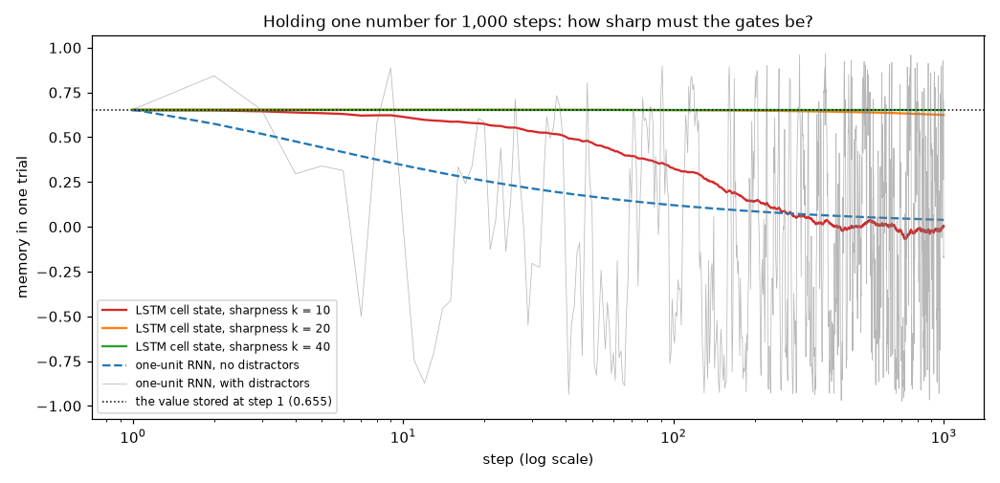
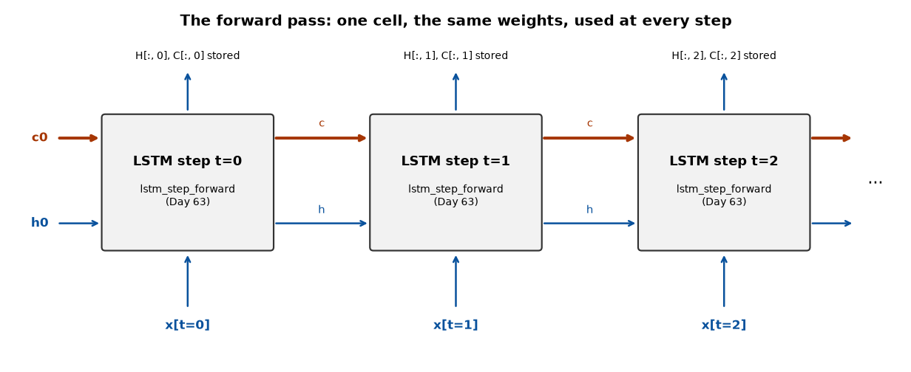

# Week 10: LSTM & GRU (Days 63–69)

Week 9 built the plain RNN and measured its limit: it cannot carry information far. Week 10 replaces the cell. It follows Week 9's two-track structure: Days 63–68 each get the usual full-depth lesson (real experiments, paired study-guide PDFs) plus a short `dayNN_exercise.py` isolating that day's one new piece, and Day 69 (sequence-to-sequence) is built from those exercise scripts. See [`full_syllabus_days_1_365.md`](../full_syllabus_days_1_365.md) for the week's plan.

## Day 63 — The LSTM cell: gates explained, starting from Day 59's problem
[`day63_lstm_cell_gates.py`](day63_lstm_cell_gates.py) — one LSTM cell doing one step, and nothing more (the forward pass over sequences is Day 64, training is Day 65). The cell keeps a second state, the cell state `c`, updated by `c = f * c_old + i * g` with no weight matrix and no squashing in its path; `h = o * tanh(c)` is what it shows. `lstm_step_forward` is traced by hand on a one-unit example and checked against the four gate formulas written out separately (difference 5.55e-17). Nothing is trained today, and the lesson says so where it matters.

- **What each gate does**, with the gates set directly: f = 1, i = 0 copies the memory forward exactly; o = 0 hides it without losing it; f = 0 erases; f = i = 1 accumulates.
- **Store / hold / read with hand-set weights.** One unit stores a number, ignores 999 distracting inputs and returns it to within 9.02e-07 — but only if its gates are driven very close to 0 and 1. With the forget gate 99.3% open, the correlation with the stored value after 999 steps is 0.037: the memory is gone (0.9933^999 = 0.0012). A one-unit hand-set RNN fails two different ways: with distractors its state is uncorrelated with the stored value after 9 steps (0.0177); with none, a stored 0.9 shrinks to 0.0387.
- **Day 59's question, asked of the LSTM** (16 units, untrained, same inputs and RNN weights as Day 59): how much of a nudge at step 0 is left T steps later? The answer depends almost entirely on the forget gate. At forget bias 0 the LSTM fades as fast as the RNN at spectral radius 1.0 (1.09e-04 vs 1.30e-04 after 20 steps); its direct cell-state route is 1.63e-15 after 50. At forget bias 4 the direct route still carries 4.00e-01 after 50 steps and 1.68e-01 after 100 — a route the RNN does not have.
- **It does not make the LSTM safe.** The direct route is bounded by 1, but the route through the hidden state and the gates is not: total sensitivity reaches 4.53e+02 at 100 steps, and 2.80e+05 with weights ten times larger (direct route 1.16e-01). LSTMs still need clipping. And one number looks better than it is: at forget bias 2 the total stays between 0.765 and 1.71 at every length, but by 100 steps the direct route is only 6.74e-06 — that is the indirect route happening to balance, not memory arriving.
- **Cost:** exactly four times the weights of an RNN of the same size (8,320 vs 2,080 at Day 62's tagger size), and a few times slower per step.

The honest summary: the LSTM does not remove the vanishing problem; it turns it from a fixed property of the weights into a dial — the forget gate — that is bounded, per-unit and learnable. Hence the standard practice of starting the forget bias at 1 or 2.

Study guide: [`day63_lstm_cell_gates_complete_guide.pdf`](day63_lstm_cell_gates_complete_guide.pdf) · Syntax walkthrough: [`day63_syntax_line_by_line.pdf`](day63_syntax_line_by_line.pdf) · [Run output](day63_run_output.txt)

Exercise: [`day63_exercise.py`](day63_exercise.py) isolates `lstm_step_forward` and checks it against the gate-by-gate formulas ([run output](day63_exercise_run_output.txt)) — Day 64's exercise will loop exactly this function over time.

## Day 64 — The LSTM forward pass from scratch
[`day64_lstm_forward_pass.py`](day64_lstm_forward_pass.py) — Day 63's step inside a loop over time, carrying two states (h and c) and caching every gate for tomorrow's backward pass. Nothing is trained today.

- **Checked against steps chained by hand:** identical at every step (difference 0.00e+00). One set of weights runs sequences of 5, 50 and 500 steps.
- **Padding with two states:** on a padded step both h and c are carried forward. A plausible bug, masking h only, leaves the final h exact (5.55e-17) while c is off by 3.67e-01 — a test that only checks h would pass it.
- **A faster forward pass?** Precomputing the input part of every gate for all steps in one product gives the same numbers (1.9e-16). The first timing showed it ~8x faster; that was mostly this machine's 16-thread OpenBLAS being very slow on one mid-sized product (35266.3 µs with default threads, 421.0 µs on one thread). With the library on one thread the real gain is none for small layers and about 1.3–1.4x for large ones (1.37 at D = H = 128).
- **200 steps, by forget bias:** at bias 0–2 the cell state settles; at bias 4 it keeps adding up (mean |c| 4.858, one value 26.03 by step 200) and 55.0% of units have a saturated tanh(c) — part of the price of Day 63's long-lived memory.
- **Memory:** the cache is 20.48 MB against an RNN's 4.10 MB at the same size (ratio 5.0; D + 6H vs. D + H numbers per example per step).

Study guide: [`day64_lstm_forward_pass_complete_guide.pdf`](day64_lstm_forward_pass_complete_guide.pdf) · Syntax walkthrough: [`day64_syntax_line_by_line.pdf`](day64_syntax_line_by_line.pdf) · [Run output](day64_run_output.txt)

Exercise: [`day64_exercise.py`](day64_exercise.py) loops Day 63's exercise cell over time and checks it against three hand-chained steps ([run output](day64_exercise_run_output.txt)) — Day 65's exercise will differentiate exactly this loop.

---
[← Back to main README](../README.md)
