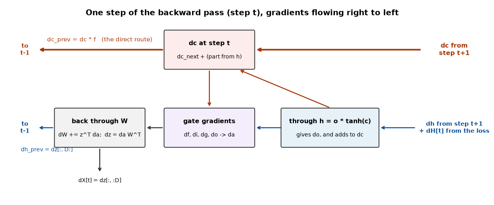
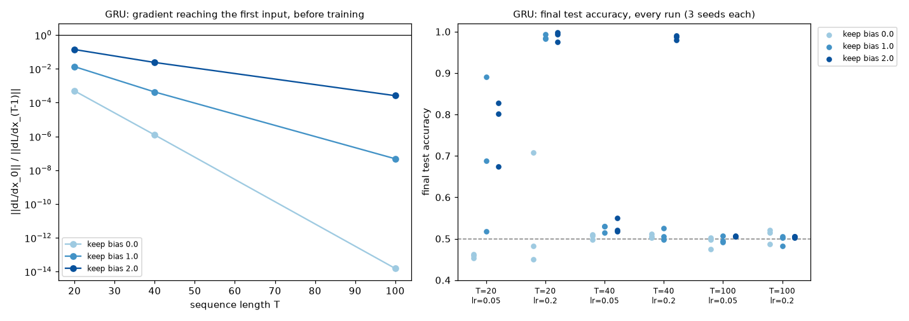
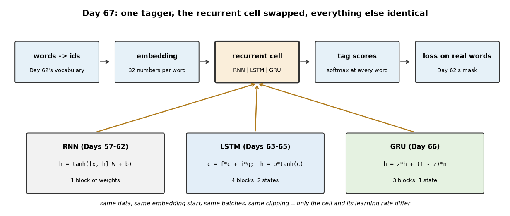
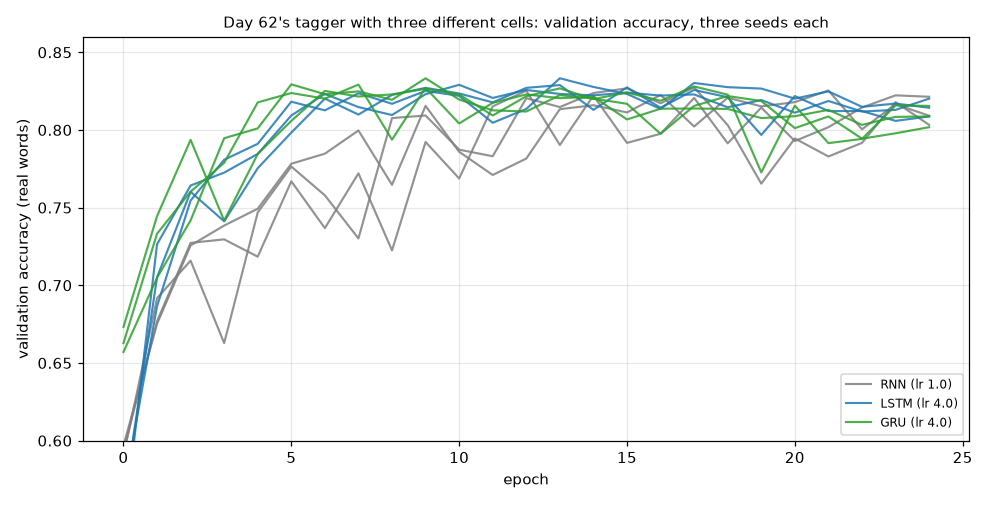
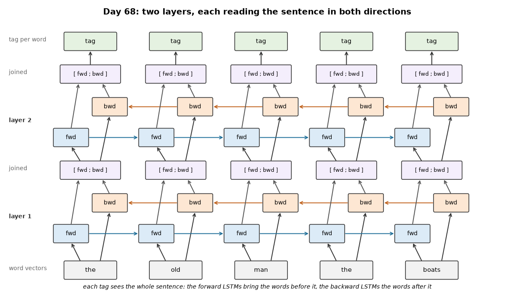

# Week 10: LSTM & GRU (Days 63–69)

Week 9 built the plain RNN and measured its limit: it cannot carry information far. Week 10 replaces the cell. It follows Week 9's two-track structure: Days 63–68 each get the usual full-depth lesson (real experiments, paired study-guide PDFs) plus a short `dayNN_exercise.py` isolating that day's one new piece, and Day 69 (sequence-to-sequence) is built from those exercise scripts. See [`full_syllabus_days_1_365.md`](../full_syllabus_days_1_365.md) for the week's plan.

## Day 63 — The LSTM cell: gates explained, starting from Day 59's problem
[`day63_lstm_cell_gates.py`](day63_lstm_cell_gates.py) — one LSTM cell doing one step, and nothing more (the forward pass over sequences is Day 64, training is Day 65). The cell keeps a second state, the cell state `c`, updated by `c = f * c_old + i * g` with no weight matrix and no squashing in its path; `h = o * tanh(c)` is what it shows. `lstm_step_forward` is traced by hand on a one-unit example and checked against the four gate formulas written out separately (difference 5.55e-17). Nothing is trained today, and the lesson says so where it matters.

- **What each gate does**, with the gates set directly: f = 1, i = 0 copies the memory forward exactly; o = 0 hides it without losing it; f = 0 erases; f = i = 1 accumulates.
- **Store / hold / read with hand-set weights.** One unit stores a number, ignores 999 distracting inputs and returns it to within 9.02e-07 — but only if its gates are driven very close to 0 and 1. With the forget gate 99.3% open, the correlation with the stored value after 999 steps is 0.037: the memory is gone (0.9933^999 = 0.0012). A one-unit hand-set RNN fails two different ways: with distractors its state is uncorrelated with the stored value after 9 steps (0.0177); with none, a stored 0.9 shrinks to 0.0387.
- **Day 59's question, asked of the LSTM** (16 units, untrained, same inputs and RNN weights as Day 59): how much of a nudge at step 0 is left T steps later? The answer depends almost entirely on the forget gate. At forget bias 0 the LSTM fades as fast as the RNN at spectral radius 1.0 (1.09e-04 vs 1.30e-04 after 20 steps); its direct cell-state route is 1.63e-15 after 50. At forget bias 4 the direct route still carries 4.00e-01 after 50 steps and 1.68e-01 after 100 — a route the RNN does not have.
- **It does not make the LSTM safe.** The direct route is bounded by 1, but the route through the hidden state and the gates is not: total sensitivity reaches 4.53e+02 at 100 steps, and 2.80e+05 with weights ten times larger (direct route 1.16e-01). LSTMs still need clipping. And one number looks better than it is: at forget bias 2 the total stays between 0.765 and 1.71 at every length, but by 100 steps the direct route is only 6.74e-06 — that is the indirect route happening to balance, not memory arriving.
- **Cost:** exactly four times the weights of an RNN of the same size (8,320 vs 2,080 at Day 62's tagger size), and a few times slower per step.

The honest summary: the LSTM does not remove the vanishing problem; it turns it from a fixed property of the weights into a dial — the forget gate — that is bounded, per-unit and learnable. Hence the standard practice of starting the forget bias at 1 or 2.

Study guide: [`day63_lstm_cell_gates_complete_guide.pdf`](day63_lstm_cell_gates_complete_guide.pdf) · Syntax walkthrough: [`day63_syntax_line_by_line.pdf`](day63_syntax_line_by_line.pdf) · [Run output](day63_run_output.txt)

Exercise: [`day63_exercise.py`](day63_exercise.py) isolates `lstm_step_forward` and checks it against the gate-by-gate formulas ([run output](day63_exercise_run_output.txt)) — Day 64's exercise will loop exactly this function over time.

## Day 64 — The LSTM forward pass from scratch
[`day64_lstm_forward_pass.py`](day64_lstm_forward_pass.py) — Day 63's step inside a loop over time, carrying two states (h and c) and caching every gate for tomorrow's backward pass. Nothing is trained today.

- **Checked against steps chained by hand:** identical at every step (difference 0.00e+00). One set of weights runs sequences of 5, 50 and 500 steps.
- **Padding with two states:** on a padded step both h and c are carried forward. A plausible bug, masking h only, leaves the final h exact (5.55e-17) while c is off by 3.67e-01 — a test that only checks h would pass it.
- **A faster forward pass?** Precomputing the input part of every gate for all steps in one product gives the same numbers (1.9e-16). The first timing showed it ~8x faster; that was mostly this machine's 16-thread OpenBLAS being very slow on one mid-sized product (35266.3 µs with default threads, 421.0 µs on one thread). With the library on one thread the real gain is none for small layers and about 1.3–1.4x for large ones (1.37 at D = H = 128).
- **200 steps, by forget bias:** at bias 0–2 the cell state settles; at bias 4 it keeps adding up (mean |c| 4.858, one value 26.03 by step 200) and 55.0% of units have a saturated tanh(c) — part of the price of Day 63's long-lived memory.
- **Memory:** the cache is 20.48 MB against an RNN's 4.10 MB at the same size (ratio 5.0; D + 6H vs. D + H numbers per example per step).

Study guide: [`day64_lstm_forward_pass_complete_guide.pdf`](day64_lstm_forward_pass_complete_guide.pdf) · Syntax walkthrough: [`day64_syntax_line_by_line.pdf`](day64_syntax_line_by_line.pdf) · [Run output](day64_run_output.txt)

Exercise: [`day64_exercise.py`](day64_exercise.py) loops Day 63's exercise cell over time and checks it against three hand-chained steps ([run output](day64_exercise_run_output.txt)) — Day 65's exercise will differentiate exactly this loop.

## Day 65 — The LSTM backward pass, a gradient check, and a first training run
[`day65_lstm_backward_pass.py`](day65_lstm_backward_pass.py) — Day 64's cache walked backwards: two gradients flowing back in time, dh through the gates and W, dc along the cell-state line, where each step back multiplies it by the forget gate (Day 63's direct route, now as a gradient).

- **Gradient check, on its own:** a loss that uses every hidden state, the last hidden state and the last cell state, with padding; all 136 entries of W, b, X, h0 and c0 pass (largest relative error 4.88e-09). **Through the trained classifier:** W, b, Why, by all pass (1.99e-07).
- **The direct route:** with the gates cut off from h, the gradient at c_0 equals the gradient at c_T times the product of forget gates (difference 6.94e-17). In a normal untrained LSTM at forget bias 2 the indirect routes carry far more (6.125373e+01 vs. 1.313349e+00).
- **Gradient reaching the first input before training**, Day 59's sign task: 3.279e-04 at 20 steps with forget bias 0, falling to 3.298e-15 at 100; with forget bias 2 it is 9.932e+00 at 100.
- **First training runs**, Day 59's data and Day 60's setup (clipping at 1.0), lr 0.05 and 0.2, three seeds each, 54 runs. Forget bias 0: **0 of 18** runs learn (final ≥ 0.9), even at 20 steps where Day 60's clipped RNN reached 0.955. Forget bias 2: **12 of 12** at 20 and 40 steps (the RNN ended at 0.525 at 40) and 4 of 6 at 100 (the two failures end at 0.782 and 0.682). Forget bias 1 is in between. Seeds matter: one setting ended at 0.605 for one seed and 0.978 for another.

Study guide: [`day65_lstm_backward_pass_complete_guide.pdf`](day65_lstm_backward_pass_complete_guide.pdf) · Syntax walkthrough: [`day65_syntax_line_by_line.pdf`](day65_syntax_line_by_line.pdf) · [Run output](day65_run_output.txt)

Exercise: [`day65_exercise.py`](day65_exercise.py) adds the backward pass to Day 64's exercise loop and checks every entry of W and b numerically ([run output](day65_exercise_run_output.txt)) — the LSTM version of Day 58's exercise.

## Day 66 — The GRU, a simpler gated cell, from scratch
[`day66_gru_from_scratch.py`](day66_gru_from_scratch.py) — one state, an update gate z (keep), a reset gate r and a candidate n: `h = z * h_prev + (1 - z) * n`. Built and checked the way the LSTM was over Days 63–65, then trained on exactly Day 65's grid.

- **Checks:** the step matches hand arithmetic and the gate-by-gate formulas; forward/backward pass gradient checks on their own and through the classifier. Three quarters of an LSTM's weights.
- **The direct route:** `dh_prev = dh * z` — with the gates cut off from h, the gradient at h_0 is exactly the product of update gates (6.94e-17). The GRU's other routes add little (3.077409e+00 total vs. 1.203778e+00 direct; the LSTM's added ~47x), so less gradient reaches early inputs at the same bias (2.383e-02 at 40 steps, keep-bias 2, vs. the LSTM's 1.524).
- **Day 65's grid, like for like:** 0, 3 and 6 of 18 runs learned at keep-bias 0, 1, 2 (LSTM: 0, 10, 16). The GRU learned only at lr 0.2 — every run at 20 steps (bias 1–2) and 40 steps (bias 2) — and nothing at 100 steps.
- **Slower, or unable?** At 40 steps and lr 0.05, three times the epochs: 2 of 3 learn. Keep-bias 3: 3 of 3; keep-bias 4: 0 of 3 — because one gate both keeps and writes, at bias 4 the GRU keeps 0.982 and can write only 0.018 of the candidate, while an LSTM's separate input gate still writes 0.5. At 100 steps: keep-bias 3 0 of 3, keep-bias 4 0 of 3.

Study guide: [`day66_gru_from_scratch_complete_guide.pdf`](day66_gru_from_scratch_complete_guide.pdf) · Syntax walkthrough: [`day66_syntax_line_by_line.pdf`](day66_syntax_line_by_line.pdf) · [Run output](day66_run_output.txt)

Exercise: [`day66_exercise.py`](day66_exercise.py) isolates the GRU step and checks it against the gate-by-gate formulas ([run output](day66_exercise_run_output.txt)).

## Day 67 — RNN vs LSTM vs GRU: a real comparison on Week 9's tagging task
[`day67_rnn_lstm_gru_compared.py`](day67_rnn_lstm_gru_compared.py) — Day 62's part-of-speech tagger with only the recurrent cell swapped: same data, same starting word vectors, same batches and clipping. Each cell's learning rate (and gate bias) is chosen on validation accuracy only; three seeds per cell; test read once at the best validation epoch.

- **Checks:** all three cells pass Day 62's gradient check through the whole tagger, and the RNN reproduces Day 62's result exactly (0.8338).
- **The comparison:** test accuracy RNN 0.8327, LSTM 0.8377, GRU 0.8336 (most-frequent-tag baseline 0.8016; one standard error about 0.0027). The LSTM's edge is small but consistent — every LSTM seed beats every RNN seed — and comes mostly from unknown words (0.5072 vs 0.4914) and later positions. The GRU is level with the RNN. The cells disagree on about one word in ten (9.93% for RNN-LSTM), each right about equally often when they do.
- **Why the gap is small:** a look-back probe (change one word k positions before a target, measure how the target's tag distribution moves) shows every tagger relies on the last few words: the previous word changes the prediction in about 18% of cases (18.55% for the RNN), 12 words back in about 0.1% (0.09%). Part-of-speech tags are short-range; the plain RNN's memory already covers that range.
- **Not just size:** an RNN with as many cell weights as the LSTM (hidden 76) did worse, 0.8256 — more overfitting. The validation choices themselves were within noise of each other (LSTM 0.8333 vs 0.8331 for the runner-up).
- **Cost:** an LSTM epoch took 3.40 times an RNN epoch.

Study guide: [`day67_rnn_lstm_gru_compared_complete_guide.pdf`](day67_rnn_lstm_gru_compared_complete_guide.pdf) · Syntax walkthrough: [`day67_syntax_line_by_line.pdf`](day67_syntax_line_by_line.pdf) · [Run output](day67_run_output.txt)

Exercise: [`day67_exercise.py`](day67_exercise.py) gives an LSTM an output and a loss at every step, gradient-checks it, and trains it to output the token seen two steps earlier ([run output](day67_exercise_run_output.txt)) — Day 69's decoder.

## Day 68 — Stacked and bidirectional RNNs, from scratch
[`day68_stacked_bidirectional.py`](day68_stacked_bidirectional.py) — Day 67's LSTM tagger with two new switches: `bidirectional` (a second LSTM reads each sentence right to left; the two states are joined at every word) and `layers` (a second LSTM layer reads the first layer's states). `reverse_padded` flips only each sentence's real words, so padding stays at the end; the backward pass flips the gradient the same way.

- **Checks:** reversing twice restores every sentence; the 2-layer bidirectional tagger passes Day 62's gradient check on all 11 parameter arrays; changing the last word moves the first word's prediction in the bidirectional tagger and not at all (0.00e+00) in the left-to-right one.
- **Reading both ways is the big step:** test accuracy 0.8377 → 0.8577, about eight standard errors (0.0026), every bidirectional seed above every left-to-right seed. Not size: a left-to-right tagger with as many LSTM weights (hidden 50) reaches 0.8393. The gain is on ambiguous words (0.8749 → 0.9083) and unknown words (0.5072 → 0.5374); verbs gain +0.0865.
- **A second layer does not help here:** 0.8326 left to right, 0.8557 bidirectional. Not the learning rate: at half of it, validation moved by less than the noise (0.8282 vs 0.8233; 0.8547 vs 0.8563).
- **The probe, both ways:** the left-to-right tagger is exactly blind to later words (0.0000); the bidirectional one uses the next word (0.1614) about as much as the previous one (0.1247).
- **Cost:** a second direction 1.97 times the training time, both a second direction and a second layer 4.09 times.

Study guide: [`day68_stacked_bidirectional_complete_guide.pdf`](day68_stacked_bidirectional_complete_guide.pdf) · Syntax walkthrough: [`day68_syntax_line_by_line.pdf`](day68_syntax_line_by_line.pdf) · [Run output](day68_run_output.txt)

Exercise: [`day68_exercise.py`](day68_exercise.py) isolates a bidirectional LSTM layer, gradient-checks it, and trains it to output the NEXT token: bidirectional 1.000, forward only 0.263 (guessing: 0.250) ([run output](day68_exercise_run_output.txt)).

---
[← Back to main README](../README.md)
