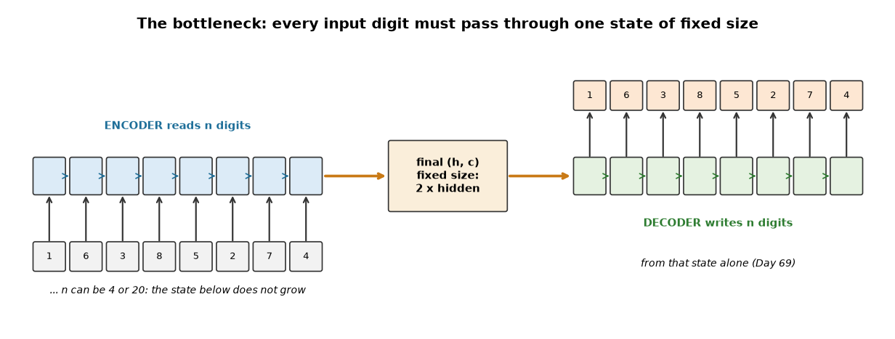
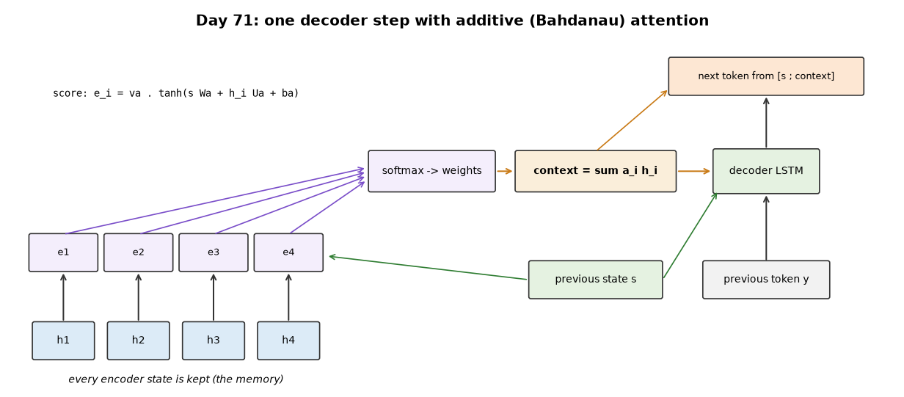

# Week 11: Attention Mechanism (Days 70–76)

Week 10 ended with an encoder-decoder whose decoder sees only the encoder's final state. Week 11 measures what that costs and replaces it with attention. It follows the two-track structure of Weeks 9–10: Days 70–75 each get the full-depth lesson (real experiments, paired study-guide PDFs) plus a short `dayNN_exercise.py` isolating one piece, and Day 76 (multi-head attention) is built from those exercise scripts. See [`full_syllabus_days_1_365.md`](../full_syllabus_days_1_365.md) for the week's plan.

## Day 70 — The information bottleneck: where one fixed-size state stops being enough
[`day70_information_bottleneck.py`](day70_information_bottleneck.py) — Day 69's encoder-decoder, whose decoder sees only the encoder's final (h, c), pushed to longer sequences, with controls that separate "too far back" from "too much to hold". No timings today: the runs are long enough that this machine's run-to-run speed swings would make them meaningless.

- **Outside Day 69's training range** (trained on 3–8 digits): exact match 0.947 at 8 digits, 0.113 at 10, 0 from 12 — but that mixes the bottleneck with never having seen those lengths.
- **The fair test** (trained on 3–20, three seeds, 40,000 steps): 20-digit COPY exact match 0.000 / 0.004 / 0.157 at hidden 16 / 32 / 64. A bigger state fails later, not never.
- **Too far, or too much?** Every input has 20 digits; write back only the first k. Same distance, different amount: k = 4 → 1.000, 8 → 0.986, 12 → 0.761, 16 → 0.106, 20 → 0.013. The LSTM keeps 4 digits across 20 steps perfectly; it cannot keep 20 in one state.
- **What the final state holds** (linear probe per input position): the k = 4 model keeps the first digits (1.000 at position 1) and lets the rest fall to guessing; the COPY model keeps position 1 (0.990) and only part of every middle position.
- **Not just training time:** three times the budget lifts 16-digit exact match to 0.563 at 80,000 steps, then it falls back to 0.370. **Reversing** helps (0.447 vs 0.198 at 16 digits) but reaches only 0.057 at 20.

Study guide: [`day70_information_bottleneck_complete_guide.pdf`](day70_information_bottleneck_complete_guide.pdf) · Syntax walkthrough: [`day70_syntax_line_by_line.pdf`](day70_syntax_line_by_line.pdf) · [Run output](day70_run_output.txt)

Exercise: [`day70_exercise.py`](day70_exercise.py) isolates the read that replaces the bottleneck — a masked softmax over memory slots and the weighted average — and gradient-checks it ([run output](day70_exercise_run_output.txt)).

## Day 71 — Additive (Bahdanau) attention, from scratch
[`day71_additive_attention.py`](day71_additive_attention.py) — the decoder keeps every encoder state and, at each output step, scores each one against its previous state (`e_i = va · tanh(s Wa + h_i Ua + ba)`), turns the scores into weights with a softmax and reads their weighted average (Day 70's exercise). Its input is [previous token ; context]; the output layer sees [state ; context]. The decoder is differentiated one step at a time (`lstm_step_backward`) because each step's input depends on its own previous state.

- **Checks:** one attention step matches hand arithmetic; every entry passes the gradient check, with the decoder starting from the encoder's final state and from zeros.
- **Day 70's hardest test, with attention** (COPY 3–20 digits, hidden 32, the same test sequences, half the steps): 1.000 exact match at every length for every seed from 7,500 steps on — where Day 70's best (hidden 64) reached 0.157 at 20 digits.
- **Hidden 16 is enough** (1.000 at every length, 5898 weights); REVERSE is solved too; a decoder starting from zeros, with attention as its only view of the input, reaches 0.971 at 20 digits.
- **An honest limit:** longer than any training sequence, exact match is 0.000 at 25 digits (token accuracy 0.742) — removing the bottleneck is not the same as handling unseen lengths.
- **Cost:** a training step took 2.45 times as long as Day 69's in this run (only the ratio is meaningful).

Study guide: [`day71_additive_attention_complete_guide.pdf`](day71_additive_attention_complete_guide.pdf) · Syntax walkthrough: [`day71_syntax_line_by_line.pdf`](day71_syntax_line_by_line.pdf) · [Run output](day71_run_output.txt)

Exercise: [`day71_exercise.py`](day71_exercise.py) isolates one additive attention read, forward and backward, gradient-checked ([run output](day71_exercise_run_output.txt)).

## Day 72 — Looking inside attention: alignment heatmaps on the toy task
[`day72_attention_heatmaps.py`](day72_attention_heatmaps.py) — Day 71's models (retrained with the same seeds, so the same models) and the weights they produce at every output step: where the decoder looked.

- **The alignment a person would draw:** a diagonal for COPY, an anti-diagonal for REVERSE. The largest weight is on the input digit being written for 1.000 of COPY outputs and about 0.99 of REVERSE outputs.
- **Where the leftover weight goes:** for REVERSE mostly to the *next* encoder state (0.201–0.237) rather than the previous one. A probe explains it: the digit at position 8 is read from h_8 at 1.000 and from h_9 at 0.999, but from h_7 only at 0.131 (guessing 0.125). COPY's smaller weight on the previous state is not explained by this probe.
- **When it forms:** untrained, 0.083 of COPY outputs look at the target (chance for 12 positions); by 1,000 steps 0.442 while exact match is still 0.002; by 5,000 steps 0.998. Learning where to look comes first or together with learning what to write.
- **Where it breaks:** on 30- and 40-digit inputs the alignment collapses after about position 20, the longest training length; digits written right had 0.675 of their weight on the target, digits written wrong 0.064.

Study guide: [`day72_attention_heatmaps_complete_guide.pdf`](day72_attention_heatmaps_complete_guide.pdf) · Syntax walkthrough: [`day72_syntax_line_by_line.pdf`](day72_syntax_line_by_line.pdf) · [Run output](day72_run_output.txt)

Exercise: [`day72_exercise.py`](day72_exercise.py) computes the three alignment measurements on hand-built weight matrices with known answers ([run output](day72_exercise_run_output.txt)).

---
[← Back to main README](../README.md)
