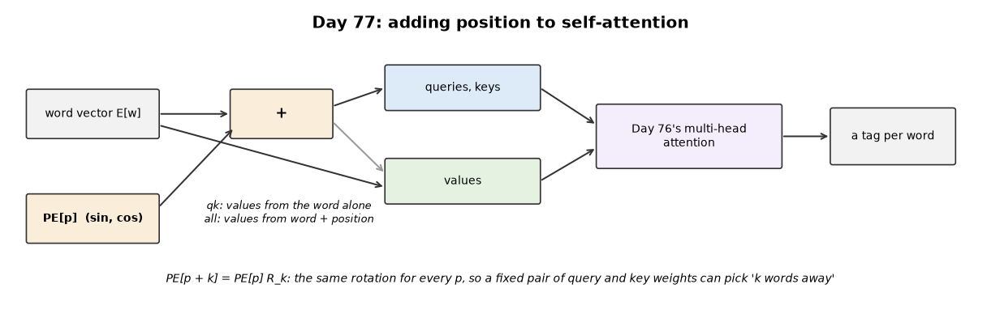
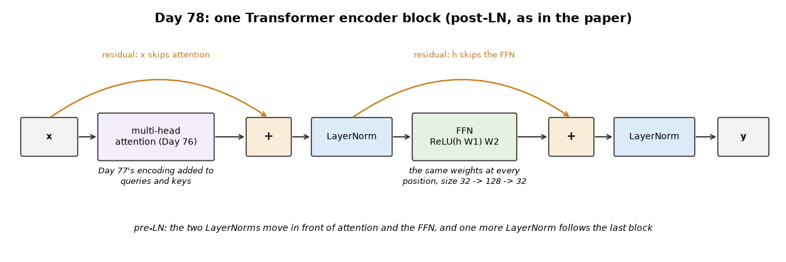
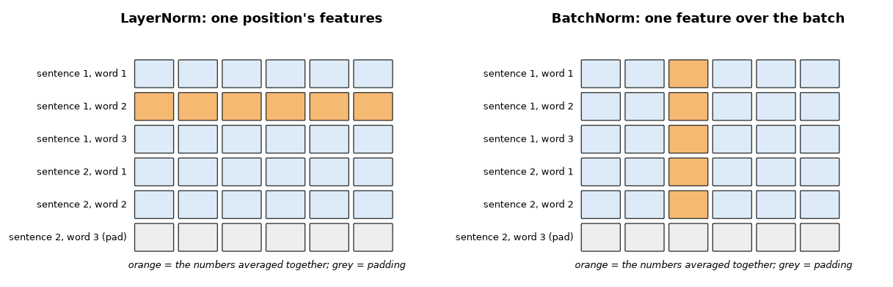
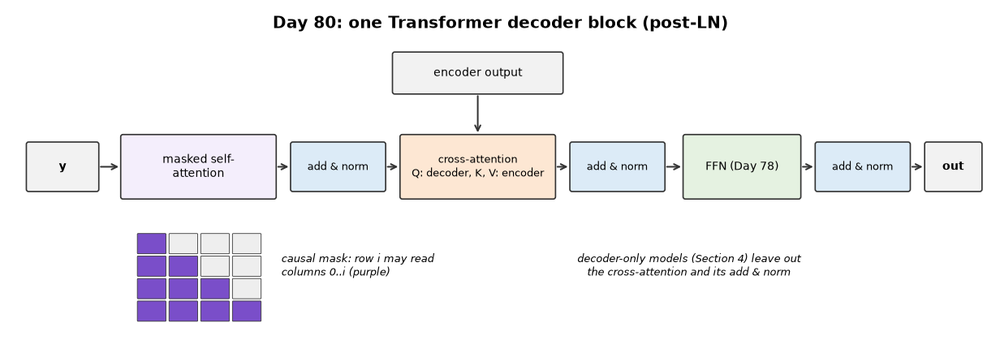
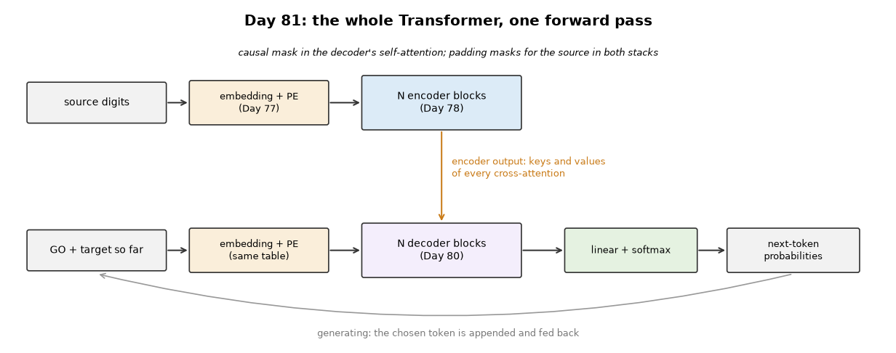
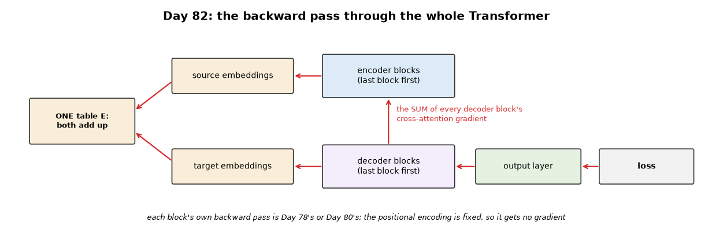
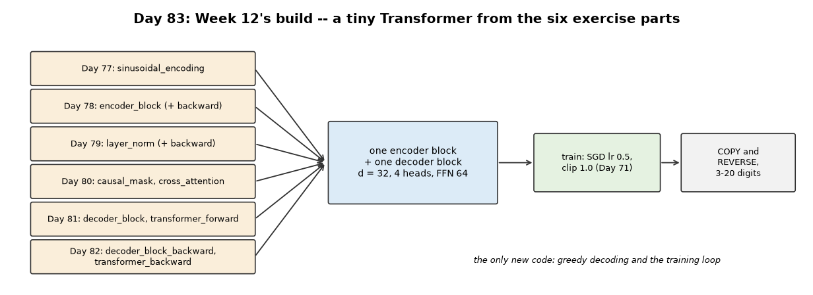

# Week 12: The Transformer (Days 77–83)

Week 11 built attention up to multi-head self-attention. Week 12 builds the Transformer around it. It follows the two-track structure of Weeks 9–11: Days 77–82 each get the full-depth lesson (real experiments, paired study-guide PDFs) plus a short `dayNN_exercise.py` isolating one part, and Day 83 trains a tiny Transformer built from those exercise scripts. See [`full_syllabus_days_1_365.md`](../full_syllabus_days_1_365.md) for the week's plan.

## Day 77 — Positional encoding, from scratch
[`day77_positional_encoding.py`](day77_positional_encoding.py) — the sinusoidal encoding (`PE[p, 2i] = sin(p / 10000^(2i/d))`, `PE[p, 2i+1] = cos(...)`), added to the word vectors so that self-attention can see order. Built, its key property checked, then tested on a toy task that needs position and on Week 9's real tagging task with Day 76's multi-head layer.

- **Moving along is a rotation:** one matrix R_k built from k alone maps PE[p] to PE[p + k] for every p (to 3.71e-15), so PE[p] · PE[p + k] depends only on k. Day 74's shuffle test: 8.88e-15 without the encoding, 3.18e+01 with it.
- **Toy task (write the previous token):** 0.253 with no encoding, 1.000 with sinusoidal or learned positions on the trained lengths. Beyond them both mostly fail: at 32 tokens, never-seen positions are right 0.278 (sinusoidal) and 0.130 (learned) of the time.
- **Real tagging, chosen on validation:** added to the whole word vector ('all') the encoding barely helps (0.8063 vs 0.8036) and at strength 3 training collapses (0.1400). Added only to the queries and keys at strength 3 ('qk'): 0.8487 over three seeds, above Day 62's RNN (0.8327) and Day 68's LSTM (0.8377), below the bidirectional LSTM (0.8577).
- **How:** one head puts 0.918 of its weight on the next word, another 0.569 on the previous one. Shuffling the test sentences now costs accuracy (0.8485 → 0.7376); without an encoding nothing changes.

Study guide: [`day77_positional_encoding_complete_guide.pdf`](day77_positional_encoding_complete_guide.pdf) · Syntax walkthrough: [`day77_syntax_line_by_line.pdf`](day77_syntax_line_by_line.pdf) · [Run output](day77_run_output.txt)

Exercise: [`day77_exercise.py`](day77_exercise.py) is the encoding table as one function, with its rotation and order checks — the first part of Day 83's Transformer ([run output](day77_exercise_run_output.txt)).

## Day 78 — The Transformer encoder block, from scratch
[`day78_encoder_block.py`](day78_encoder_block.py) — multi-head attention (Day 76) and a position-wise feed-forward network, each wrapped in "add & norm": a residual connection and layer normalisation. Post-LN (the paper's order) and pre-LN, forward and backward from scratch, stacked and tested on Week 9's tagging task with Day 77's encoding.

- **Checks:** LayerNorm by hand; the FFN works on every position on its own (shuffled positions give shuffled outputs exactly, 0.00e+00); post-LN and pre-LN stacks and every ablation pass the gradient check. The loss is now a log-softmax: Day 62's `log(p + 1e-9)` made one entry fail the check although the analytic gradient was right.
- **What keeps the gradient alive** (8 untrained blocks): with neither residuals nor LayerNorm the gradient at the bottom fades to 1.472e-02; residuals alone make it grow to 3.022e+01; with LayerNorm it stays the same size with or without residuals (1.237e+01 and 8.498e+00).
- **One block on real tagging:** 0.8510 over three seeds (lr 2.0, chosen on validation), a little above Day 77's single layer (0.8487). Without the FFN 0.8378; without LayerNorm 0.8485 and without residuals 0.8475, within the seeds' spread.
- **Deeper did not help:** 2 and 4 blocks, post-LN or pre-LN, all tested below one block (best 0.8478 for 4 post-LN blocks against 0.8535, seed 0) and reached lower training accuracy too (0.9082 to 0.9501 against 0.9652): under plain SGD they train less well, rather than overfit.

Study guide: [`day78_encoder_block_complete_guide.pdf`](day78_encoder_block_complete_guide.pdf) · Syntax walkthrough: [`day78_syntax_line_by_line.pdf`](day78_syntax_line_by_line.pdf) · [Run output](day78_run_output.txt)

Exercise: [`day78_exercise.py`](day78_exercise.py) is one post-LN encoder block on its own, forward and backward, gradient-checked, ignoring padded positions — the second part of Day 83's Transformer ([run output](day78_exercise_run_output.txt)).

## Day 79 — LayerNorm vs BatchNorm, a real comparison
[`day79_layernorm_vs_batchnorm.py`](day79_layernorm_vs_batchnorm.py) — Day 78's encoder block with the norm as a setting: LayerNorm (each position's features), BatchNorm with padding left out of its statistics, and BatchNorm with padding counted. Same starting weights for all three, on Week 9's padded sentences.

- **Accuracy is not the difference:** with batches of 32, LayerNorm 0.8510, BatchNorm 0.8520, BatchNorm counting padding 0.8504 (three seeds). With batches of 4 both drop at the same learning rate (0.7746 / 0.7785) and both recover when it is scaled down 8 times (0.8520 / 0.8503): the learning rate, not the norm.
- **Independence is:** with BatchNorm (train mode) a sentence's output changes by up to 1.39e+00 when the other sentences in its batch change, LayerNorm's not at all (0.00e+00); counting padding in BatchNorm's statistics changes outputs by 1.38e+00.
- **Test time:** the trained BatchNorm tagger scores 0.8496 with its running averages, 0.8466 with each test batch's statistics (256 sentences) and 0.8361 with batches of 4. LayerNorm has no such choice.
- BatchNorm's backward pass with masked statistics passes the gradient check inside the block.

Study guide: [`day79_layernorm_vs_batchnorm_complete_guide.pdf`](day79_layernorm_vs_batchnorm_complete_guide.pdf) · Syntax walkthrough: [`day79_syntax_line_by_line.pdf`](day79_syntax_line_by_line.pdf) · [Run output](day79_run_output.txt)

Exercise: [`day79_exercise.py`](day79_exercise.py) is LayerNorm as one function, forward and backward, gradient-checked, beside BatchNorm — the third part of Day 83's Transformer ([run output](day79_exercise_run_output.txt)).

## Day 80 — The Transformer decoder block, and masked self-attention
[`day80_decoder_block.py`](day80_decoder_block.py) — masked (causal) self-attention, cross-attention to an encoder's output (queries from the decoder, keys and values from the encoder) and Day 78's FFN, each with add & norm. Then a decoder-only next-word model on Week 9's sentences, trained with and without the causal mask.

- **Checks:** the mask leaves exactly zero weight on later positions; changing a later word leaves the earlier outputs unchanged (0.00e+00, against 1.61e+00 without the mask); the full decoder block, including the gradient for the encoder's output, passes the gradient check.
- **Why the mask:** without it the next-word model scores 0.5133 / 0.5167 / 0.5007 on whole sentences, as in training, because it reads the next word (0.536 of its attention is one position ahead). Predicting from the past only, as when writing text, it falls to 0.0877 / 0.1222 / 0.1102, below always guessing '<unk>' (0.1853). With the mask both scores are the same: 0.2254 / 0.2442 / 0.2326.
- **An honest limit:** one small block trained with SGD on 2,000 sentences stays below a bigram table (0.2519) on accuracy.
- **One pass = one pass per word:** with the mask, a whole-sentence pass equals feeding each prefix separately (7.11e-15), which is why decoders train on whole sentences.

Study guide: [`day80_decoder_block_complete_guide.pdf`](day80_decoder_block_complete_guide.pdf) · Syntax walkthrough: [`day80_syntax_line_by_line.pdf`](day80_syntax_line_by_line.pdf) · [Run output](day80_run_output.txt)

Exercise: [`day80_exercise.py`](day80_exercise.py) is causal self-attention and cross-attention on their own, gradient-checked — the fourth part of Day 83's Transformer ([run output](day80_exercise_run_output.txt)).

## Day 81 — The whole Transformer: one forward pass on a toy copy task
[`day81_transformer_forward.py`](day81_transformer_forward.py) — Days 77–80's parts joined into the encoder-decoder model of Vaswani et al.: one shared embedding table plus Day 77's encoding, Day 78's encoder blocks, Day 80's decoder blocks (causal self-attention, cross-attention, FFN), a linear layer and a softmax. Run forward only, untrained, on Day 69's COPY/REVERSE digits.

- **Shapes and size:** one block per side has 21642 weights; a decoder block (12576) is about one and a half encoder blocks (8416) because of its cross-attention.
- **The masks, end to end:** digits under source padding change nothing (0.00e+00); a later decoder input never moves an earlier score; a real source digit reaches every decoder position (smallest change 1.92e-01).
- **Before training:** the untrained loss is 2.5–2.9, above log 10 = 2.303, whatever the embedding spread (the decoder ends in LayerNorm); with the output layer's starting weights 10 times smaller it is 2.302–2.322.
- **Decoding:** writing one token at a time gives the same scores as one teacher-forced pass (2.66e-15). Eight times the length cost 24.41 times as much in this run: part of the work grows like n, part like n squared.

Study guide: [`day81_transformer_forward_complete_guide.pdf`](day81_transformer_forward_complete_guide.pdf) · Syntax walkthrough: [`day81_syntax_line_by_line.pdf`](day81_syntax_line_by_line.pdf) · [Run output](day81_run_output.txt)

Exercise: [`day81_exercise.py`](day81_exercise.py) builds the forward pass only from Days 77–80's exercise functions plus a new `decoder_block` — the fifth part of Day 83's Transformer ([run output](day81_exercise_run_output.txt)).

## Day 82 — The backward pass through the whole Transformer, and a gradient check
[`day82_transformer_backward.py`](day82_transformer_backward.py) — Day 81's model with its backward pass: each block's own backward pass (Days 78 and 80) chained in reverse, from the loss to the output layer, down the decoder, into the encoder through cross-attention, and back to the one embedding table. Two sums matter: every decoder block's share of the encoder's gradient, and the source and target sides of the shared embedding table.

- **Gradient check of the whole model:** two blocks per side, padded source and target, LayerNorm weights moved off 1 and 0 — all 2714 entries pass (largest difference 6.88e-11).
- **Would it catch a bug?** Overwriting the encoder's gradient instead of adding each decoder block's share fails exactly the parts behind the mistake — both encoder blocks (up to 1.05e-02) and the embedding table (4.69e-03) — while the output layer and both decoder blocks still pass.
- **Where the gradient goes, untrained:** the output layer about 0.6, the blocks about 0.04–0.1, the embedding table about 0.008; with two blocks per side the lower blocks get about as much as the upper ones.
- **Does it teach?** Plain SGD fits one fixed batch of 32 REVERSE examples to token accuracy 1.000 at lr 0.1, 0.5 and 2.0.

Study guide: [`day82_transformer_backward_complete_guide.pdf`](day82_transformer_backward_complete_guide.pdf) · Syntax walkthrough: [`day82_syntax_line_by_line.pdf`](day82_syntax_line_by_line.pdf) · [Run output](day82_run_output.txt)

Exercise: [`day82_exercise.py`](day82_exercise.py) is the backward pass of the exercise model (`decoder_block_backward`, `transformer_backward`), checked entry by entry — the sixth and last part of Day 83's Transformer ([run output](day82_exercise_run_output.txt)).

## Day 83 — The Week 12 build: a tiny Transformer from the exercise parts, trained
[`day83_tiny_transformer.py`](day83_tiny_transformer.py) — Days 77–82's exercise functions copied in unchanged (a banner above each group names its script), plus greedy decoding and a training loop. One encoder block and one decoder block, d = 32, 4 heads, FFN 64. Trained exactly as Day 71 trained its attention LSTM (plain SGD lr 0.5, clip 1.0, batches of 32, 20,000 steps, three seeds, the same data and test sets), so the two can be compared directly.

- **The parts fit:** the assembled model passes a gradient check on all 1442 entries (largest difference 6.60e-11). It has 21642 weights, against the LSTM's 17866.
- **COPY is learned much faster:** 0.956 exact match at 20 digits after 1000 steps, and every length perfect from 1500 steps (seed 1: 1000). Day 71's LSTM was at 0.000 after 2500 steps.
- **REVERSE is not:** slower to learn, and it ends at 0.986 at 20 digits; only one seed of three gets every length perfect (at 15000 steps). Day 71's LSTM ended at 1.000 at every length. On this task, at this size and with plain SGD, the Transformer is not better.
- **Longer than training:** no exact matches at 25, 30 or 40 digits. COPY keeps positions 1–20 almost right (token accuracy 0.897 at 25 digits, against the LSTM's 0.742). REVERSE falls to about chance everywhere (0.134; chance is 0.125), probably because it cannot find where an unseen length ends. That reason was not tested.
- **Cross-attention found the alignment:** its largest weight is on the right source digit 1.000 (COPY) and 0.998 (REVERSE) of the time, with 0.933 and 0.968 of the weight there.
- **Learning rate and cost:** lr 0.1 to 1.0 all solve COPY within 5000 steps; lr 2.0 fails (0.000). One step took 25.7 ms against the LSTM's 24.2 ms in the same run: about the same cost per step, but far fewer steps on COPY.

Study guide: [`day83_tiny_transformer_complete_guide.pdf`](day83_tiny_transformer_complete_guide.pdf) · Syntax walkthrough: [`day83_syntax_line_by_line.pdf`](day83_syntax_line_by_line.pdf) · [Run output](day83_run_output.txt)

Day 83 is the week's build, so it has no exercise script of its own.

---
[← Back to main README](../README.md)
