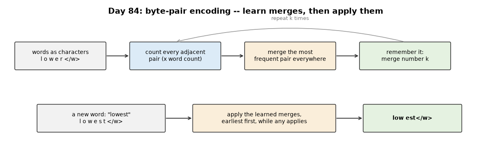

# Week 13: Tokenization & Embeddings (Days 84–90)

Week 12 built and trained a Transformer on digits. Week 13 turns to text: how it is cut into tokens, and how tokens become vectors. It follows the two-track structure of Weeks 9–12: Days 84–89 each get the full-depth lesson (real experiments, paired study-guide PDFs) plus a short `dayNN_exercise.py` isolating one part, and Day 90 builds a tiny character-level GPT-style model from those parts and Weeks 11–12's. See [`full_syllabus_days_1_365.md`](../full_syllabus_days_1_365.md) for the week's plan.

## Day 84 — Byte-pair encoding (BPE) from scratch, on real text
[`day84_byte_pair_encoding.py`](day84_byte_pair_encoding.py) — the subword tokenizer of Sennrich et al. (2016): start from characters plus an end-of-word mark `</w>`, and repeatedly merge the most frequent adjacent pair into one new symbol. Worked by hand on the paper's four-word example, then trained with 4000 merges on Week 9's 2,001 training sentences and tested on the 1,647 test sentences.

- **Lossless:** every test sentence decodes back exactly (0 of 1647 differ); the test text takes 1.454 tokens per word.
- **Vocabulary against length:** 71 symbols give 5.096 tokens per word; 4071 symbols give 1.454, with 0.788 of test words a single token. A bigger vocabulary means shorter sequences.
- **No more `<unk>`:** the 3725 test words (20.2%) outside Day 62's word vocabulary become 3.16 pieces on average instead of one unknown token. Words seen 10 or more times are 1.00 piece; words never seen, 3.46.
- **The gap that is left:** 4 characters in the test text never appear in training (in 6 test words), so they stay symbols a model has never seen. Byte-level BPE, as in GPT-2, starts from the 256 byte values and closes this gap.
- **Cost:** 4000 merges took 42.8 s here, because this simple version recounts every pair every round.

Study guide: [`day84_byte_pair_encoding_complete_guide.pdf`](day84_byte_pair_encoding_complete_guide.pdf) · Syntax walkthrough: [`day84_syntax_line_by_line.pdf`](day84_syntax_line_by_line.pdf) · [Run output](day84_run_output.txt)

Exercise: [`day84_exercise.py`](day84_exercise.py) is a whole-text BPE tokenizer in four functions (spaces are ordinary characters, so merges can cross word boundaries: "the food was " becomes one token) — the first part of Day 90's tiny GPT-style model ([run output](day84_exercise_run_output.txt)).

---
[← Back to main README](../README.md)
