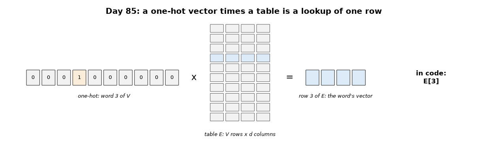
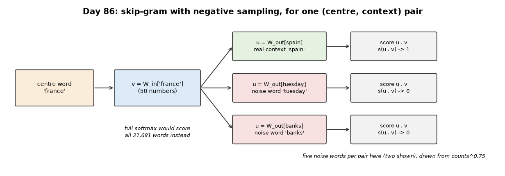
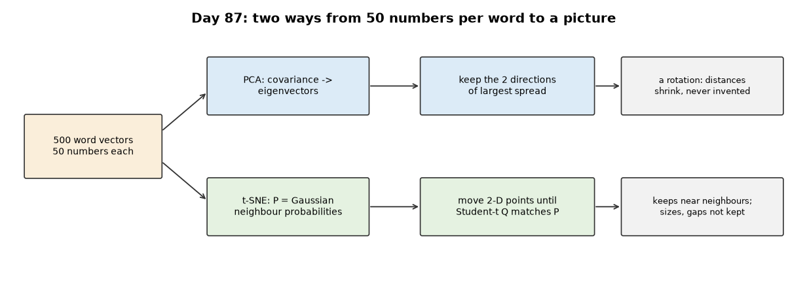
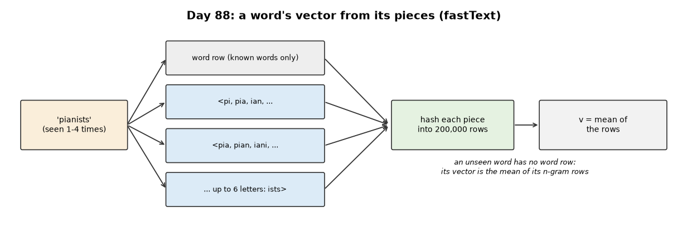
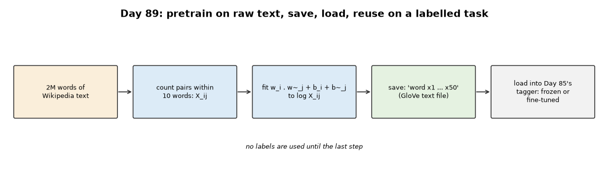

# Week 13: Tokenization & Embeddings (Days 84–90)

Week 12 built and trained a Transformer on digits. Week 13 turns to text: how it is cut into tokens, and how tokens become vectors. It follows the two-track structure of Weeks 9–12: Days 84–89 each get the full-depth lesson (real experiments, paired study-guide PDFs) plus a short `dayNN_exercise.py` isolating one part, and Day 90 builds a tiny character-level GPT-style model from those parts and Weeks 11–12's. See [`full_syllabus_days_1_365.md`](../full_syllabus_days_1_365.md) for the week's plan.

## Day 84 — Byte-pair encoding (BPE) from scratch, on real text
[`day84_byte_pair_encoding.py`](day84_byte_pair_encoding.py) — the subword tokenizer of Sennrich et al. (2016): start from characters plus an end-of-word mark `</w>`, and repeatedly merge the most frequent adjacent pair into one new symbol. Worked by hand on the paper's four-word example, then trained with 4000 merges on Week 9's 2,001 training sentences and tested on the 1,647 test sentences.

- **Lossless:** every test sentence decodes back exactly (0 of 1647 differ); the test text takes 1.454 tokens per word.
- **Vocabulary against length:** 71 symbols give 5.096 tokens per word; 4071 symbols give 1.454, with 0.788 of test words a single token. A bigger vocabulary means shorter sequences.
- **No more `<unk>`:** the 3725 test words (20.2%) outside Day 62's word vocabulary become 3.16 pieces on average instead of one unknown token. Words seen 10 or more times are 1.00 piece; words never seen, 3.46.
- **The gap that is left:** 4 characters in the test text never appear in training (in 6 test words), so they stay symbols a model has never seen. Byte-level BPE, as in GPT-2, starts from the 256 byte values and closes this gap.
- **Cost:** 4000 merges took 42.8 s here, because this simple version recounts every pair every round.

Study guide: [`day84_byte_pair_encoding_complete_guide.pdf`](day84_byte_pair_encoding_complete_guide.pdf) · Syntax walkthrough: [`day84_syntax_line_by_line.pdf`](day84_syntax_line_by_line.pdf) · [Run output](day84_run_output.txt)

Exercise: [`day84_exercise.py`](day84_exercise.py) is a whole-text BPE tokenizer in four functions (spaces are ordinary characters, so merges can cross word boundaries: "the food was " becomes one token) — the first part of Day 90's tiny GPT-style model ([run output](day84_exercise_run_output.txt)).

## Day 85 — Word embeddings: one-hot vs dense, on a real vocabulary
[`day85_word_embeddings.py`](day85_word_embeddings.py) — a one-hot vector times a matrix picks out one row, so an embedding table is the same thing as a one-hot input layer, stored as a lookup. Tested on Week 9's tagging task with Day 62's 2082-word vocabulary: the same window tagger (a word and its two neighbours, 64 hidden units) fed one-hot vectors, a learned dense table, or a random table that is never trained. Learning rate chosen on validation for each kind of input; three seeds.

- **The same rows, two ways:** one-hot times the table equals the lookup exactly (0.0e+00); the product was 266 times slower in this run, and one-hot inputs for 1,000 words take 16.7 MB against 4.0 kB of ids.
- **Dense beats one-hot:** test accuracy 0.8529 with d = 32 against 0.8190 for one-hot, which has 400913 weights and took 4.70 s per epoch. Even d = 2 (0.8362) beats one-hot; d = 8, 32 and 128 are level (0.8528, 0.8529, 0.8509).
- **Learning the table matters:** a random table that is never trained reaches 0.6972.
- **What the table learned:** for the 500 most frequent words, a word's nearest neighbour has the same most common tag 0.854 of the time, against 0.136 for the random table (two random words: 0.138).
- **Not shown:** why dense wins. The likely reason, one table shared by all three window positions, was not tested. The best dense learning rate (0.25) is the smallest one tried.

Study guide: [`day85_word_embeddings_complete_guide.pdf`](day85_word_embeddings_complete_guide.pdf) · Syntax walkthrough: [`day85_syntax_line_by_line.pdf`](day85_syntax_line_by_line.pdf) · [Run output](day85_run_output.txt)

Exercise: [`day85_exercise.py`](day85_exercise.py) is an embedding layer, forward (`E[ids]`) and backward (`np.add.at`), gradient-checked with repeated tokens; the plain-assignment mistake is off by 0.90 — the second part of Day 90's model ([run output](day85_exercise_run_output.txt)).

## Day 86 — Word2Vec (skip-gram) from scratch, on a real small corpus
[`day86_word2vec_skipgram.py`](day86_word2vec_skipgram.py) — word vectors learned from raw text: every word in turn predicts the words around it (skip-gram), trained with negative sampling (is this pair real, or one of 5 made-up ones?). The corpus is new: the first 2,000,000 words of text8 (Wikipedia, lowercase letters only), kept with Tiny Shakespeare (for Day 90) in [`corpora/`](corpora) — see its [README](corpora/README.txt) for sources and licences.

- **Both objectives checked:** negative sampling and the full softmax pass gradient checks (5.40e-10, 8.05e-10); one batch with the full softmax over 21681 words was 282 times slower in this run.
- **Groups, from raw text:** 0.970 of 90 listed words (months, numbers, countries, ...) have a same-group nearest neighbour (three seeds), against 0.156 for the untrained table. Measured after every epoch: 0.789 after the first.
- **Analogies mostly fail at this size:** capitals 0.140, gender 0.263 (paris:france :: rome:? and similar, the whole vocabulary searched).
- **Ingredients trade off:** without subsampling, gender analogies rise to 0.489 but capitals fall to 0.070 (one seed; the likely reason, frequent words like 'he' and 'she' being thinned out, was not tested); a window of 2 or a single noise word is weaker.
- All 21681 vectors are saved to `day86_vectors.txt.gz` (word2vec text format) for Days 87 and 89.

Study guide: [`day86_word2vec_skipgram_complete_guide.pdf`](day86_word2vec_skipgram_complete_guide.pdf) · Syntax walkthrough: [`day86_syntax_line_by_line.pdf`](day86_syntax_line_by_line.pdf) · [Run output](day86_run_output.txt)

Exercise: [`day86_exercise.py`](day86_exercise.py) is the output layer a language model needs instead: a full softmax over the vocabulary, forward and backward (gradient check 5.37e-10) — the third part of Day 90's model ([run output](day86_exercise_run_output.txt)).

## Day 87 — Embedding visualization: PCA and t-SNE from scratch, and what survives the projection
[`day87_embedding_visualization.py`](day87_embedding_visualization.py) — Day 86's 50 numbers per word drawn in two dimensions, two ways, both from scratch: PCA (the directions of largest spread) and exact t-SNE (keep each word's near neighbours near). Every picture comes with two numbers: the group check, and how many of each word's 10 nearest neighbours in 50-D stay among its 10 nearest in 2-D.

- **Both methods checked:** PCA matches NumPy's SVD (9.9e-14); t-SNE's gradient passes the check (1.24e-10).
- **PCA loses the groups:** two directions keep 0.377 of the spread; on 500 words the group check falls from 0.967 (50-D) to 0.433, and only 0.151 of near neighbours survive.
- **t-SNE keeps them:** group check 0.944 to 0.956 over five random starts, about half the near neighbours (0.490 to 0.510); different layouts, the same numbers.
- **Controls:** on the untrained random table, t-SNE gives chance (0.167) and draws no groups. On made-up clusters with known sizes, t-SNE draws a cluster 10.09 times wider as the same size (0.99) and a gap 4.00 times wider as the same (0.98); PCA keeps both roughly (12.79, 4.01).

Study guide: [`day87_embedding_visualization_complete_guide.pdf`](day87_embedding_visualization_complete_guide.pdf) · Syntax walkthrough: [`day87_syntax_line_by_line.pdf`](day87_syntax_line_by_line.pdf) · [Run output](day87_run_output.txt)

Exercise: [`day87_exercise.py`](day87_exercise.py) is `pca` in one function, checked against the SVD — the fourth part of Day 90's model, used to draw its character table ([run output](day87_exercise_run_output.txt)).

## Day 88 — Subword embeddings and out-of-vocabulary words (fastText from scratch)
[`day88_subword_embeddings.py`](day88_subword_embeddings.py) — fastText: a word's vector is the mean of rows for its character n-grams (3 to 6 letters, hashed into 200,000 rows) and for the word itself, so any word gets a vector, including one never seen. Tested honestly: 31 words (every second word of six of Day 86's groups) are removed from the corpus before training, then fastText's vectors for them are compared with a spelling-only baseline and chance. Day 86's code is imported from its script.

- **Checked:** the subword input passes a gradient check through the training step itself (7.37e-10).
- **Known words:** fastText matches Word2Vec on word groups (0.932 both) but its analogies are much weaker (capitals 0.011 against 0.151).
- **Words never seen:** Word2Vec has no vector; fastText finds a same-group word 0.290 of the time, far above chance (0.082) but below plain spelling similarity (0.355). Its neighbours share endings: 'four' -> 'honour', 'odour'.
- **Rare real words:** the stem is among the 10 nearest words 0.182 of the time for fastText, 0.993 for spelling (a test that favours spelling by design).
- **Why, measured:** n-gram rows shared by 100+ words grow to length 3.930, rows used by one word stay at 0.242, so common pieces decide every mean; a known word's n-gram-only vector and full vector have cosine 0.9996. On two million words, fastText mostly learns endings.

Study guide: [`day88_subword_embeddings_complete_guide.pdf`](day88_subword_embeddings_complete_guide.pdf) · Syntax walkthrough: [`day88_syntax_line_by_line.pdf`](day88_syntax_line_by_line.pdf) · [Run output](day88_run_output.txt)

Exercise: [`day88_exercise.py`](day88_exercise.py) is the subword part on its own (n-grams, a fixed FNV-1a hash, the mean of rows and its gradient, 6.73e-11) — the fifth part of Day 90's model, which uses `char_ngrams` to check its invented words ([run output](day88_exercise_run_output.txt)).

## Day 89 — Pretrained embeddings: GloVe from scratch, saved, loaded and used
[`day89_glove_pretrained.py`](day89_glove_pretrained.py) — GloVe: count how often every two words appear within 10 words of each other (weighted 1 / distance), then fit word vectors so that their dot products match the log counts. Trained on Day 86's corpus, saved in GloVe's text format (`day89_glove_vectors.txt.gz`), loaded back, and used with Day 86's Word2Vec vectors as the starting table of Day 85's tagger: frozen or fine-tuned, with all the labelled sentences or a tenth. Days 85 and 86 are imported from their scripts.

- **Counts:** 8,153,059 nonzero pairs, 1.73% of all possible; the loss passes a gradient check (4.99e-09).
- **GloVe is weaker here:** after 25 epochs (measured after each) category 0.900, capitals 0.074, gender 0.167, against Word2Vec's 0.967, 0.129, 0.211 on the same two million words; still rising.
- **Files:** save and load lose only the 5-decimal rounding (5.0e-06); one loader reads GloVe's format and word2vec's.
- **Pretrained vectors help when labels are few:** with 200 labelled sentences, fine-tuning from Word2Vec gives 0.7660 and from GloVe 0.7558, against 0.7373 from random (frozen: 0.7217, 0.6782 against 0.5583). With all 2,001 the fine-tuned gain almost vanishes (0.8537, 0.8548 against 0.8517).

Study guide: [`day89_glove_pretrained_complete_guide.pdf`](day89_glove_pretrained_complete_guide.pdf) · Syntax walkthrough: [`day89_syntax_line_by_line.pdf`](day89_syntax_line_by_line.pdf) · [Run output](day89_run_output.txt)

Exercise: [`day89_exercise.py`](day89_exercise.py) is the vector-file part: save, load (both formats) and nearest neighbours by cosine — the sixth and last part of Day 90's model ([run output](day89_exercise_run_output.txt)).

---
[← Back to main README](../README.md)
