# Week 14: Mini-GPT & Language Modeling (Days 91–97)

Week 13 built a tiny GPT-style model on Shakespeare. Week 14 studies language modeling properly: the chain rule and honest baselines, training with real perplexity numbers, sampling, judging generated text, scaling and fine-tuning. It follows the two-track structure of Weeks 9–13: Days 91–96 each get the full-depth lesson plus a short `dayNN_exercise.py` isolating one part, and Day 97 builds the week's evaluation of a mini-GPT from those parts. The text is Week 13's Tiny Shakespeare ([`../week-13-tokenization-embeddings/corpora/`](../week-13-tokenization-embeddings/corpora)). See [`full_syllabus_days_1_365.md`](../full_syllabus_days_1_365.md) for the week's plan.

## Day 91 — Causal language modeling: next-token prediction from scratch
[`day91_causal_language_modeling.py`](day91_causal_language_modeling.py) — by the chain rule, a text's probability is a product of next-token predictions. Checked by enumeration, then three ways to make the predictions on Day 90's Shakespeare split (characters): counting with add-k and with interpolated Kneser-Ney smoothing (from scratch), a fixed-window neural model (Bengio et al., 2003), and Day 90's GPT. Day 90's code is imported from its script.

- **Why causal:** summed over all 81 strings of a tiny vocabulary, a causal model's probabilities give 1.000000; the same weights without the causal mask give 1.051473, so they are not probabilities at all.
- **Counting is the baseline to beat:** Kneser-Ney reaches 2.197 bits per character with 6 characters of context, where add-k stalls at 2.554 and gets worse with more context. Its discount (0.9) was chosen on held-back training text, inside the grid.
- **A fixed-window neural model:** best 2.633 at 8 characters; 16 is worse (2.685), probably undertrained at 4,000 steps (not tested further).
- **Day 90's GPT (2.525) is behind Kneser-Ney.** The target for Day 92 is below 2.197.

Study guide: [`day91_causal_language_modeling_complete_guide.pdf`](day91_causal_language_modeling_complete_guide.pdf) · Syntax walkthrough: [`day91_syntax_line_by_line.pdf`](day91_syntax_line_by_line.pdf) · [Run output](day91_run_output.txt)

Exercise: [`day91_exercise.py`](day91_exercise.py) is the Kneser-Ney character model in one class, with every context's probabilities checked to sum to 1 — the first part of Day 97's build, its counting baseline ([run output](day91_exercise_run_output.txt)).

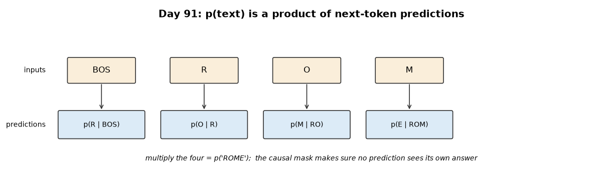
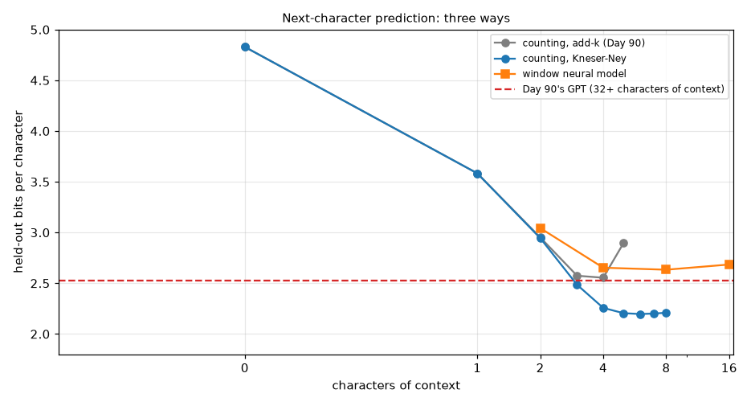

## Day 92 — Training the mini-GPT on real text, with honest perplexity numbers
[`day92_training_mini_gpt.py`](day92_training_mini_gpt.py) — Day 90's GPT trained properly: a warm-up and cosine learning-rate schedule (new), the peak rate chosen by a real 300-step sweep, a bigger model (4 blocks of 128, context 128) beside Day 90's, held-out loss measured with full context (sliding windows) every 500 steps next to the same measure on training text, and perplexity reported per character and per word. The three 5,000-step runs train at the same time in separate processes. The big model is saved to `day92_mini_gpt.npz` for Days 93 and 94.

- **The sweep:** a peak of 0.006 stalls (4.639 bits); 0.003 is chosen narrowly over 0.001 (3.374 against 3.425 at step 300).
- **The schedule helps the same model:** 2.443 against 2.492 bits per character at Day 90's constant rate.
- **The big model (824129 weights) reaches 2.188** — level with Day 91's Kneser-Ney counter (2.197, scored on slightly different positions), not clearly better; its training-text loss is 1.829, a gap of 0.358 bits that is still growing.
- **Perplexity needs its unit:** 4.56 per character, 4190 per word (5.50 characters per word), for the same model.

Study guide: [`day92_training_mini_gpt_complete_guide.pdf`](day92_training_mini_gpt_complete_guide.pdf) · Syntax walkthrough: [`day92_syntax_line_by_line.pdf`](day92_syntax_line_by_line.pdf) · [Run output](day92_run_output.txt)

Exercise: [`day92_exercise.py`](day92_exercise.py) is the schedule and a full-context evaluator that takes any model as a function (a uniform model scores log2 V, an all-knowing one 0) — the second part of Day 97's build ([run output](day92_exercise_run_output.txt)).

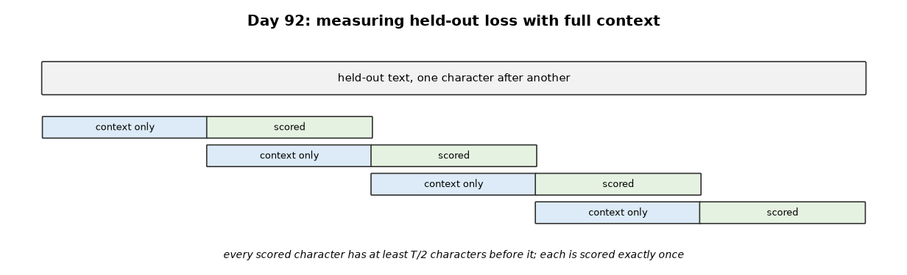
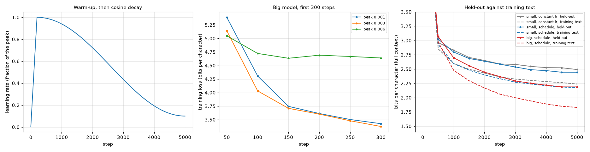

## Day 93 — Sampling strategies from scratch: greedy, temperature, top-k, top-p
[`day93_sampling_strategies.py`](day93_sampling_strategies.py) — one sampler for all four strategies (inverse-CDF draws), checked against exact distributions, then Day 92's saved mini-GPT continuing 20 held-out prompts by 400 characters with seven strategies, each measured: distinct word pairs (repetition), real words, the model's own bits (how safe) and Day 91's Kneser-Ney as an outside judge (how odd). Days 90 and 91 are imported from their scripts.

- **The sampler is right:** every strategy matches its exact distribution within 0.0019 over 200,000 draws.
- **Greedy loops:** only 0.059 of its word pairs are distinct (real text: 0.909), at 1.160 bits for the model.
- **Temperature trades safety for variety:** from 0.5 to 1.2, distinct pairs rise from 0.744 to 0.980 while real words fall from 0.974 to 0.806 and the judge's bits rise from 1.673 to 2.755.
- **Top-k 5 and top-p 0.9** land near temperature 0.8 (0.881 and 0.921 distinct pairs; 0.936 and 0.940 real words). Every cooled or truncated strategy is less surprising to the judge than the real text (2.208): safer than Shakespeare.

Study guide: [`day93_sampling_strategies_complete_guide.pdf`](day93_sampling_strategies_complete_guide.pdf) · Syntax walkthrough: [`day93_syntax_line_by_line.pdf`](day93_syntax_line_by_line.pdf) · [Run output](day93_run_output.txt)

Exercise: [`day93_exercise.py`](day93_exercise.py) is the sampler on its own, checked against exact distributions and at its two limits — the third part of Day 97's build ([run output](day93_exercise_run_output.txt)).

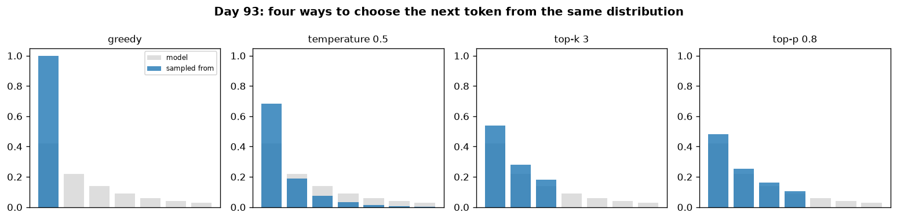
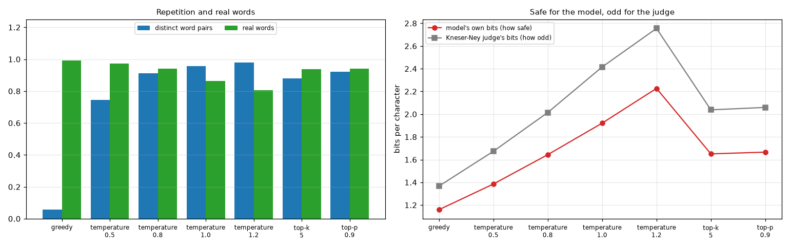

## Day 94 — Real generated text from the mini-GPT: an honest quality assessment
[`day94_generated_text_quality.py`](day94_generated_text_quality.py) — 120 passages of 300 characters from Day 92's mini-GPT (temperature 1.0 and top-p 0.9) and from Day 91's Kneser-Ney model, all continuing the same 120 held-out prompts, judged by measurement against the real continuations, with a control. Day 93's generation code is imported from its script.

- **A simple classifier can tell:** a logistic regression on character 1-3-gram counts (from scratch, 5-fold cross-validated) separates the GPT's text from real Shakespeare 0.725 of the time at temperature 1.0 and 0.825 with top-p 0.9; Kneser-Ney's 0.754. The control, two halves of the real text, gives 0.442: chance.
- **No copying:** the share of 16-character pieces found verbatim in the training text is 0.014-0.017 for the GPT against 0.015 for real unseen text; Kneser-Ney copies more (0.042).
- **The play's shape is off:** 0.144 of the GPT's lines are speaker lines against 0.260 in the real text, and its lines run longer (34.9 characters against 30.3).

Study guide: [`day94_generated_text_quality_complete_guide.pdf`](day94_generated_text_quality_complete_guide.pdf) · Syntax walkthrough: [`day94_syntax_line_by_line.pdf`](day94_syntax_line_by_line.pdf) · [Run output](day94_run_output.txt)

Exercise: [`day94_exercise.py`](day94_exercise.py) is the set of text measures (copying, distinct pairs, real words, speaker lines), each checked on texts with known answers — the fourth part of Day 97's build ([run output](day94_exercise_run_output.txt)).

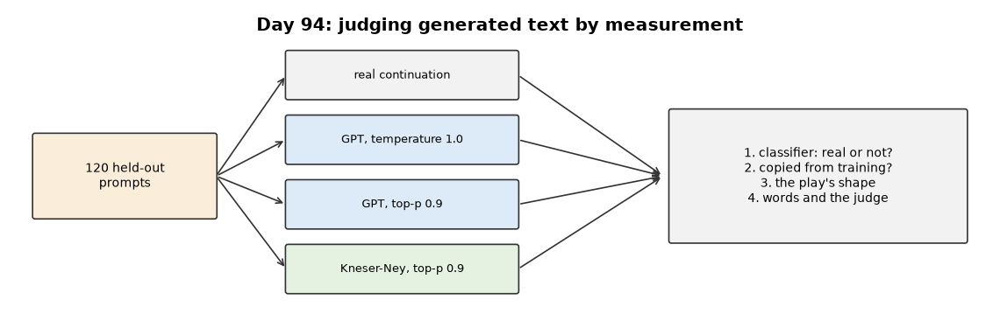
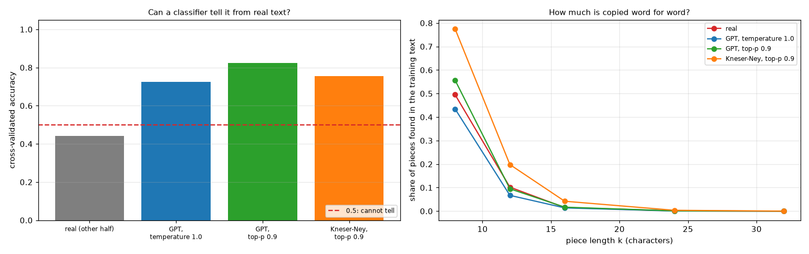

## Day 95 — Scaling-laws intuition: a real experiment varying model size and data
[`day95_scaling_laws.py`](day95_scaling_laws.py) — seven runs of Day 90's GPT with one fixed budget (3,000 steps, Day 92's schedule), trained at the same time: four widths (16 to 128) on all the training text, and four amounts of text (1/32 to all) at width 64. A power law L = c + a x^-alpha is fitted from scratch, and each fit is repeated with one point left out to show how firm it is. Days 90 and 92 are imported from their scripts.

- **Weights, by formula:** 9601 to 420417, matching the models exactly.
- **Model size follows a power law closely:** 3.072, 2.777, 2.534 and 2.361 bits; alpha 0.251, every point within 0.004 bits, and 0.21 to 0.30 leaving one point out. The fitted floor (1.910) lies far below every point and is not a real limit.
- **Data does not, under a fixed budget:** on 1/32 of the text each character is seen 195.9 times, training text falls to 1.158 bits while held-out text rises to 4.888 (best at step 500). With final losses the fit misses by 0.152 bits and alpha moves from 0.12 to 1.04; with each run's best checkpoint it still misses by 0.094 and its floor sits at the edge of the allowed range.

Study guide: [`day95_scaling_laws_complete_guide.pdf`](day95_scaling_laws_complete_guide.pdf) · Syntax walkthrough: [`day95_syntax_line_by_line.pdf`](day95_syntax_line_by_line.pdf) · [Run output](day95_run_output.txt)

Exercise: [`day95_exercise.py`](day95_exercise.py) is the weight count and the power-law fit, checked on made-up losses with a known law, with and without noise — the fifth part of Day 97's build ([run output](day95_exercise_run_output.txt)).

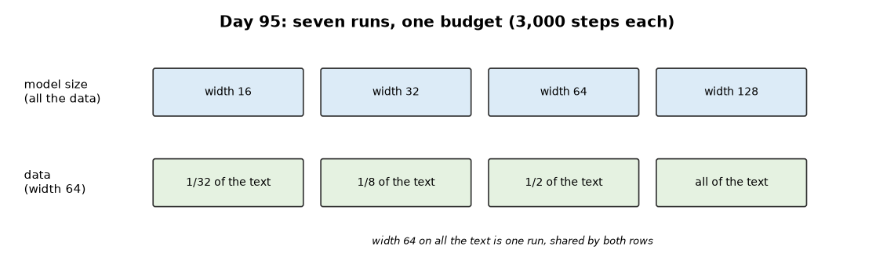
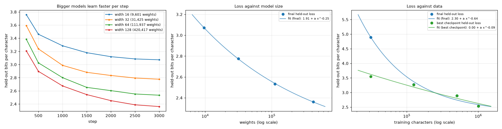

## Day 96 — Fine-tuning the mini-GPT on a narrower real task
[`day96_fine_tuning.py`](day96_fine_tuning.py) — Day 92's saved mini-GPT never saw the last tenth of Tiny Shakespeare, which ends with a whole play, The Tempest. The play is split in its own order (70% train, 15% dev, 15% test) and the model is adapted to it in five ways, each for 400 steps with its best dev checkpoint kept: full fine-tuning (learning rate chosen on dev), from scratch, top block and output layer only, replay (half of each batch from the original text) and a quarter of the data. Forgetting is measured on the rest of the held-out text, which no run trains on. The fine-tuned model is saved as [`day96_finetuned_gpt.npz`](day96_finetuned_gpt.npz) for Day 97.

- **The task is new:** all 11 of 11 of the play's speakers never speak in the training text; zero-shot the play's test part costs 2.486 bits per character against 2.054 for other unseen Shakespeare.
- **Learning rate, on dev:** 0.0003 best (2.212 at step 100, then rising to 2.347 as it memorises); 0.0001 close behind (2.218) and still improving at step 400; 0.001 ends at 3.071, worse than zero-shot.
- **Pretraining is most of the result:** full fine-tuning reaches 2.104 on test; the same model from scratch only 4.807.
- **Top block + output only** (206145 of 824129 weights) matches full fine-tuning: 2.105.
- **Forgetting:** other unseen Shakespeare goes from 2.054 to 2.190 after full fine-tuning. Replay did best on both measures, 2.050 on the play and 2.089 elsewhere (one seed; the reason it also helps the play was not tested).
- **A quarter of the data:** 2.130, but best at step 50 and then overfitting; it forgot the most (2.230).
- **In the samples:** 0.778 of the fine-tuned model's speaker lines name one of the play's new speakers, against 0.000 before.

Study guide: [`day96_fine_tuning_complete_guide.pdf`](day96_fine_tuning_complete_guide.pdf) · Syntax walkthrough: [`day96_syntax_line_by_line.pdf`](day96_syntax_line_by_line.pdf) · [Run output](day96_run_output.txt)

Exercise: [`day96_exercise.py`](day96_exercise.py) is the model-file and fine-tuning helpers: `save_params` / `load_params`, `adam_subset` (frozen weights do not move by one bit) and `snapshot` (a deep copy, unlike a shallow one) — the sixth part of Day 97's build ([run output](day96_exercise_run_output.txt)).

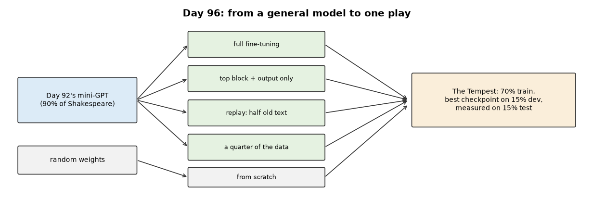
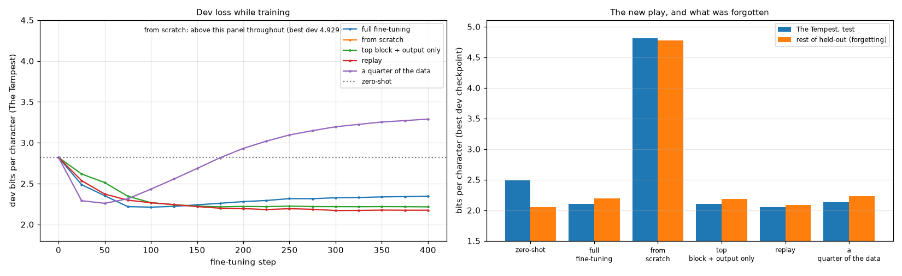

---
[← Back to main README](../README.md)
