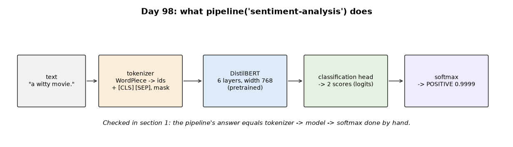
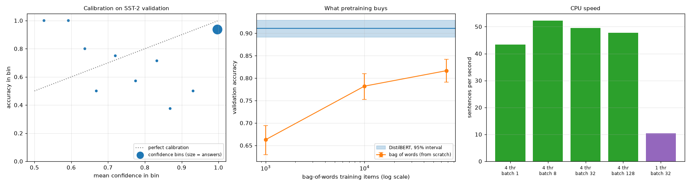
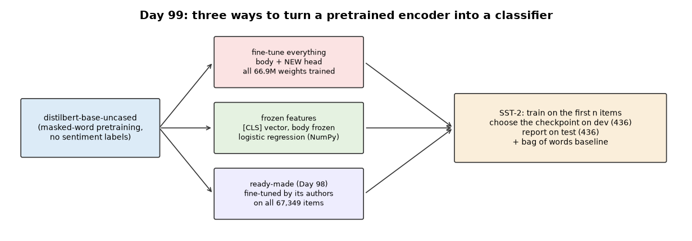
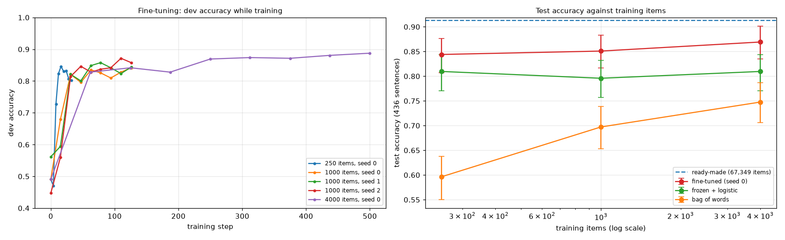
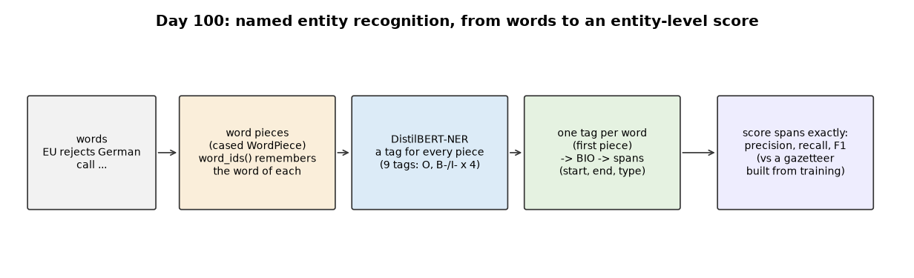
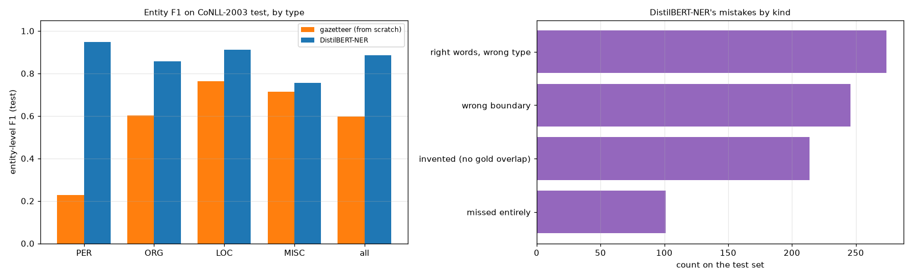
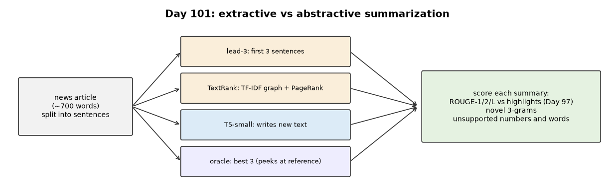
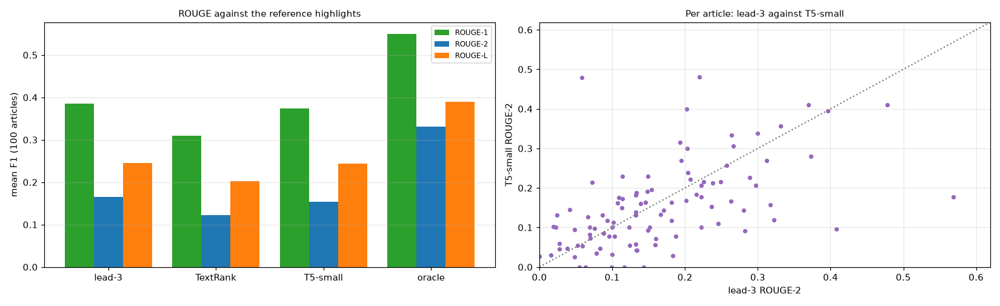
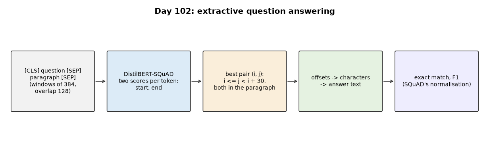
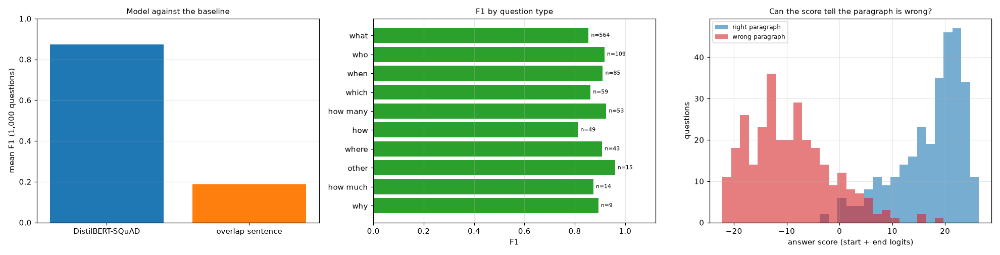

# Week 15: Practical NLP with Pretrained Models (Days 98–104)

Weeks 11–14 built attention, the Transformer and a mini-GPT from scratch. Week 15 uses the tools practitioners use: the Hugging Face `transformers` library (on PyTorch) and models pretrained by others, measured honestly on real datasets with metrics written from scratch. It follows the two-track structure of Weeks 9–14: Days 98–103 each get the full-depth lesson plus a short `dayNN_exercise.py` isolating one part, and Day 104 builds a small retrieval-augmented question-answering system from those parts. Models and datasets download on first use into the Hugging Face cache outside the repository and are not committed. See [`full_syllabus_days_1_365.md`](../full_syllabus_days_1_365.md) for the week's plan.

## Day 98 — A pretrained-transformers library, and a real pretrained model
[`day98_pretrained_transformers.py`](day98_pretrained_transformers.py) — the Hugging Face `transformers` library on PyTorch, with DistilBERT fine-tuned for sentiment (`distilbert/distilbert-base-uncased-finetuned-sst-2-english`), measured on SST-2's 872 validation sentences. The from-scratch parts are NumPy: a bootstrap interval, a calibration table, and a bag-of-words logistic regression as the baseline.

- **The pipeline is just tokenizer → model → softmax:** the largest gap from doing the steps by hand is 0.0e+00. The model has 66,955,010 weights.
- **The tokenizer:** WordPiece needs 1.185 pieces per word on real reviews, never produces [UNK], and padding changes probabilities by at most 1.4e-06 thanks to the attention mask.
- **Accuracy 0.9106** (95% bootstrap interval 0.8911 to 0.9289); caveat: the model's authors may have tuned on this standard development set.
- **Overconfident:** the top confidence bin holds 806 answers with mean confidence 0.997 but accuracy 0.937; expected calibration error 0.0803.
- **What pretraining buys:** the from-scratch bag of words reaches 0.6628, 0.7821 and 0.8165 with 1,000, 10,000 and all 67,349 training items.
- **Where it fails:** mixed and ironic reviews, at confidence 0.9994 and above; sentences with a negation word 0.866 against 0.921 (intervals overlap slightly).
- **CPU speed:** best at batch 8 (52.3 sentences per second); one thread is far slower (10.4).

Study guide: [`day98_pretrained_transformers_complete_guide.pdf`](day98_pretrained_transformers_complete_guide.pdf) · Syntax walkthrough: [`day98_syntax_line_by_line.pdf`](day98_syntax_line_by_line.pdf) · [Run output](day98_run_output.txt)

Exercise: [`day98_exercise.py`](day98_exercise.py) is the batching part: `batched`, `run_batched` and a safe `softmax`, checked against one-at-a-time predictions (differences under 1e-7) — the first part of Day 104's build ([run output](day98_exercise_run_output.txt)).

## Day 99 — Fine-tuning a BERT-style model on a real classification dataset
[`day99_fine_tuning_bert.py`](day99_fine_tuning_bert.py) — plain `distilbert-base-uncased` (no sentiment training) fine-tuned on this CPU on 250, 1,000 (three seeds) and 4,000 SST-2 items, in five parallel processes, with AdamW, warm-up and decay, and the best dev checkpoint. SST-2's validation set is split into 436 dev and 436 test sentences. Compared on the same test half: frozen pretrained features with a NumPy logistic regression, Day 98's from-scratch bag of words, and Day 98's ready-made model.

- **Little data goes far:** 0.844 with 250 items, 0.851 with 1,000 (three seeds within 0.007), 0.869 with 4,000. Accuracies reproduced exactly on rerun; two runs were still improving at their last step.
- **Against the alternatives:** bag of words 0.596 / 0.697 / 0.748; frozen features 0.810 / 0.796 / 0.810; ready-made (all 67,349 items) 0.913.
- **Paired comparisons:** fine-tuned minus frozen at 1,000 items +0.055, ready-made minus the 4,000-item fine-tune +0.043, both excluding 0; 4,000 minus 1,000 items +0.018 crosses 0.
- **Honest limits:** the frozen model's L2 choice on dev is noisy, and pairing did not narrow every comparison (0.103 wide, because those two models agree on only 0.681 of sentences).

Study guide: [`day99_fine_tuning_bert_complete_guide.pdf`](day99_fine_tuning_bert_complete_guide.pdf) · Syntax walkthrough: [`day99_syntax_line_by_line.pdf`](day99_syntax_line_by_line.pdf) · [Run output](day99_run_output.txt)

Exercise: [`day99_exercise.py`](day99_exercise.py) is `bootstrap_ci` and `paired_bootstrap`, checked on made-up results with a known answer — the second part of Day 104's build ([run output](day99_exercise_run_output.txt)).

## Day 100 — Named entity recognition with a pretrained model on a real dataset (Day 100 of 365)
[`day100_named_entity_recognition.py`](day100_named_entity_recognition.py) — `dslim/distilbert-NER` (DistilBERT fine-tuned on CoNLL-2003's training set) tags every word of CoNLL-2003's genuine held-out test set (3,453 Reuters sentences) as part of a person, organisation, location or other name, or none. Word-piece alignment, BIO-to-span decoding, entity-level scoring and a gazetteer baseline are written from scratch.

- **Alignment matters:** this model tags every piece of a rare name B-PER; reading each word's first piece gives one tag per word, and the decoding matches the library's pipeline exactly.
- **Entity-level F1 0.8854** (precision 0.8735, recall 0.8977); PER 0.9471, ORG 0.8565, LOC 0.9105, MISC 0.7565. Per-word accuracy (0.9780) flatters: tagging every word O already scores 0.8253.
- **A gazetteer of every training name** (8,082 strings) gets 0.5965, and finds 0.0000 of the 2,600 names it never saw; the model finds 0.8612 of them.
- **Mistakes:** 274 right words with the wrong type (ORG and LOC swapped most), 246 wrong boundaries, 214 invented, 101 missed.

Study guide: [`day100_named_entity_recognition_complete_guide.pdf`](day100_named_entity_recognition_complete_guide.pdf) · Syntax walkthrough: [`day100_syntax_line_by_line.pdf`](day100_syntax_line_by_line.pdf) · [Run output](day100_run_output.txt)

Exercise: [`day100_exercise.py`](day100_exercise.py) is the scoring part: `spans` (BIO tags to spans, including stray I- tags and type changes) and `prf` (exact-span precision, recall, F1) — the third part of Day 104's build ([run output](day100_exercise_run_output.txt)).

## Day 101 — Text summarization: extractive vs abstractive, on real news
[`day101_summarization.py`](day101_summarization.py) — four summaries of 100 CNN/DailyMail test articles: lead-3, TextRank (TF-IDF sentence graph and PageRank, from scratch), the pretrained `google-t5/t5-small`, and an oracle that peeks at the reference. Scored with Day 97's ROUGE (imported unchanged) and Day 99's bootstrap, plus two checks ROUGE cannot do: novel wording, and numbers or words the article does not support.

- **ROUGE-2:** lead-3 0.166, T5-small 0.154 (the difference, +0.011, is inside the noise), TextRank 0.122, oracle 0.331. Copying the opening is hard to beat on news.
- **What ROUGE misses:** T5-small writes 0.235 novel 3-grams, and 15 of its 100 summaries are flagged; the script prints each flagged sentence beside the article. Reading them finds real errors — Friday for Thursday, 'the italian capital' for Madrid, an invented byline, 'blackburn beat blackburn' — next to harmless rewording.
- **Honest limits of the check:** it flags paraphrase and cannot catch an error built from the article's own words.

Study guide: [`day101_summarization_complete_guide.pdf`](day101_summarization_complete_guide.pdf) · Syntax walkthrough: [`day101_syntax_line_by_line.pdf`](day101_syntax_line_by_line.pdf) · [Run output](day101_run_output.txt)

Exercise: [`day101_exercise.py`](day101_exercise.py) is the text-cutting part: `split_sentences` (abbreviations, initials, quotes) and `chunk_words` (overlapping windows) — the fourth part of Day 104's build ([run output](day101_exercise_run_output.txt)).

## Day 102 — Question answering with a pretrained transformer on a real dataset
[`day102_question_answering.py`](day102_question_answering.py) — `distilbert/distilbert-base-cased-distilled-squad` on 1,000 random SQuAD v1.1 validation questions. The best-span search over overlapping windows, SQuAD's official exact-match and F1, and a best-overlap-sentence baseline are written from scratch (transformers 5 removed its question-answering pipeline, so the span search is what the model needs).

- **EM 0.8010, F1 0.8732** (95% intervals about two points wide); choosing start and end separately gives an invalid span for 6 of 200 questions.
- **Baseline:** the best-overlap sentence contains the answer 0.8310 of the time but scores F1 0.1867 — locating is easy, the exact span is not.
- **Hardest questions:** 'how' (EM 0.633) and 'why' (EM 0.556, 9 questions).
- **The wrong paragraph:** the model still answers, but its score falls from a median 19.26 to -10.23; as a detector, ROC area 0.989 — the hook for Day 104.

Study guide: [`day102_question_answering_complete_guide.pdf`](day102_question_answering_complete_guide.pdf) · Syntax walkthrough: [`day102_syntax_line_by_line.pdf`](day102_syntax_line_by_line.pdf) · [Run output](day102_run_output.txt)

Exercise: [`day102_exercise.py`](day102_exercise.py) is SQuAD's metrics — `normalize`, `exact_match`, `f1` — checked on hand-worked cases; the fifth part of Day 104's build ([run output](day102_exercise_run_output.txt)).

---
[← Back to main README](../README.md)
