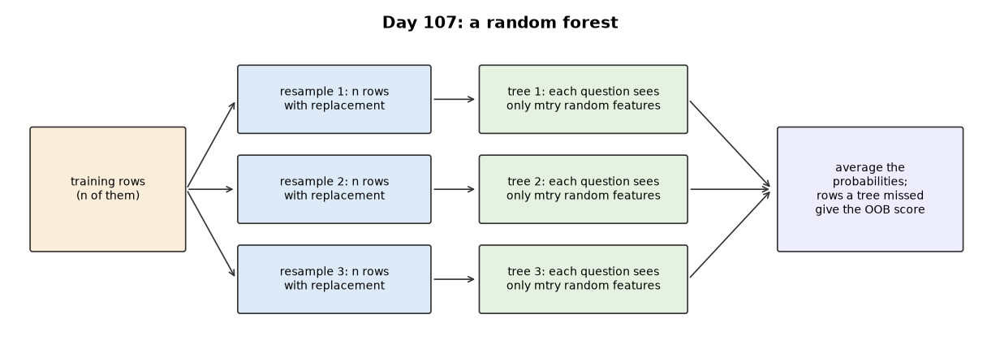
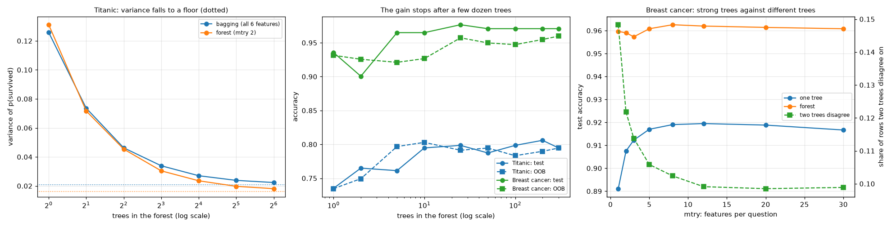
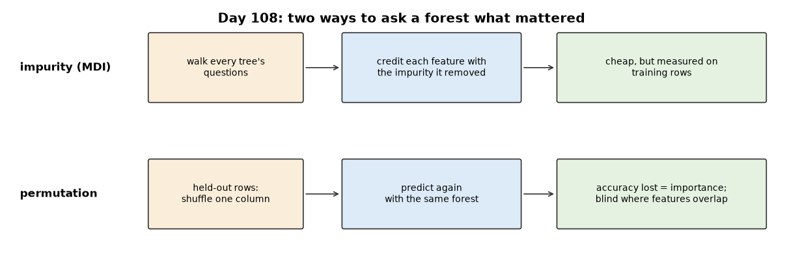
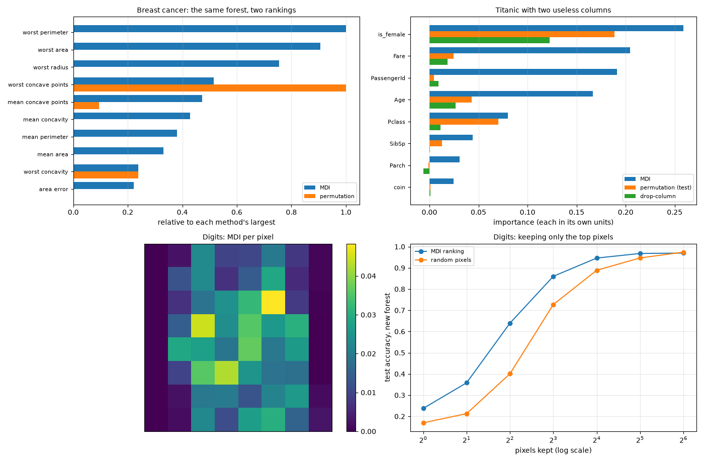
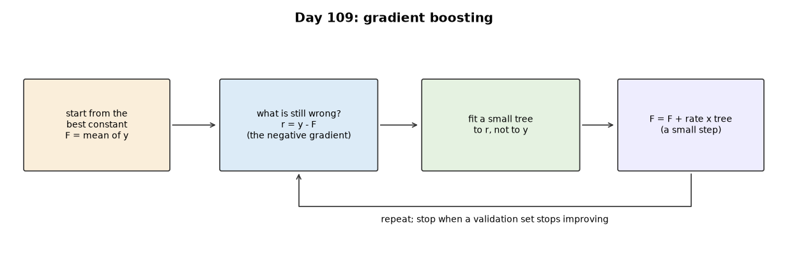
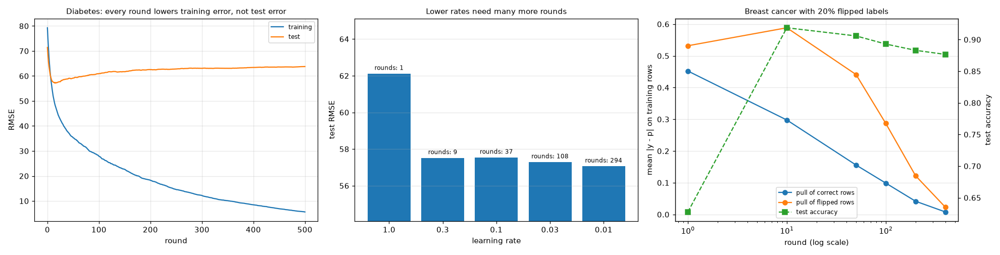

# Week 16: Classical ML I — Trees (Days 105–111)

After fifteen weeks of neural networks, Week 16 returns to classical machine learning: decision trees and the ensembles built from them, written from scratch in NumPy on real datasets. It follows the two-track structure: Days 105–110 each get the full-depth lesson plus a short `dayNN_exercise.py` isolating one part, and Day 111 assembles them. See [`full_syllabus_days_1_365.md`](../full_syllabus_days_1_365.md) for the week's plan.

## Day 105 — Decision trees from scratch: entropy and Gini on real data
[`day105_decision_trees.py`](day105_decision_trees.py) — a decision tree in NumPy: Gini and entropy, a split search that scores every threshold of a feature at once with sorted cumulative class counts, recursive growth, 5-fold cross-validation, and bootstrap resamples. Data: the Breast Cancer Wisconsin set bundled with scikit-learn (569 tumours, 30 features; no scikit-learn models are used) and the repository's own Titanic file.

- **Checked:** the fast split search finds the brute-force best gain in 30 of 30 random problems.
- **Depth:** training accuracy reaches 1.0000 (19 leaves) while test accuracy stops at 0.9415; 5-fold CV picks depth 2 (test 0.9357, interval 0.8947 to 0.9708 — too few test tumours to separate shallow depths).
- **Gini vs entropy:** different first questions (worst radius vs worst perimeter, near-duplicates); entropy scored higher on this split, inside the noise.
- **Instability:** across 30 bootstrap resamples the first question uses five features and single trees range 0.9006 to 0.9649; their majority vote gets 0.9649 (Day 107's random forest).
- **A readable tree:** Titanic at depth 3 reads like history and beats 'women survive' (0.8022 vs 0.7724), but has a leaf made from one passenger — the case for Day 106's pruning.

Study guide: [`day105_decision_trees_complete_guide.pdf`](day105_decision_trees_complete_guide.pdf) · Syntax walkthrough: [`day105_syntax_line_by_line.pdf`](day105_syntax_line_by_line.pdf) · [Run output](day105_run_output.txt)

Exercise: [`day105_exercise.py`](day105_exercise.py) is `gini`, `entropy` and `best_split`, checked on a table small enough to solve by hand and on the edge cases — the first part of Day 111's build ([run output](day105_exercise_run_output.txt)).

## Day 106 — Decision-tree pruning: real over- and underfitting
[`day106_pruning.py`](day106_pruning.py) — cost-complexity pruning from scratch on Day 105's tree: the weakest-link path, alpha chosen by 5-fold cross-validation, and the one-standard-error rule. Data: Titanic and breast cancer, plus a synthetic exclusive-or, on purpose, for the horizon effect.

- **Checked:** the path has the lowest possible cost in 1000 of 1000 checks against every possible pruned tree.
- **Over- and underfitting:** Titanic from one leaf to 145: training rises to 0.9823 while test peaks at 0.8172 and falls to 0.7537.
- **Thirty splits:** pruning adds +0.0397 on Titanic and +0.0076 on breast cancer. Against a depth limit it adds only +0.0052 and +0.0058, and the Titanic interval touches zero.
- **Label noise:** with 30% of training labels flipped, the full tree scores 0.6524 and the pruned tree 0.8916.
- **The horizon effect:** on an exclusive-or a fixed gain threshold of 0.02 stops at the root (0.4974), but a threshold chosen by CV avoids the trap (0.7901). Pruning reaches 0.7984 and cannot add what greedy growth missed.

Study guide: [`day106_pruning_complete_guide.pdf`](day106_pruning_complete_guide.pdf) · Syntax walkthrough: [`day106_syntax_line_by_line.pdf`](day106_syntax_line_by_line.pdf) · [Run output](day106_run_output.txt)

Exercise: [`day106_exercise.py`](day106_exercise.py) is the weakest-link path in short functions, checked on a three-leaf tree with alphas worked out by hand and on the edge cases — the second part of Day 111's build ([run output](day106_exercise_run_output.txt)).

## Day 107 — Random forests from scratch: bagging and a real variance-reduction demo
[`day107_random_forests.py`](day107_random_forests.py) — bagging and a random forest on Day 105's split search: bootstrap resamples, random feature subsets at each question, out-of-bag (OOB) scoring, and variance measured directly on repeated training sets. Data: Titanic, breast cancer and digits; scikit-learn's forest runs beside it only as an outside check.

- **Checked:** with every feature, in Day 105's order and without resampling, the tree matches Day 105's exactly; the forest matches scikit-learn's on breast cancer (0.9608 vs 0.9614).
- **Variance, measured:** on Titanic, from 1 to 64 trees the variance of a prediction falls from 0.1258 to 0.0224 while bias+noise stays near 0.14. Correlation between trees sets the floor (0.0207 for bagging, 0.0163 for a forest).
- **OOB is a free validation set:** it stays within 0.0073 of test, and choosing the leaf size with it lifts Titanic from 0.8045 to 0.8175.
- **Useless columns:** 300 of them take a forest from 0.9591 to 0.9497; bagging holds 0.9567.
- **No universal win:** against a pruned tree the forest gains +0.1224 on digits and +0.0354 on breast cancer, but a default forest (0.7996) does not beat a pruned tree (0.8093) on Titanic.

Study guide: [`day107_random_forests_complete_guide.pdf`](day107_random_forests_complete_guide.pdf) · Syntax walkthrough: [`day107_syntax_line_by_line.pdf`](day107_syntax_line_by_line.pdf) · [Run output](day107_run_output.txt)

Exercise: [`day107_exercise.py`](day107_exercise.py) is a small complete forest, checked on Day 105's eight patients and on the edge cases — the third part of Day 111's build ([run output](day107_exercise_run_output.txt)).

## Day 108 — Feature importance: permutation against impurity-based
[`day108_feature_importance.py`](day108_feature_importance.py) — impurity importance (MDI), permutation importance and drop-column importance from scratch on Day 107's forest, tested on cases where the right answer is known. Data: breast cancer, Titanic and digits; scikit-learn appears only as an outside check.

- **Two rankings, one forest:** on breast cancer their rank correlation is -0.280.
- **Correlated features blind permutation:** 26 of 30 features cost nothing to shuffle, but shuffling a group of 6 correlated size features together costs 0.2813.
- **Noise fools MDI:** a real row number, `PassengerId`, ranks third on Titanic (0.1910, above Age); held-out permutation gives it 0.0045. Permutation on training rows is fooled too (0.1028).
- **A duplicated feature:** MDI divides the credit (0.1427 + 0.1441); permutation shrinks it (0.0613 + 0.0593 against 0.1757 alone).
- **Stability:** rank correlation between splits is 0.930 for MDI and 0.144 for permutation, which is not the same as being right.
- **Using it:** 16 of 64 digit pixels chosen on training rows reach 0.9462, against 0.9697 for all.

Study guide: [`day108_feature_importance_complete_guide.pdf`](day108_feature_importance_complete_guide.pdf) · Syntax walkthrough: [`day108_syntax_line_by_line.pdf`](day108_syntax_line_by_line.pdf) · [Run output](day108_run_output.txt)

Exercise: [`day108_exercise.py`](day108_exercise.py) is both measures, with permutation written for any model that has a score function — the fourth part of Day 111's build ([run output](day108_exercise_run_output.txt)).

## Day 109 — Gradient boosting from scratch: real sequential error correction
[`day109_gradient_boosting.py`](day109_gradient_boosting.py) — a regression tree and gradient boosting in NumPy, for squared error and for log loss with Newton leaves, plus shrinkage and early stopping. Data: Diabetes, breast cancer and Titanic; scikit-learn's boosting runs only as an outside check, and a synthetic exclusive-or is used on purpose for interactions.

- **Checked:** split search 30 of 30 against brute force, gradient to 3.7e-10, training log loss falling in 200 of 200 rounds, and test RMSE within +0.0929 of scikit-learn.
- **Error correction:** on Diabetes training RMSE falls from 79.29 to 5.62, while test reaches 57.13 at round 15 and climbs to 63.77: unlike a forest, boosting overfits with more trees.
- **Learning rate:** rates from 0.3 to 0.01 are indistinguishable once validation chooses the rounds, at 8.9 to 293.8 rounds.
- **Depth:** stumps are best on Diabetes (56.35) and cannot learn an exclusive-or (0.5020); depth 3 reaches 0.9236.
- **Bias and variance:** bias+noise falls from 0.2168 to 0.1336 while variance grows from 0.0004 to 0.0439; the best Brier score (0.1415) beats the forest's 0.1532.
- **Wrong labels:** with 20% flipped, boosting peaks at 0.9187 and falls to 0.8766 as it memorises them; Day 107's forest holds 0.9333.
- **No universal win:** boosting beats a forest on Titanic (+0.0177), loses on breast cancer (-0.0111), and plain linear regression beats it on Diabetes (54.77 vs 58.07).

Study guide: [`day109_gradient_boosting_complete_guide.pdf`](day109_gradient_boosting_complete_guide.pdf) · Syntax walkthrough: [`day109_syntax_line_by_line.pdf`](day109_syntax_line_by_line.pdf) · [Run output](day109_run_output.txt)

Exercise: [`day109_exercise.py`](day109_exercise.py) is the regression tree and the boosting loop, checked by hand on six numbers and on the edge cases — the fifth part of Day 111's build ([run output](day109_exercise_run_output.txt)).

---
[← Back to main README](../README.md)
