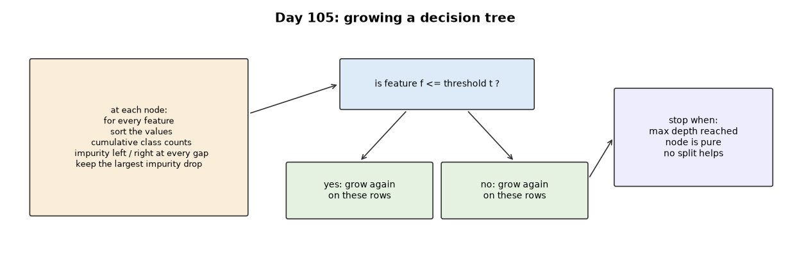
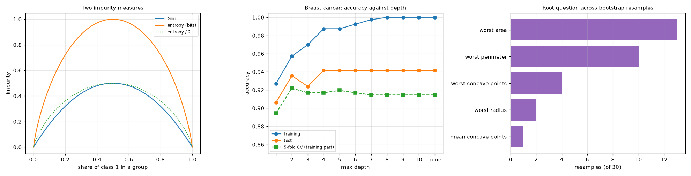
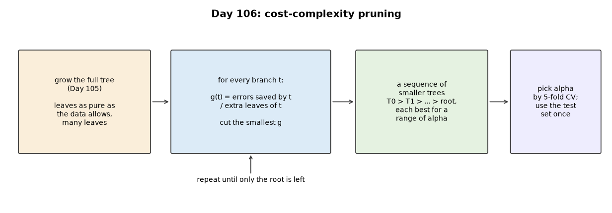
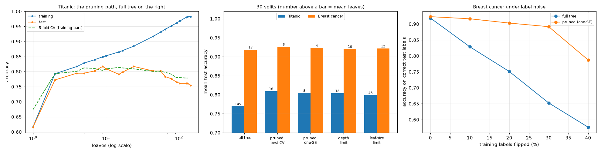

# Week 16: Classical ML I — Trees (Days 105–111)

After fifteen weeks of neural networks, Week 16 returns to classical machine learning: decision trees and the ensembles built from them, written from scratch in NumPy on real datasets. It follows the two-track structure: Days 105–110 each get the full-depth lesson plus a short `dayNN_exercise.py` isolating one part, and Day 111 assembles them. See [`full_syllabus_days_1_365.md`](../full_syllabus_days_1_365.md) for the week's plan.

## Day 105 — Decision trees from scratch: entropy and Gini on real data
[`day105_decision_trees.py`](day105_decision_trees.py) — a decision tree in NumPy: Gini and entropy, a split search that scores every threshold of a feature at once with sorted cumulative class counts, recursive growth, 5-fold cross-validation, and bootstrap resamples. Data: the Breast Cancer Wisconsin set bundled with scikit-learn (569 tumours, 30 features; no scikit-learn models are used) and the repository's own Titanic file.

- **Checked:** the fast split search finds the brute-force best gain in 30 of 30 random problems.
- **Depth:** training accuracy reaches 1.0000 (19 leaves) while test accuracy stops at 0.9415; 5-fold CV picks depth 2 (test 0.9357, interval 0.8947 to 0.9708 — too few test tumours to separate shallow depths).
- **Gini vs entropy:** different first questions (worst radius vs worst perimeter, near-duplicates); entropy scored higher on this split, inside the noise.
- **Instability:** across 30 bootstrap resamples the first question uses five features and single trees range 0.9006 to 0.9649; their majority vote gets 0.9649 (Day 107's random forest).
- **A readable tree:** Titanic at depth 3 reads like history and beats 'women survive' (0.8022 vs 0.7724), but has a leaf made from one passenger — the case for Day 106's pruning.

Study guide: [`day105_decision_trees_complete_guide.pdf`](day105_decision_trees_complete_guide.pdf) · Syntax walkthrough: [`day105_syntax_line_by_line.pdf`](day105_syntax_line_by_line.pdf) · [Run output](day105_run_output.txt)

Exercise: [`day105_exercise.py`](day105_exercise.py) is `gini`, `entropy` and `best_split`, checked on a table small enough to solve by hand and on the edge cases — the first part of Day 111's build ([run output](day105_exercise_run_output.txt)).

## Day 106 — Decision-tree pruning: real over- and underfitting
[`day106_pruning.py`](day106_pruning.py) — cost-complexity pruning from scratch on Day 105's tree: the weakest-link path, alpha chosen by 5-fold cross-validation, and the one-standard-error rule. Data: Titanic and breast cancer, plus a synthetic exclusive-or, on purpose, for the horizon effect.

- **Checked:** the path has the lowest possible cost in 1000 of 1000 checks against every possible pruned tree.
- **Over- and underfitting:** Titanic from one leaf to 145: training rises to 0.9823 while test peaks at 0.8172 and falls to 0.7537.
- **Thirty splits:** pruning adds +0.0397 on Titanic and +0.0076 on breast cancer. Against a depth limit it adds only +0.0052 and +0.0058, and the Titanic interval touches zero.
- **Label noise:** with 30% of training labels flipped, the full tree scores 0.6524 and the pruned tree 0.8916.
- **The horizon effect:** on an exclusive-or a fixed gain threshold of 0.02 stops at the root (0.4974), but a threshold chosen by CV avoids the trap (0.7901). Pruning reaches 0.7984 and cannot add what greedy growth missed.

Study guide: [`day106_pruning_complete_guide.pdf`](day106_pruning_complete_guide.pdf) · Syntax walkthrough: [`day106_syntax_line_by_line.pdf`](day106_syntax_line_by_line.pdf) · [Run output](day106_run_output.txt)

Exercise: [`day106_exercise.py`](day106_exercise.py) is the weakest-link path in short functions, checked on a three-leaf tree with alphas worked out by hand and on the edge cases — the second part of Day 111's build ([run output](day106_exercise_run_output.txt)).

---
[← Back to main README](../README.md)
