# Week 17: Classical ML II — Kernels & Ensembles (Days 112–118)

Week 16 built trees and the ensembles made from them. Week 17 covers the rest of the classical toolbox: support vector machines and the kernel trick, Naive Bayes, k-nearest neighbours, stacking, imbalanced data, and how to choose between models. Everything is written from scratch in NumPy on real datasets, with scikit-learn used only as an outside check. It follows the two-track structure: Days 112–117 each get the full-depth lesson plus a short `dayNN_exercise.py` isolating one part, and Day 118 assembles them. See [`full_syllabus_days_1_365.md`](../full_syllabus_days_1_365.md) for the week's plan.

## Day 112 — Support vector machines from scratch: separable and non-separable data
[`day112_support_vector_machines.py`](day112_support_vector_machines.py) — a linear SVM whose dual problem is solved by SMO (two multipliers at a time, the most violating pair first), with the weights, bias and margin recovered from the multipliers. Data: iris (setosa against versicolor is separable) and breast cancer; scikit-learn's SVC runs only as an outside check.

- **Checked:** the duality gap is 0.013% of the objective, the same 35 support vectors as scikit-learn, and the same prediction on every test tumour (1.0000). The first version never finished: rounding left multipliers at about 1e-17, and snapping them onto their bounds fixed it.
- **The widest gap:** on separable irises the margin is 1.3038 cm, set by 2 support vectors; the perceptron's gap varies from 0.0109 to 1.2132 cm depending only on the order it saw the flowers.
- **Only the support vectors matter:** retraining on them alone changes w by 1.6e-04, about the solver's tolerance; without half of them, by 4.9e-01.
- **C and scaling:** C trades margin (6.2727 down to 0.0808) for training errors. Unscaled, the SVM scores 0.6696 against 0.9746, and SMO did not finish on 19 of 20 splits. Against logistic regression it is no better (-0.0023).

Study guide: [`day112_support_vector_machines_complete_guide.pdf`](day112_support_vector_machines_complete_guide.pdf) · Syntax walkthrough: [`day112_syntax_line_by_line.pdf`](day112_syntax_line_by_line.pdf) · [Run output](day112_run_output.txt)

Exercise: [`day112_exercise.py`](day112_exercise.py) is the solver alone, which only ever sees a matrix of dot products, checked by hand on four points — the first part of Day 118's build ([run output](day112_exercise_run_output.txt)).

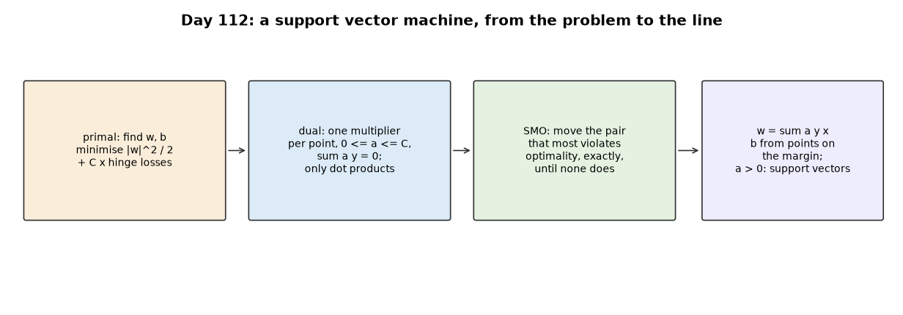
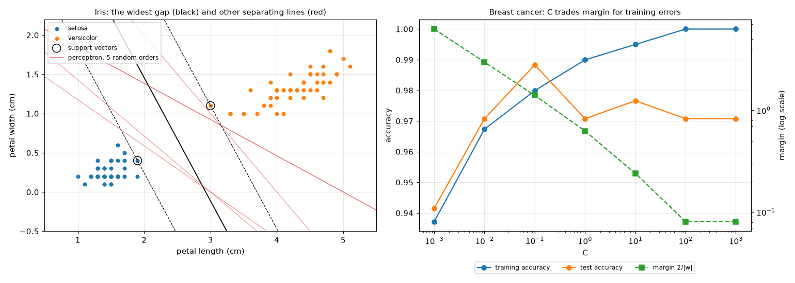

## Day 113 — The kernel trick from scratch: a real RBF-kernel demonstration
[`day113_kernel_trick.py`](day113_kernel_trick.py) — linear, polynomial and RBF kernels, the explicit features a polynomial kernel stands for, Day 112's SMO unchanged with one-vs-rest for ten classes, and random Fourier features. Data: breast cancer and handwritten digits.

- **The trick, checked:** a degree-2 polynomial kernel equals the dot products of 2,145 explicit features to 5.7e-14; degree 5 would need 11,238,513.
- **Valid kernels:** tanh(x.z - 1), once widely used as a 'sigmoid kernel', has 62 negative eigenvalues on 300 images.
- **A real curved boundary:** on two breast-cancer measurements, gamma from 0.01 to 100 bends the boundary from straight to wrapping single tumours (train 0.9749, test 0.9474). A straight line is as good here (0.9591).
- **Where it helps:** on digits RBF beats linear on all 5 splits (0.9814 against 0.9633); on breast cancer the gain is small (+0.0058). Tuned by CV (the grid was extended past its first edge), digits reach 0.9870.
- **Random features:** a linear SVM on 3,000 random Fourier features matches the exact kernel (0.9566 against 0.9570).

Study guide: [`day113_kernel_trick_complete_guide.pdf`](day113_kernel_trick_complete_guide.pdf) · Syntax walkthrough: [`day113_syntax_line_by_line.pdf`](day113_syntax_line_by_line.pdf) · [Run output](day113_run_output.txt)

Exercise: [`day113_exercise.py`](day113_exercise.py) is the kernels and random features, checked by hand — the second part of Day 118's build ([run output](day113_exercise_run_output.txt)).

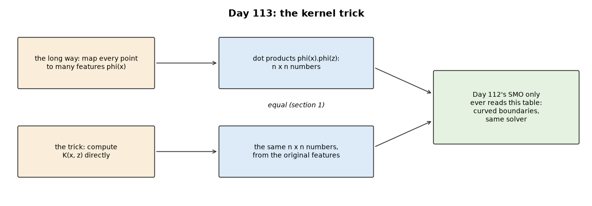
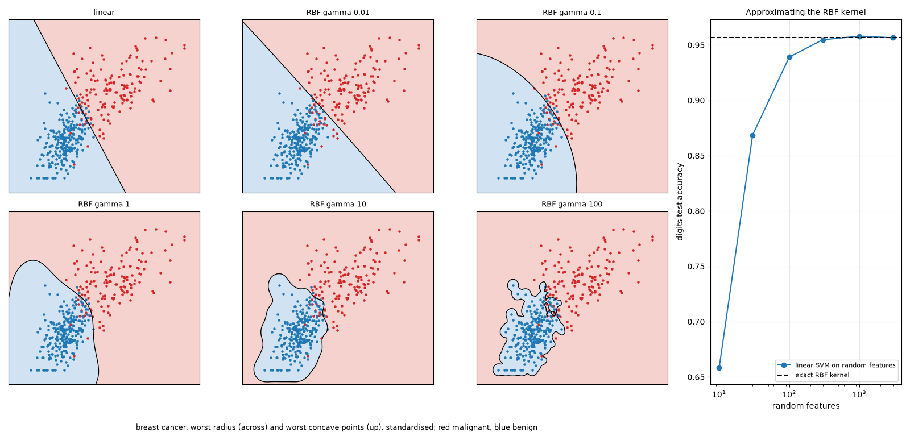

## Day 114 — Naive Bayes from scratch: real text classification
[`day114_naive_bayes.py`](day114_naive_bayes.py) — multinomial, binary and Bernoulli Naive Bayes with Laplace smoothing, on unigrams and bigrams. Data: SST-2 from Week 15's local cache (67,349 training phrases and sentences, 872 validation sentences); Day 98's tokeniser, logistic regression and calibration measure are imported unchanged.

- **Checked:** matches scikit-learn's MultinomialNB to 1.4e-13.
- **Against the alternatives:** binary NB 0.8085, with bigrams 0.8165; Day 98's logistic regression 0.8165 (reproduced exactly); DistilBERT 0.9106.
- **Little data:** Naive Bayes leads logistic regression on every subset up to 3,000 items (+0.0477 at 100), and loses with all of it (-0.0080), as Ng and Jordan (2002) predicted.
- **The naive assumption:** 0.4484 of its answers claim 99% certainty (logistic regression 0.0688), ECE 0.1112 against 0.0202; writing each sentence twice doubles its evidence (2.0000).
- **Smoothing:** cross-validation on training phrases chooses alpha 0.1, while validation sentences prefer 3, most likely because phrases are not sentences.

Study guide: [`day114_naive_bayes_complete_guide.pdf`](day114_naive_bayes_complete_guide.pdf) · Syntax walkthrough: [`day114_syntax_line_by_line.pdf`](day114_syntax_line_by_line.pdf) · [Run output](day114_run_output.txt)

Exercise: [`day114_exercise.py`](day114_exercise.py) is the three kinds of Naive Bayes in one class, checked by hand on four tiny reviews — the third part of Day 118's build ([run output](day114_exercise_run_output.txt)).

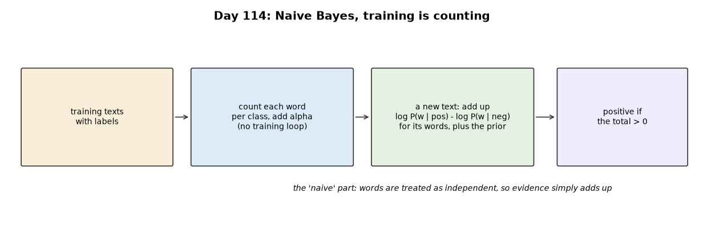
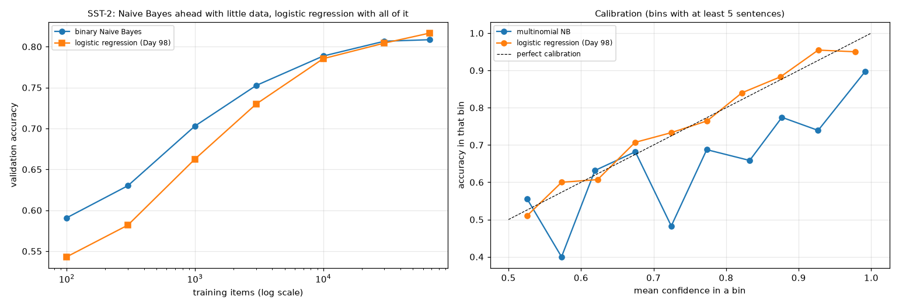

## Day 115 — k-nearest neighbours from scratch: a real curse-of-dimensionality demonstration
[`day115_k_nearest_neighbors.py`](day115_k_nearest_neighbors.py) — kNN with all distances at once, partial sorting and a vote, and PCA by the singular value decomposition. Data: digits and breast cancer, plus uniform random points for the pure geometry; scikit-learn's KNeighborsClassifier runs only as an outside check.

- **Checked:** identical predictions to scikit-learn at k = 1 and 5; 0.9829 on digits with no training at all.
- **Scaling:** on raw breast-cancer measurements one feature makes up 0.6700 of the typical distance; standardising lifts accuracy from 0.9345 to 0.9637.
- **Distances concentrate:** among 1,000 random points in 1,000 dimensions, the nearest is 0.9447 of the average distance away.
- **Neighbourhoods stop being local:** in 100 dimensions a cube holding 1% of the points spans 0.9550 of every side.
- **On real data:** 1,024 useless dimensions take digits from 0.9829 to 0.6545; with 256 of them, 10 PCA components recover 0.9555 against 0.8779.

Study guide: [`day115_k_nearest_neighbors_complete_guide.pdf`](day115_k_nearest_neighbors_complete_guide.pdf) · Syntax walkthrough: [`day115_syntax_line_by_line.pdf`](day115_syntax_line_by_line.pdf) · [Run output](day115_run_output.txt)

Exercise: [`day115_exercise.py`](day115_exercise.py) is the vote and PCA, checked by hand and on the edge cases — the fourth part of Day 118's build ([run output](day115_exercise_run_output.txt)).

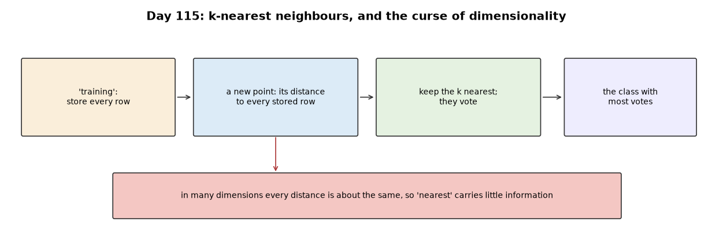
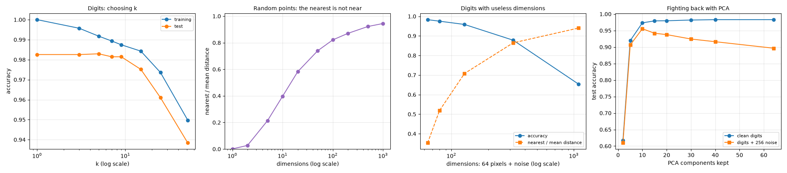

## Day 116 — Stacking and blending from scratch: a real meta-model
[`day116_stacking_blending.py`](day116_stacking_blending.py) — softmax regression (base model and meta-model), out-of-fold predictions, stacking, blending and simple averaging, over five base models imported unchanged: kNN (Day 115), an RBF SVM (Days 112–113), a random forest (Day 107) and gradient boosting (Day 109). Data: breast cancer, Titanic and digits.

- **The leakage trap:** on Titanic, a meta-model trained on in-sample predictions puts its weight on the forest (+3.26), which is right on 0.9839 of its own training rows, and loses 0.0272 accuracy (worse on 9 of 10 splits). On breast cancer it did no measurable harm (-0.0012).
- **Stacking did not beat picking the best model by CV:** +0.0026 on breast cancer, -0.0017 on Titanic, -0.0082 on digits (worse on 5 of 5 splits).
- **A plain average did as well or better:** 0.9766, 0.8209 and 0.9766; blending was worst (0.7944 on Titanic).
- **Why the gains are small:** on Titanic 0.1073 of test rows are wrong for every model, and only 0.2144 are disputed; kNN and the SVM make mistakes on the same rows (correlation 0.843).
- **Diversity matters:** three forests that differ only in seed stack to 0.9602, below their best member (0.9643).

Study guide: [`day116_stacking_blending_complete_guide.pdf`](day116_stacking_blending_complete_guide.pdf) · Syntax walkthrough: [`day116_syntax_line_by_line.pdf`](day116_syntax_line_by_line.pdf) · [Run output](day116_run_output.txt)

Exercise: [`day116_exercise.py`](day116_exercise.py) is softmax regression, out-of-fold predictions and the stack, checked on a useful and a useless model — the fifth part of Day 118's build ([run output](day116_exercise_run_output.txt)).

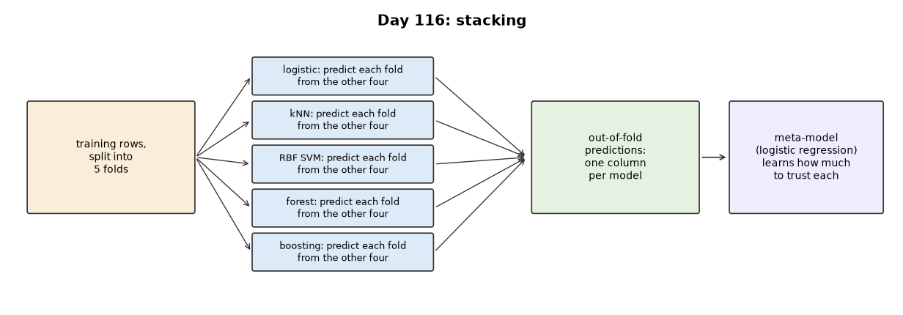
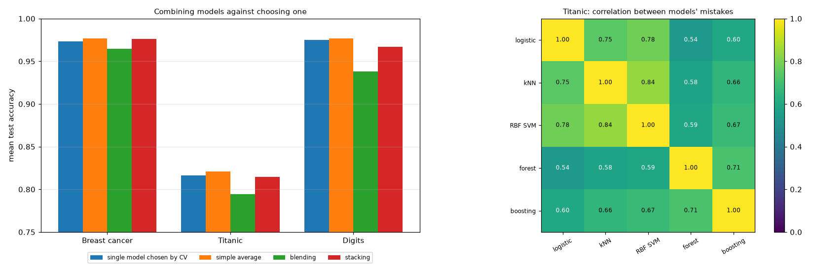

## Day 117 — Imbalanced data: SMOTE against class weighting
[`day117_imbalanced_data.py`](day117_imbalanced_data.py) — metrics written from scratch (precision, recall, F1, balanced accuracy, ROC AUC in its rank form, average precision), SMOTE, random over- and undersampling, class-weighted logistic regression, a balanced random forest and threshold moving. Data, all real rows: digits (a 9 against the rest), breast cancer with malignant tumours subsampled to 5%, and the top 10% of Diabetes progression scores; scikit-learn's metrics are an outside check.

- **Accuracy misleads:** always predicting the common class scores 0.8998 on digits and finds none of the rare rows.
- **Checked metrics:** AUC, average precision and F1 match scikit-learn to six decimals (0.997595, 0.985937, 0.962963).
- **Rebalancing moves the threshold:** on Diabetes, logistic recall rises from 0.2750 to 0.7929 with class weights, while AUC barely moves (0.8967 to 0.8991); F1 goes from 0.3386 to 0.5023 with weights and 0.5056 with SMOTE.
- **The forest needs it more:** untreated it finds 0.1143 of Diabetes' rare cases; balanced, 0.7214.
- **The price:** with class weights, the predicted rare share on Diabetes is 0.2670 against a true 0.1061, 2.52 times too many.

Study guide: [`day117_imbalanced_data_complete_guide.pdf`](day117_imbalanced_data_complete_guide.pdf) · Syntax walkthrough: [`day117_syntax_line_by_line.pdf`](day117_syntax_line_by_line.pdf) · [Run output](day117_run_output.txt)

Exercise: [`day117_exercise.py`](day117_exercise.py) is the metrics and SMOTE, checked by hand on six rows — the sixth part of Day 118's build ([run output](day117_exercise_run_output.txt)).

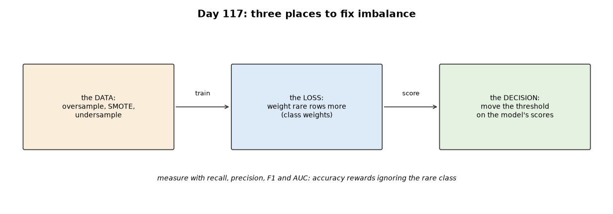
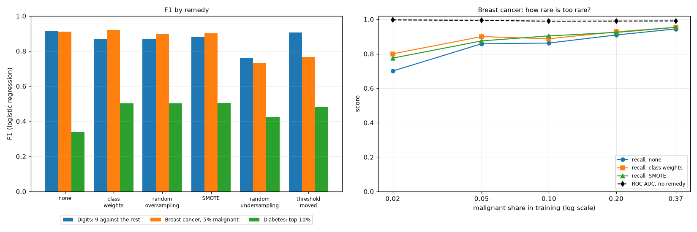

## Day 118 — The Week 17 build: model selection and cross-validation strategies
[`day118_model_selection.py`](day118_model_selection.py) — the week's six exercise parts, pasted in verbatim under banners (a run-time check confirms all 24 of 24 match), become the models: Day 112's SMO with Day 113's RBF kernel, Day 115's kNN and Day 117's metrics. New today: k-fold, stratified and forward-chaining folds, nested CV, and time-series helpers. Data: digits, breast cancer, and two real records from statsmodels' bundled datasets, weekly CO2 at Mauna Loa and yearly sunspots.

- **Stratify on rare classes:** on breast cancer with 19 malignant rows, plain k-fold left 4 of 250 folds with none; stratified folds halve the wobble of the CV F1 (0.0778 to 0.0445).
- **Fewer folds underestimate:** on digits, 2-fold misses the true accuracy by -0.0727 on average, leave-one-out by -0.0093; every estimate is still off by a few points for any one training set.
- **Choosing was not costly here:** the best CV score (0.9726) sat below the chosen model's test accuracy (0.9784), and nested CV lower still (0.9678): the usual optimism did not show.
- **Time series:** for kNN on CO2, shuffled folds report an RMSE of 0.521 ppm, forward-chaining 2.932, and the real future gives 7.232: kNN cannot forecast above anything it has seen.
- **An honest estimate is not a good choice:** forward-chaining chose kNN's k no better than shuffled folds on either series.

Study guide: [`day118_model_selection_complete_guide.pdf`](day118_model_selection_complete_guide.pdf) · Syntax walkthrough: [`day118_syntax_line_by_line.pdf`](day118_syntax_line_by_line.pdf) · [Run output](day118_run_output.txt)

Day 118 is the week's build, so it has no exercise script of its own.

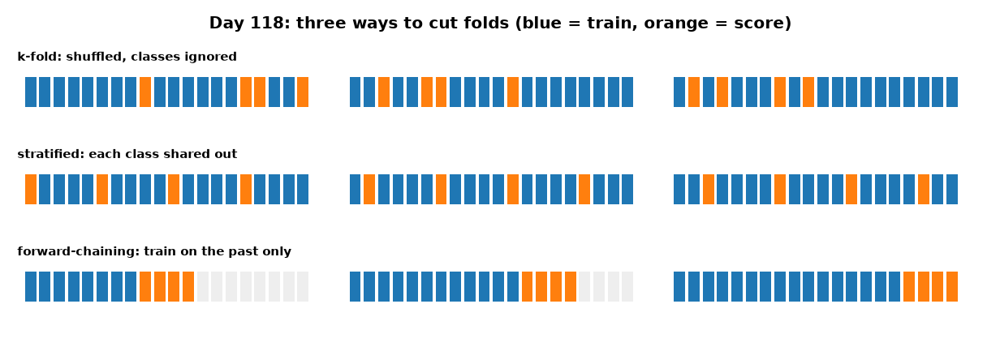
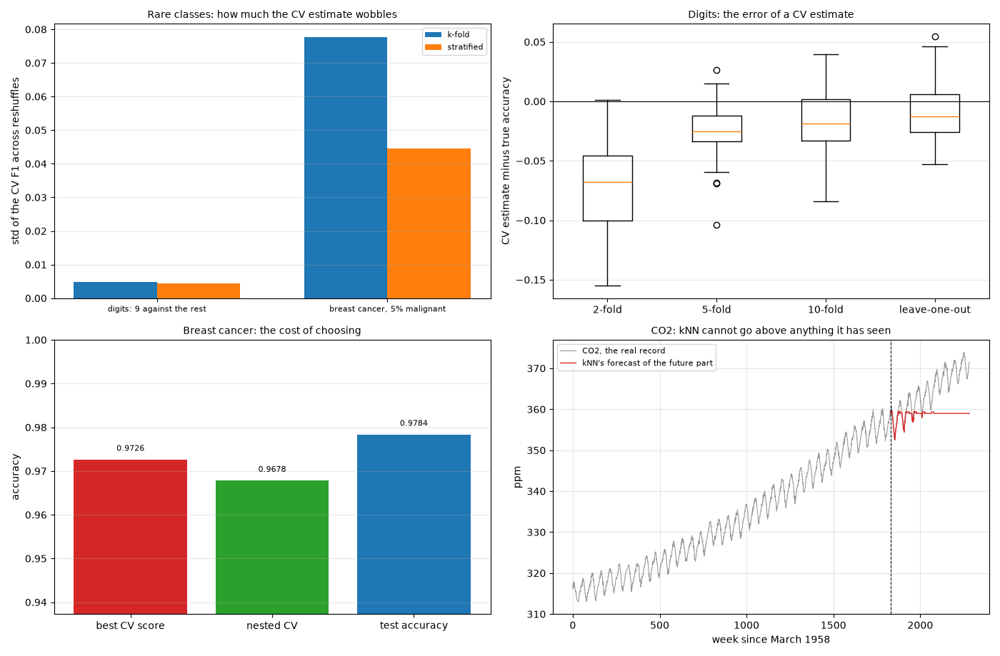

---
[← Back to main README](../README.md)
