# Week 18: Unsupervised Learning I (Days 119–125)

Weeks 16 and 17 covered supervised classical machine learning. Week 18 turns to data without labels: clustering (k-means, hierarchical clustering, DBSCAN, Gaussian mixtures) and dimensionality reduction (PCA, SVD, t-SNE and UMAP). Everything is written from scratch in NumPy on real datasets whose true groups are known, so every clustering can be judged; scikit-learn and SciPy are used only as outside checks. Days 119–124 each get the full-depth lesson plus a short `dayNN_exercise.py` isolating one part, and Day 125 brings the parts together. See [`full_syllabus_days_1_365.md`](../full_syllabus_days_1_365.md) for the week's plan.

## Day 119 — k-means from scratch: the elbow method tested
[`day119_k_means.py`](day119_k_means.py) — Lloyd's loop, random and k-means++ starts with restarts, the silhouette, the adjusted Rand index (ARI) and an automatic elbow, all in NumPy. Data with known groups, used only to judge: iris and wine (standardised) and digits; scikit-learn runs only as an outside check.

- **Checked:** the inertia rose on 0 of 381 steps; the silhouette and ARI match scikit-learn (0.187974, 0.652481). From the same start the two versions end slightly apart (1167803.84 against 1167791.56) because of exact ties at step 1 (two images equally far from two centres); on mean-centred data, as scikit-learn computes it, the result matches exactly.
- **The elbow works twice and fails once:** it finds 3 on iris and wine, but k = 5 on digits, whose true number is 10.
- **k-means++ was no better than random starts here** (mean inertia 1193076 against 1183979); restarts are what help.
- **Scaling decides wine:** ARI 0.3711 raw, 0.8975 standardised.
- **No labels used:** 0.7896 of digit images land in a cluster led by their own digit; k-means fails on curved shapes (two moons, ARI 0.2475).

Study guide: [`day119_k_means_complete_guide.pdf`](day119_k_means_complete_guide.pdf) · Syntax walkthrough: [`day119_syntax_line_by_line.pdf`](day119_syntax_line_by_line.pdf) · [Run output](day119_run_output.txt)

Exercise: [`day119_exercise.py`](day119_exercise.py) is the loop, the ARI, the silhouette and the elbow, checked by hand — the first part of Day 125's build ([run output](day119_exercise_run_output.txt)).

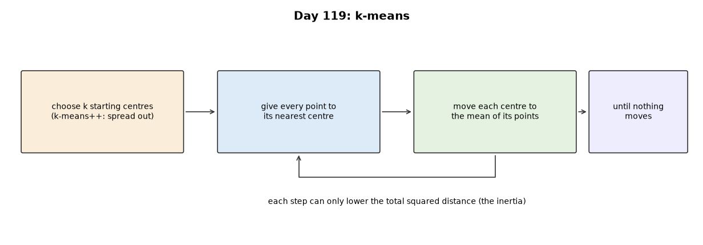
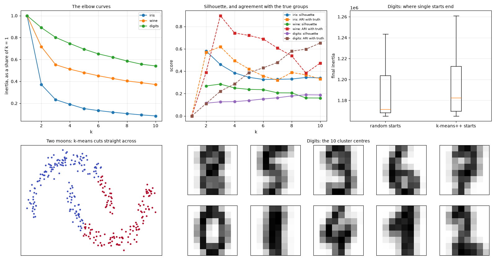

## Day 120 — Hierarchical clustering from scratch: a real dendrogram
[`day120_hierarchical_clustering.py`](day120_hierarchical_clustering.py) — agglomerative clustering with single, complete, average and Ward linkage through one Lance–Williams update, cutting the tree, cophenetic correlation, and the dendrogram laid out and drawn by hand. Data: iris and wine (standardised) and digits, labels used only to judge; SciPy's `linkage` is an outside check, and Day 119's k-means is imported for comparison.

- **Checked:** single, average and Ward match SciPy to 7.0e-15. Complete linkage differed (2.4e-02) because iris has 1631 tied distances; with ties broken by tiny noise all four agree to 1.3e-10.
- **Ward wins everywhere:** ARI 0.6153 on iris, 0.7899 on wine, 0.7940 on digits, where it beats Day 119's k-means (0.6525) despite a higher inertia.
- **Single linkage chains:** cut into 10 clusters, digits gives one cluster of 1788 of 1797 images.
- **The biggest-gap cut** finds 3 on wine but 2 on iris and on digits.
- **Cophenetic correlation does not pick the best cut:** average linkage keeps distances best (0.8544 on iris), Ward clusters best.

Study guide: [`day120_hierarchical_clustering_complete_guide.pdf`](day120_hierarchical_clustering_complete_guide.pdf) · Syntax walkthrough: [`day120_syntax_line_by_line.pdf`](day120_syntax_line_by_line.pdf) · [Run output](day120_run_output.txt)

Exercise: [`day120_exercise.py`](day120_exercise.py) is the merge loop, the cut and the cophenetic heights, checked by hand on five points — the second part of Day 125's build ([run output](day120_exercise_run_output.txt)).

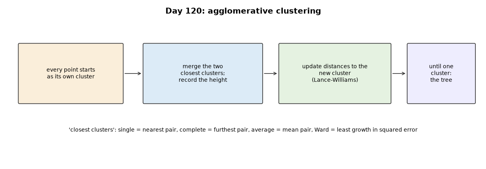
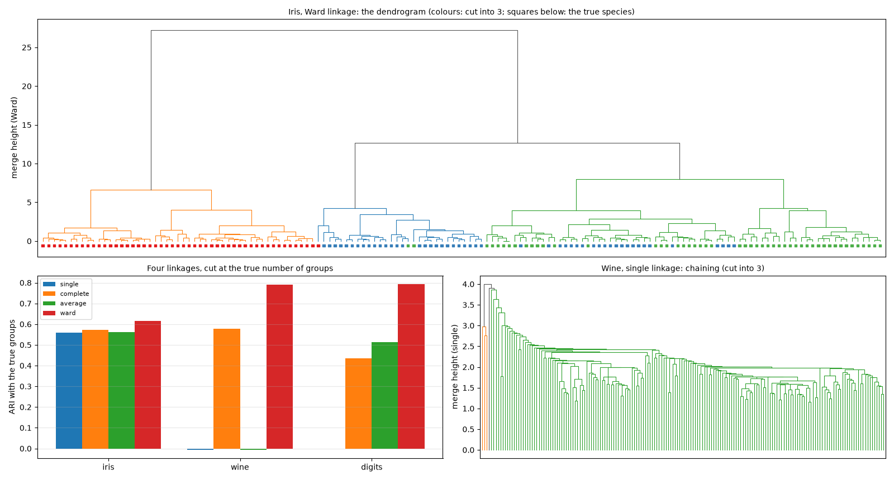

## Day 121 — DBSCAN from scratch: density-based clustering on non-convex data
[`day121_dbscan.py`](day121_dbscan.py) — neighbourhoods within eps, core and border points and noise, cluster growth through core points, and the k-distance curve. Data: shapes made on purpose (two moons, two rings, a wide cluster beside a tight one), the latitude and longitude of 20,640 California census districts (scikit-learn's California housing data, downloaded once and cached outside the repository), and digits. scikit-learn's DBSCAN is an outside check.

- **Checked:** core points and labels identical to scikit-learn on all three test sets, including California's 29 clusters.
- **Shapes k-means cannot draw:** moons and rings recovered exactly (ARI 1.0000), where k-means scores 0.2475 and 0.0039.
- **California's cities, from positions alone:** Los Angeles (7176 districts), San Francisco with San Jose, Oakland separately (the bay keeps them apart), San Diego, Sacramento and Fresno; noise districts' median house value 127,900 against 195,400 inside clusters.
- **The k-distance knee rule chose badly on all three datasets:** eps 0.128 on the moons (ARI 0.4083), 21.53 km on California.
- **One eps for every density:** California's noise share falls from 0.888 to 0.106 as eps grows from 2 to 12 km while Los Angeles swallows its neighbours; on digits the best score (0.5711) stays below Day 119's k-means.

Study guide: [`day121_dbscan_complete_guide.pdf`](day121_dbscan_complete_guide.pdf) · Syntax walkthrough: [`day121_syntax_line_by_line.pdf`](day121_syntax_line_by_line.pdf) · [Run output](day121_run_output.txt)

Exercise: [`day121_exercise.py`](day121_exercise.py) is the neighbourhoods, DBSCAN and the k-distance, checked by hand on eleven points — the third part of Day 125's build ([run output](day121_exercise_run_output.txt)).

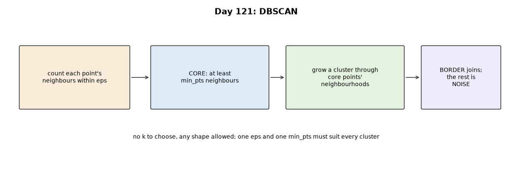
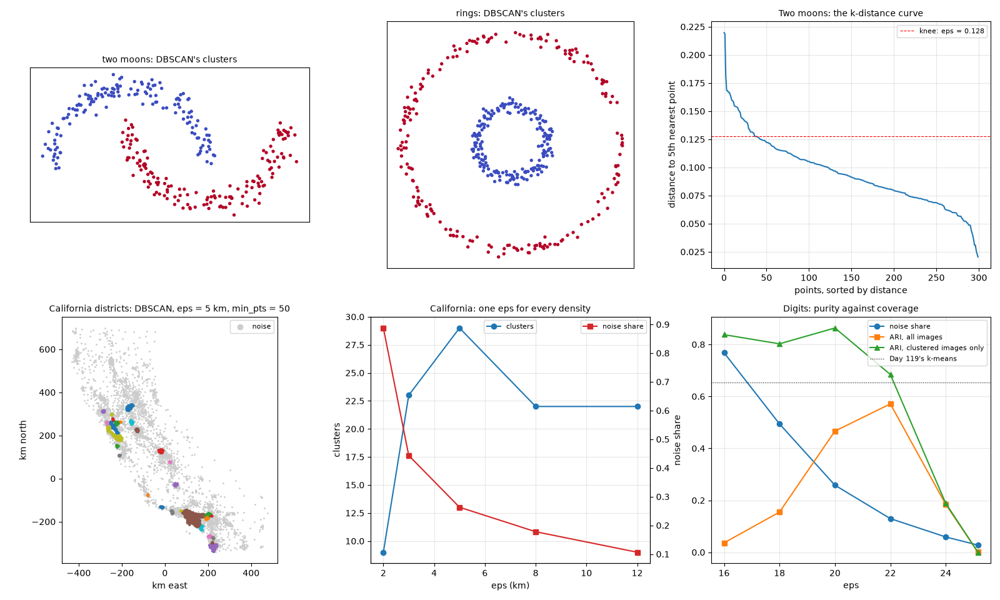

## Day 122 — Gaussian mixture models and the EM algorithm from scratch
[`day122_gmm_em.py`](day122_gmm_em.py) — the Gaussian log-density through a Cholesky factor, log-sum-exp, the E and M steps with full, diagonal or spherical covariances, EM started from Day 119's k-means, and BIC. Data: iris, wine and digits (labels used only to judge) and Day 121's shapes; scikit-learn's GaussianMixture is an outside check.

- **Checked:** the log-likelihood fell on 0 of 3454 EM steps; from the same start, the mean log-likelihood matches scikit-learn (-1.936874) and the labels agree exactly.
- **Where a mixture beats k-means:** iris 0.9039 against 0.6201, a wide cluster beside a tight one 0.8988 against 0.2036; moons defeat both (0.2755).
- **Soft assignments mean something:** of the 131 flowers it is at least 99% sure about, 0.985 are right; below 90%, 2 of 3.
- **BIC chose the wrong k:** 2 for both iris and wine (true 3); wine's full model needs 314 parameters for 178 rows.
- **Digits need a ridge:** 3 pixels never change, so full covariances fail without one; held-out likelihood prefers a ridge of 0.01, agreement with the digits prefers 10 (0.7510).

Study guide: [`day122_gmm_em_complete_guide.pdf`](day122_gmm_em_complete_guide.pdf) · Syntax walkthrough: [`day122_syntax_line_by_line.pdf`](day122_syntax_line_by_line.pdf) · [Run output](day122_run_output.txt)

Exercise: [`day122_exercise.py`](day122_exercise.py) is the density, log-sum-exp and the E and M steps, each checked against a formula — the fourth part of Day 125's build ([run output](day122_exercise_run_output.txt)).

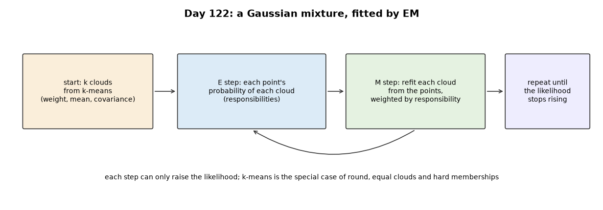
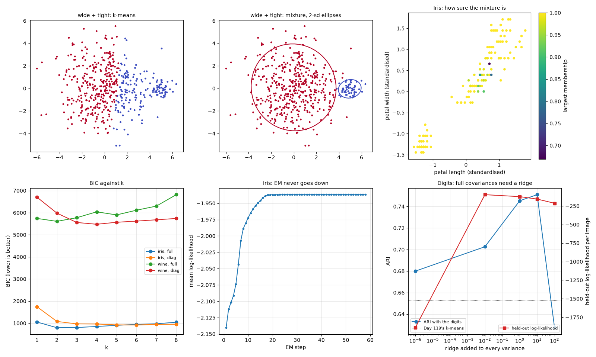

## Day 123 — PCA from scratch: variance explained
[`day123_pca.py`](day123_pca.py) — the covariance matrix and its eigenvectors, power iteration with deflation, projection, reconstruction and the variance each component explains. Data: digits, breast cancer and wine; Day 115's kNN and Day 119's k-means are imported, and scikit-learn's PCA is an outside check.

- **Checked:** shares match scikit-learn to 8.3e-17; power iteration finds the same components, in steps that follow the eigenvalue ratios exactly ([295, 180, 84, 73, 155] for ratios [0.915, 0.866, 0.713, 0.688, 0.85]).
- **Variance explained:** digits need 21 of 64 components for 90%; breast cancer's 30 measurements need 7.
- **Reconstruction:** the error equals the variance of the dropped components at every k, to four decimals.
- **Scaling decides:** raw wine's first component is proline alone (0.9981 of the variance); standardised, k-means on two components goes from 0.3711 to 0.8951.
- **Most variance is not most useful:** kNN on 10 components scores 0.9778 against 0.9907 on all 64; but with the signal in a low-variance direction, the first component gives 0.5250 and the second 1.0000.

Study guide: [`day123_pca_complete_guide.pdf`](day123_pca_complete_guide.pdf) · Syntax walkthrough: [`day123_syntax_line_by_line.pdf`](day123_syntax_line_by_line.pdf) · [Run output](day123_run_output.txt)

Exercise: [`day123_exercise.py`](day123_exercise.py) is the fit, projection, reconstruction and power iteration, checked by hand — the fifth part of Day 125's build ([run output](day123_exercise_run_output.txt)).

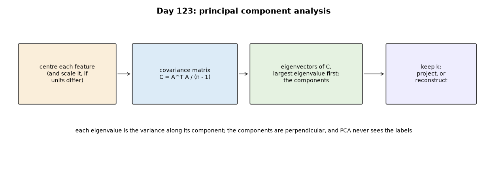
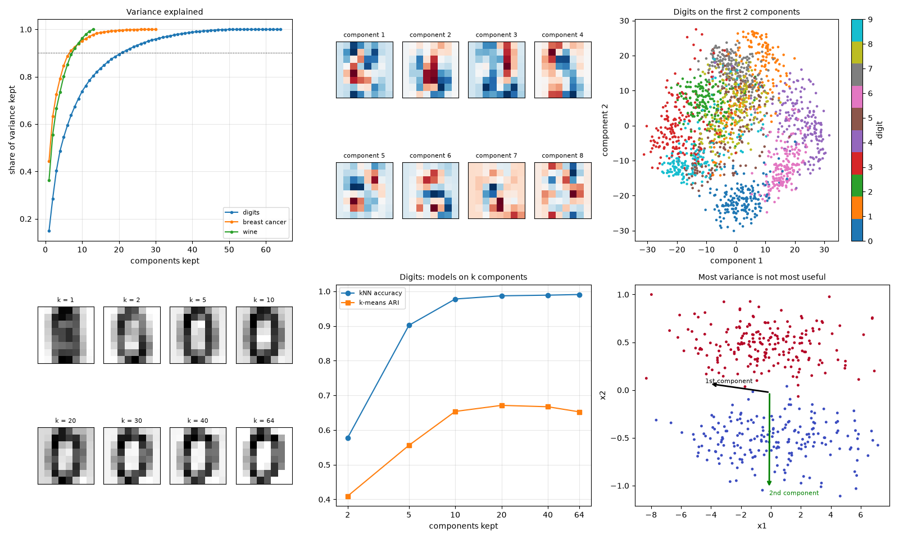

## Day 124 — The SVD and its relationship to PCA: a real matrix-factorization demonstration
[`day124_svd.py`](day124_svd.py) — the SVD through the eigenvectors of AᵀA and by power iteration on A and Aᵀ, the rank-k approximation, low-rank matrix completion, and least squares through the pseudoinverse. Data: digits, Diabetes, and a real photograph bundled with scikit-learn (china.jpg, in grey); np.linalg.svd and lstsq are the checks.

- **SVD is PCA:** on centred digits, s²/(n − 1) matches Day 123's eigenvalues to 3.4e-13, without forming the covariance matrix.
- **Squaring costs precision:** through AᵀA, the 12 × 12 Hilbert matrix's 9th singular value is off by 2.7e+01 times its own size, and the 11th and 12th become 0.
- **A photograph at rank 20:** 0.078 of the numbers, error 0.1364, exactly the size of the dropped singular values (Eckart–Young).
- **Half the pixels hidden:** a rank-10 fill recovers them with error 0.1223, against 0.3069 for column means; ranks 20 and above never settle and get worse the longer they run.
- **Least squares:** the pseudoinverse matches lstsq (1.4e-12); the smallest singular value (0.0793) belongs to two blood measurements correlated at 0.890, and dropping it tames the coefficients.

Study guide: [`day124_svd_complete_guide.pdf`](day124_svd_complete_guide.pdf) · Syntax walkthrough: [`day124_syntax_line_by_line.pdf`](day124_syntax_line_by_line.pdf) · [Run output](day124_run_output.txt)

Exercise: [`day124_exercise.py`](day124_exercise.py) is the five SVD tools, each checked on a case with a known answer — the sixth part of Day 125's build ([run output](day124_exercise_run_output.txt)).

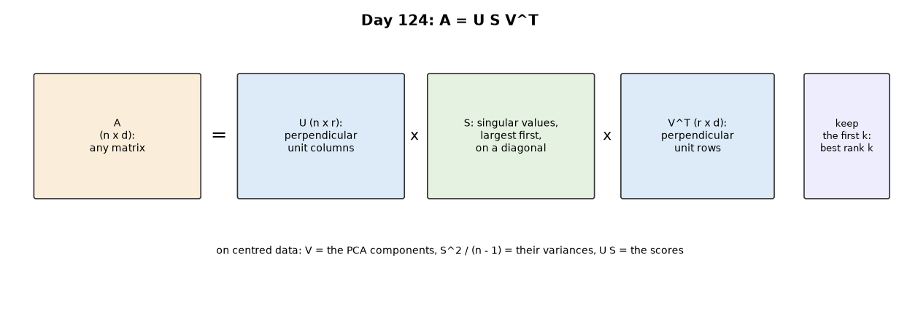
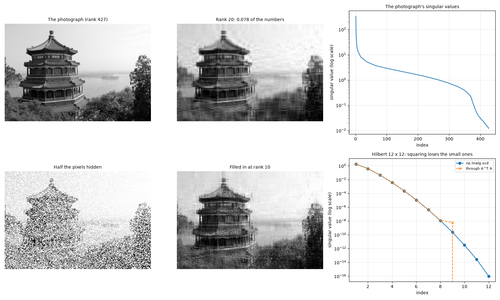

## Day 125 — The Week 18 build: t-SNE and UMAP from scratch
[`day125_tsne_umap.py`](day125_tsne_umap.py) — the week's six exercise parts, pasted in verbatim under banners (a run-time check confirms all 26 of 26 match), with t-SNE (perplexity calibration, early exaggeration, momentum and gains) and a compact UMAP (fuzzy k-nearest-neighbour graph, fitted curve, spectral start) written today. PCA (Day 123) starts t-SNE; k-means, Ward, a Gaussian mixture and DBSCAN (Days 119–122) cluster the maps. Data: the digits, and random points made on purpose; scikit-learn's t-SNE and the umap-learn library are outside checks.

- **Checked:** every perplexity calibrated to 30.0000; the t-SNE gradient matches finite differences to 2.7e-10; KL 0.6833 against scikit-learn's 0.6800; UMAP trustworthiness 0.9880 against umap-learn's 0.9888.
- **What each map keeps:** t-SNE and UMAP keep neighbourhoods (trustworthiness 0.9926 and 0.9880) where PCA does not (0.8300); distances between the digit groups were kept best by t-SNE (0.8232) and PCA (0.8195), worse by umap-learn (0.5720).
- **Clustering the maps with the week's parts:** k-means scores 0.8908 on the t-SNE map against 0.6495 on ten PCA components; DBSCAN goes from 0.0001 to 0.8811.
- **Perplexity changes the picture:** 5 fragments the digits (k-means 0.8204), 30 was best here.
- **Pure noise:** t-SNE drew an even disc, not clusters; its silhouette (0.3531) is close to PCA's flat picture of the same points (0.3232).

Study guide: [`day125_tsne_umap_complete_guide.pdf`](day125_tsne_umap_complete_guide.pdf) · Syntax walkthrough: [`day125_syntax_line_by_line.pdf`](day125_syntax_line_by_line.pdf) · [Run output](day125_run_output.txt)

Day 125 is the week's build, so it has no exercise script of its own.

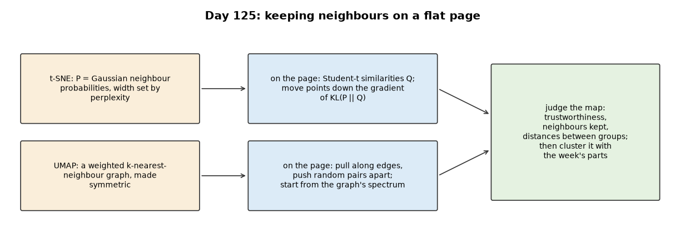
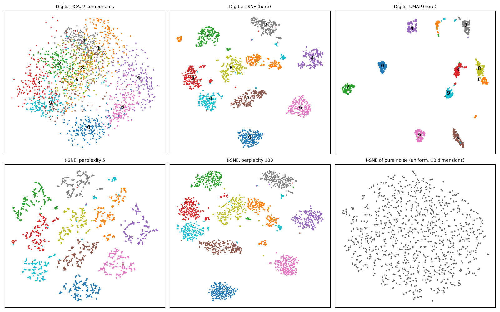

---
[← Back to main README](../README.md)
