# Week 19: Unsupervised Learning II — Autoencoders (Days 126–132)

Week 18 found structure in data without labels: clusters and low-dimensional maps. Week 19 learns it with neural networks trained to rebuild their own input: autoencoders, denoising autoencoders, anomaly detection by reconstruction error, and variational autoencoders that can generate new data. Everything is written from scratch in NumPy, on MNIST (70,000 real handwritten digits, fetched once from openml.org and cached outside the repository). Days 126–131 each get the full-depth lesson plus a short `dayNN_exercise.py` isolating one part, and Day 132 brings the parts together. See [`full_syllabus_days_1_365.md`](../full_syllabus_days_1_365.md) for the week's plan.

## Day 126 — Autoencoders from scratch: a real reconstruction demonstration
[`day126_autoencoders.py`](day126_autoencoders.py) — dense layers, ReLU, backpropagation through the whole stack, cross-entropy and squared-error losses, Adam and minibatch training, all in NumPy. Data: MNIST (70,000 handwritten digits, fetched once from openml.org and cached outside the repository); labels used only to judge. Day 123's PCA and Day 119's k-means are imported.

- **Checked:** backpropagation matches finite differences to 1.5e-09 and 2.2e-09 over all 77 parameters.
- **A linear autoencoder rediscovers PCA:** 0.01707 per pixel against PCA's 0.01689, its subspace within cosines 0.9878 to 0.9999 of PCA's.
- **With ReLU it beats PCA at every code size:** 0.00731 against 0.01689 with 32 numbers.
- **Little data, memorised:** on 1,000 images, training error 0.00161 against test 0.01827.
- **Not automatically better features, and a code space with gaps:** kNN on the codes 0.9155 against PCA's 0.9170; decoded random codes sit 0.2193 from real images, decoded real codes 0.1504.

Study guide: [`day126_autoencoders_complete_guide.pdf`](day126_autoencoders_complete_guide.pdf) · Syntax walkthrough: [`day126_syntax_line_by_line.pdf`](day126_syntax_line_by_line.pdf) · [Run output](day126_run_output.txt)

Exercise: [`day126_exercise.py`](day126_exercise.py) is the network's machinery, checked by hand: gradients, a line rediscovered, a falling loss — the first part of Day 132's build ([run output](day126_exercise_run_output.txt)).

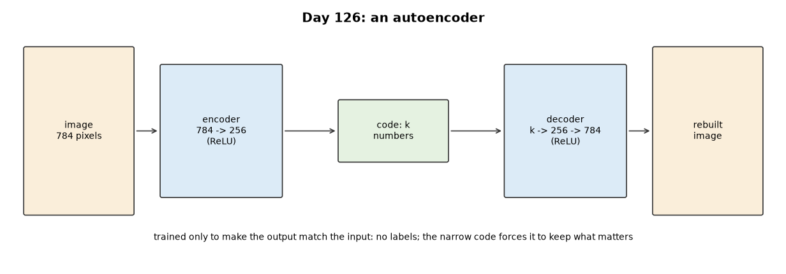
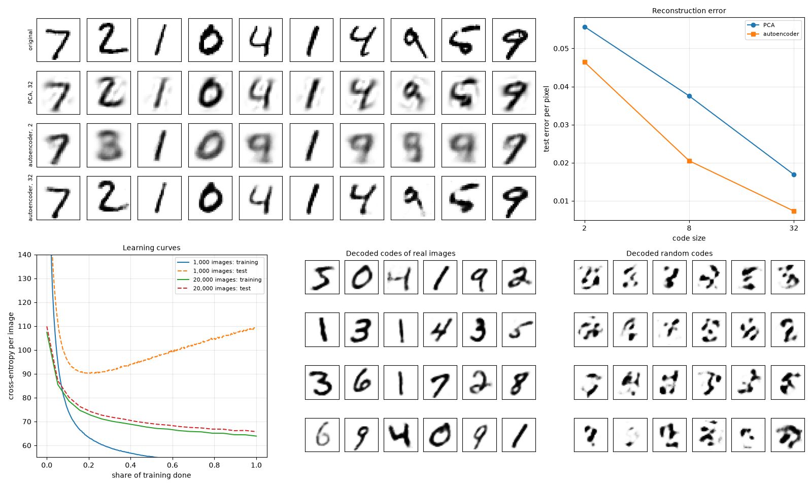

## Day 127 — Denoising autoencoders: a real noise-removal demonstration
[`day127_denoising_autoencoders.py`](day127_denoising_autoencoders.py) — Gaussian noise, masking and hidden squares, PSNR, a 3 × 3 median filter and PCA as baselines, and Day 126's network trained to turn damaged MNIST images back into clean ones (damage passed through its noise hook).

- **On the damage it trained for, the denoiser wins:** Gaussian σ 0.3: 19.25 dB, against 17.55 for the median filter, 16.42 for PCA and 13.32 untouched; the plain autoencoder makes it worse (12.93).
- **Light noise is better left alone:** at σ 0.1 the untouched image (22.65 dB) beats every denoiser.
- **The wrong damage can hurt:** the masking denoiser on Gaussian noise scores 9.45 dB, below doing nothing.
- **Robust codes:** kNN on noisy test images' codes: denoiser 0.9090, plain autoencoder 0.2815.
- **Hidden squares:** filled only modestly (error 0.4354 against 0.5492 blank).

Study guide: [`day127_denoising_autoencoders_complete_guide.pdf`](day127_denoising_autoencoders_complete_guide.pdf) · Syntax walkthrough: [`day127_syntax_line_by_line.pdf`](day127_syntax_line_by_line.pdf) · [Run output](day127_run_output.txt)

Exercise: [`day127_exercise.py`](day127_exercise.py) is the three kinds of damage, PSNR and the median filter, checked by hand — the second part of Day 132's build ([run output](day127_exercise_run_output.txt)).

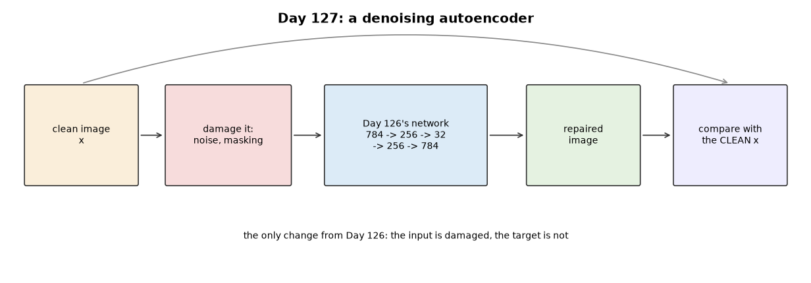
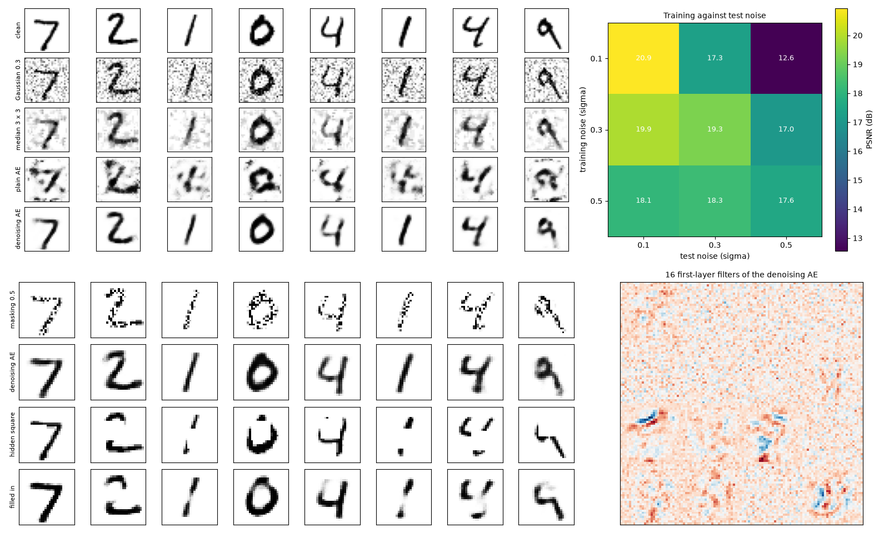

## Day 128 — Anomaly detection with autoencoders: real reconstruction-error thresholds
[`day128_anomaly_detection.py`](day128_anomaly_detection.py) — Day 126's network trained on normal data only; reconstruction error, PCA error and nearest-neighbour distance as anomaly scores; thresholds set on held-out normal data at a chosen false-alarm rate; Day 117's ROC AUC and average precision. Data, all real: MNIST with one digit held out as the anomaly, and breast-cancer measurements with the model trained on benign tumours only.

- **9s held out: barely better than chance** (ROC AUC 0.5490); PCA 0.4825; the plain nearest-neighbour distance does best (0.6754).
- **It depends on the digit:** from 0.9123 (2s held out) to 0.2375 (1s, rebuilt better than the normal digits).
- **Thresholds keep their promise on held-out normal data:** 5% aimed, 0.0409 delivered; set on training images instead, 0.0858.
- **Contamination ruins it:** with 5% of 9s hidden in the training data the AUC falls to 0.4368.
- **Tumours, where it works:** autoencoder 0.9288, but PCA 0.9366 and nearest neighbour 0.9450 do as well.

Study guide: [`day128_anomaly_detection_complete_guide.pdf`](day128_anomaly_detection_complete_guide.pdf) · Syntax walkthrough: [`day128_syntax_line_by_line.pdf`](day128_syntax_line_by_line.pdf) · [Run output](day128_run_output.txt)

Exercise: [`day128_exercise.py`](day128_exercise.py) is the three scores, the threshold and its rates, checked by hand — the third part of Day 132's build ([run output](day128_exercise_run_output.txt)).

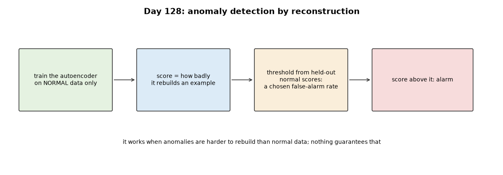
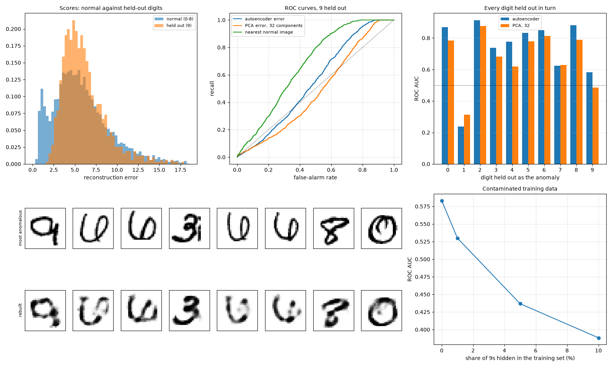

## Day 129 — Variational autoencoders: the reparameterization trick from scratch
[`day129_vae_reparameterization.py`](day129_vae_reparameterization.py) — z = μ + σε, the Gaussian KL divergence, the VAE loss (negative ELBO) with backpropagation through the draw, and the score-function (REINFORCE) estimator for comparison; Day 126's network parts do the arithmetic. Data: one-dimensional Gaussians with known answers, and MNIST.

- **Checked:** the KL formula against a million-draw estimate (1.3069 against 1.3041, standard error 0.0029); a gradient check through a whole VAE (3.1e-09 over 110 parameters).
- **Both estimators are unbiased; the trick is far less noisy:** one-draw spread 14.85 for the score function against 1.99.
- **Learning a Gaussian with a known answer:** at step 0.01 the score function blew up in 3 of 20 runs and the trick in none; at step 0.001 the trick landed about three times closer.
- **A real VAE, 10 epochs on MNIST:** loss 155.95 to 115.14 nats per image; reconstruction falls while the KL rises (16.91 to 22.16).

Study guide: [`day129_vae_reparameterization_complete_guide.pdf`](day129_vae_reparameterization_complete_guide.pdf) · Syntax walkthrough: [`day129_syntax_line_by_line.pdf`](day129_syntax_line_by_line.pdf) · [Run output](day129_run_output.txt)

Exercise: [`day129_exercise.py`](day129_exercise.py) is the trick, the KL term, the VAE loss and both estimators, checked by hand — the fourth part of Day 132's build ([run output](day129_exercise_run_output.txt)).

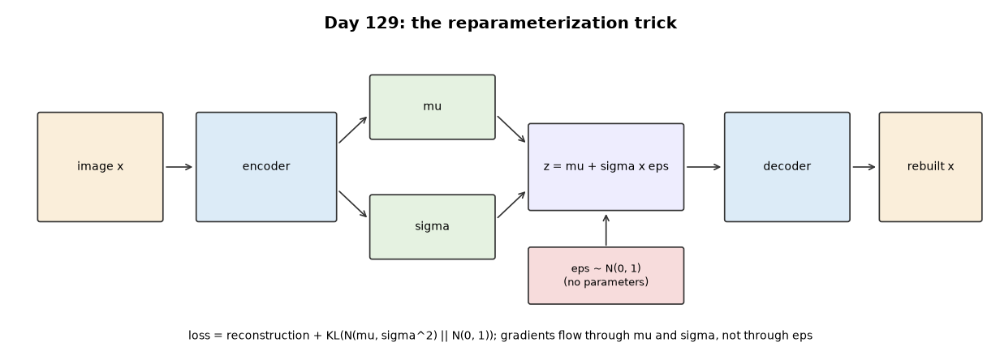
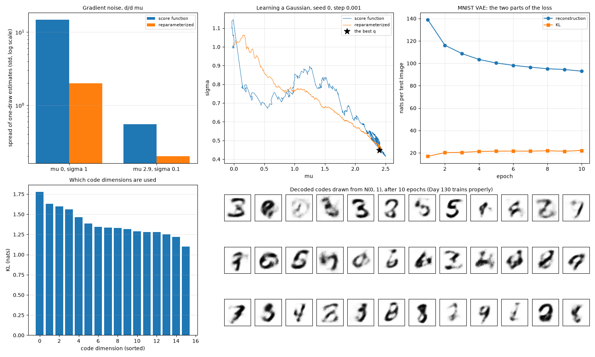

## Day 130 — Training a VAE, and a real latent-space visualisation
[`day130_vae_latent_space.py`](day130_vae_latent_space.py) — Day 129's VAE trained for 30 epochs on MNIST and compared with Day 126's plain autoencoder: encoding, decoding, sampling from N(0, 1), interpolation, a two-dimensional code map, active dimensions and a β sweep.

- **Almost the same reconstructions:** VAE 0.01236 per pixel, plain autoencoder 0.01212; test loss 109.11 nats = reconstruction 85.27 + KL 23.84.
- **A code space you can sample:** decoded N(0, 1) codes sit 0.1857 from the nearest real digit, against 0.2048 for the plain autoencoder's random codes and 0.1743 for real images.
- **The whole digit space on one page:** a 2-code VAE maps the test digits into regions; kNN on just those two numbers scores 0.5291.
- **β trades reconstruction for a smaller KL:** β = 4 gives KL 9.38 and reconstruction 116.77; its blurrier samples score 0.1695, which shows that nearest-image distance rewards blur.

Study guide: [`day130_vae_latent_space_complete_guide.pdf`](day130_vae_latent_space_complete_guide.pdf) · Syntax walkthrough: [`day130_syntax_line_by_line.pdf`](day130_syntax_line_by_line.pdf) · [Run output](day130_run_output.txt)

Exercise: [`day130_exercise.py`](day130_exercise.py) is encoding, decoding, sampling, interpolation and the two judging tools, checked by hand — the fifth part of Day 132's build ([run output](day130_exercise_run_output.txt)).

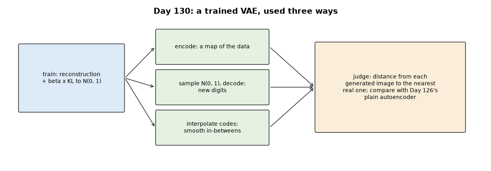
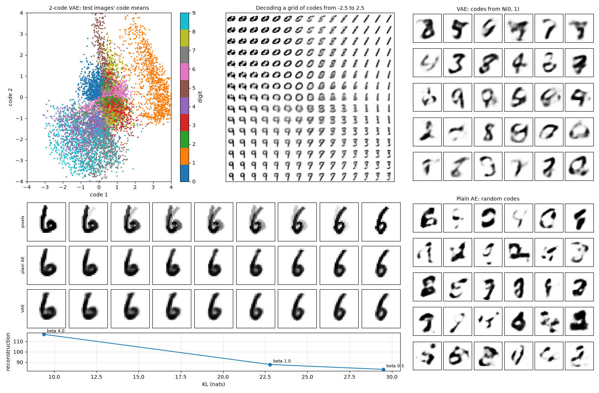

## Day 131 — Contrastive learning basics: a real positive/negative pair demonstration
[`day131_contrastive_learning.py`](day131_contrastive_learning.py) — SimCLR-style contrastive learning from scratch: random views of each image (rotation, shift, erasing, noise, for a whole batch at once), the NT-Xent loss with its gradient derived by hand, and a network 784 → 256 → 128 → 64 trained on 20,000 unlabelled MNIST images. The 128-number layer is judged with linear probes (Day 116) using few labels.

- **Checked:** the loss by hand (1.8680) and its gradient against finite differences through a whole network (3.0e-10).
- **The views are not alike in pixels:** two views of one image have cosine 0.4232, barely above different images' 0.3536; after training, 0.7997 against 0.0174 on test images.
- **Best with few labels:** with 10 labels per digit, a linear probe scores 0.8157, against 0.6078 for raw pixels and 0.7100 for Day 126's autoencoder code; with 100 per digit, 0.9311.
- **Temperature depends on the use:** τ = 0.1 is best with 100 labels per digit (0.9311), τ = 0.5 with 10 (0.8437).
- **The views decide the result:** noise alone gives 0.5800 with 10 labels per digit, below raw pixels; adding shift and rotation lifts it to 0.8111.

Study guide: [`day131_contrastive_learning_complete_guide.pdf`](day131_contrastive_learning_complete_guide.pdf) · Syntax walkthrough: [`day131_syntax_line_by_line.pdf`](day131_syntax_line_by_line.pdf) · [Run output](day131_run_output.txt)

Exercise: [`day131_exercise.py`](day131_exercise.py) is the views, the loss, training and the representation, checked by hand — the sixth part of Day 132's build ([run output](day131_exercise_run_output.txt)).

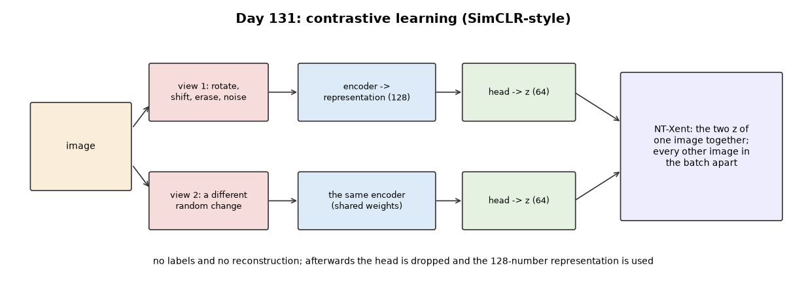
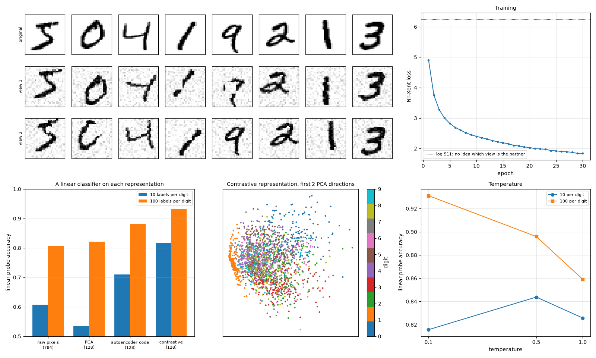

---
[← Back to main README](../README.md)
