# Week 20: Generative Models — GANs (Days 133–139)

Week 19 learned representations of images without labels, and its variational autoencoder could already draw new ones. Week 20 is about generating data: what a generative model is, as against a discriminative one, then generative adversarial networks (a generator and a discriminator trained against each other), their instability, and how to judge what they make. Everything is written from scratch in NumPy, on MNIST (cached by Day 126) and small datasets whose true distribution is known. Days 133–138 each get the full-depth lesson plus a short `dayNN_exercise.py` isolating one part, and Day 139 brings the parts together. See [`full_syllabus_days_1_365.md`](../full_syllabus_days_1_365.md) for the week's plan.

## Day 133 — Generative vs discriminative models: a real conceptual comparison
[`day133_generative_vs_discriminative.py`](day133_generative_vs_discriminative.py) — Gaussian class models from scratch (naive Bayes, LDA with one shared covariance, QDA with one per class, all through Cholesky factors) against logistic regression (Day 116's softmax regression), on MNIST and scikit-learn's bundled breast-cancer table: learning curves, and the three things only the generative model can do.

- **The same family, two routes:** LDA's posterior is exactly a softmax of linear scores (checked to 8.0e-14); on all 784 pixels LDA scores 0.8798, logistic regression 0.8917, but logistic regression is the more overconfident (log-loss 0.9116 against 0.5019).
- **Little data against a lot:** on MNIST (50 PCA numbers) LDA has the lower error up to 300 images (0.2922 against 0.3702 at 100), the two are level at 1,000, and logistic regression wins from 3,000 (0.0913 against 0.1278 at 60,000).
- **Generating:** digits drawn from QDA are recognised 0.8620 of the time, as often as real digits squeezed through the same 50 numbers (0.8600); with too much regularisation (1.0), samples of 1 were recognised only 0.01 of the time.
- **Half of every image hidden:** LDA, leaving the hidden pixels out, scores 0.7771; logistic regression with them filled with zeros, 0.3923.
- **Knowing what it does not know:** log p(x) separates random noise from digits perfectly (AUC 1.0000), while logistic regression is 1.0000 confident on noise.

Study guide: [`day133_generative_vs_discriminative_complete_guide.pdf`](day133_generative_vs_discriminative_complete_guide.pdf) · Syntax walkthrough: [`day133_syntax_line_by_line.pdf`](day133_syntax_line_by_line.pdf) · [Run output](day133_run_output.txt)

Exercise: [`day133_exercise.py`](day133_exercise.py) is the Gaussian class models (fit, Bayes' rule, marginals, log p(x), sampling), checked by hand — the first part of Day 139's build ([run output](day133_exercise_run_output.txt)).

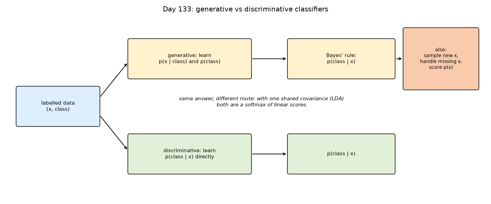
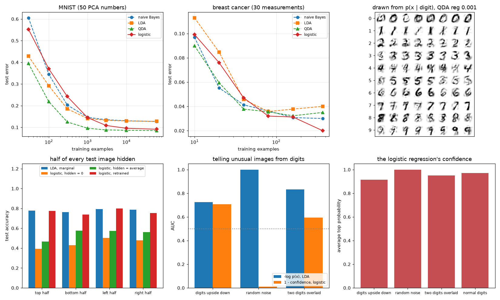

## Day 134 — A GAN from scratch: generator and discriminator, a real minimax training loop
[`day134_gan_from_scratch.py`](day134_gan_from_scratch.py) — a generator and a discriminator written from scratch on Day 126's network parts, trained against each other on a 1-D two-peaked data set (whose density is known) and on MNIST, and watched during training rather than only at the end.

- **Checked three ways:** the losses at D = 0.5 match 2 log 2 and log 2 by hand; the generator's gradient, which flows back through the discriminator, matches finite differences (worst relative error 4.2e-07); a trained discriminator lands within 0.0562 of the optimal D* = p_data / (p_data + p_g), and the game's value matches −log 4 + 2 JSD (-0.6537).
- **Why the non-saturating loss:** when the discriminator is sure a fake is fake, log(1 − D) sends back -0.0025 per fake and −log D sends -0.9975.
- **The 1-D game:** two of five seeds sat on one peak for 1,000 to 3,000 steps before finding the other; after that the distance to the data kept moving between 0.104 and 0.709 instead of settling.
- **MNIST, one setting apart:** with Adam's usual momentum (b1 0.9) some digits were never generated and the commonest took 0.630 of the samples; with b1 0.5 all ten digits appear by epoch 10, and the samples are 5.74 from their nearest training image (a real test digit: 4.49), so they are not copies.

Study guide: [`day134_gan_from_scratch_complete_guide.pdf`](day134_gan_from_scratch_complete_guide.pdf) · Syntax walkthrough: [`day134_syntax_line_by_line.pdf`](day134_syntax_line_by_line.pdf) · [Run output](day134_run_output.txt)

Exercise: [`day134_exercise.py`](day134_exercise.py) is the GAN's parts (Adam with a momentum setting, both losses, the generator, its gradient through the discriminator, one round of the game), checked by hand — the second part of Day 139's build ([run output](day134_exercise_run_output.txt)).

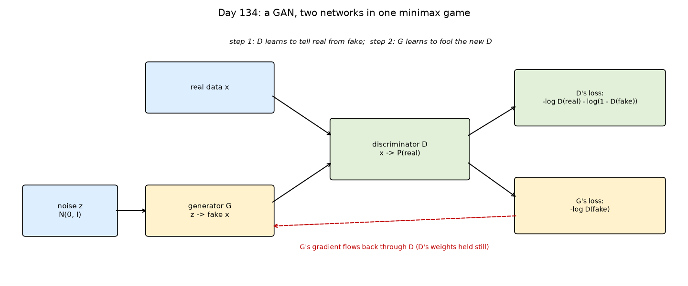
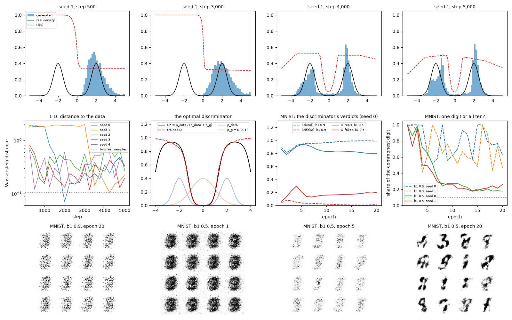

## Day 135 — GAN training instability: a real, honest mode-collapse demonstration
[`day135_gan_instability.py`](day135_gan_instability.py) — Day 134's GAN on eight tight Gaussians on a circle, where every mode is known, watched every 250 steps: how many modes the generator covers and how many of its samples are good, over five seeds, two generator losses, a discriminator head start and three imbalances between the players.

- **Collapse with the usual settings:** the non-saturating loss covered all 8 modes in 1 of 5 seeds; the others missed 1 to 3 modes while their samples stayed good (good share 0.91 to 0.95).
- **The textbook loss lost:** with equal learning rates the minimax loss covered all 8 modes in 5 of 5 seeds. Its known weakness (a gradient of about D(fake), 999 times smaller than the non-saturating one at D(fake) = 0.001) appears once the discriminator gets a 1,000-step head start: good share down to 0.06, modes lost up to 25 times; the non-saturating loss then collapses onto 3 modes in three seeds.
- **Balance matters:** a discriminator ten times slower than the generator gave good shares of 0.07 to 0.08; none of the nine imbalanced runs covered all 8 modes.

Study guide: [`day135_gan_instability_complete_guide.pdf`](day135_gan_instability_complete_guide.pdf) · Syntax walkthrough: [`day135_syntax_line_by_line.pdf`](day135_syntax_line_by_line.pdf) · [Run output](day135_run_output.txt)

Exercise: [`day135_exercise.py`](day135_exercise.py) is the ring, the mode count and the watched training loop, checked by hand — the third part of Day 139's build ([run output](day135_exercise_run_output.txt)).

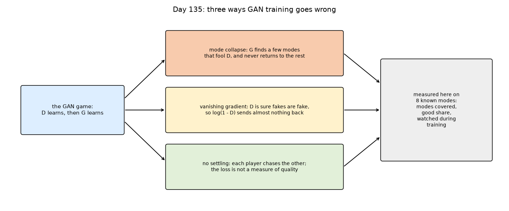
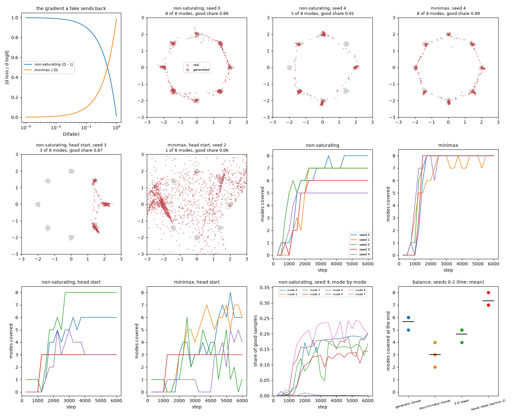

## Day 136 — A DCGAN-style convolutional GAN, on MNIST and the junction dataset
[`day136_dcgan.py`](day136_dcgan.py) — Day 134's GAN rebuilt from convolutions, all from scratch: strided convolutions shrink the image in the discriminator, transposed convolutions with batch normalisation grow it in the generator. The transposed convolution is checked as the convolution's adjoint (relative gap 6.7e-16), and kernel 4 at stride 2 gives every inner pixel the same number of contributions, where kernel 3 gives 1, 2 or 4.

- **MNIST, 20 epochs, two seeds:** with about the same number of generator weights, the DCGAN spread its output over the digits a little more evenly than the dense GAN (commonest digit 0.151 and 0.158 against 0.177 and 0.261) and matched the real digits' smoothness (pixel jump 0.0625 against real 0.0650), at about 20 to 27 times the training time.
- **Without batch normalisation:** both seeds collapsed onto one featureless image for several epochs (commonest digit 1.000, pixel jump 0.0002); seed 0 never recovered.
- **Junctions, an exact check:** on Week 7's junction images, where a generated image can be matched against all 375 perfect junctions, neither GAN learned the task in 100 epochs: at most 0.024 (dense) and 0.058 (DCGAN) of samples were valid, against 0.990 of real images, and never with 3 or 4 arms.

Study guide: [`day136_dcgan_complete_guide.pdf`](day136_dcgan_complete_guide.pdf) · Syntax walkthrough: [`day136_syntax_line_by_line.pdf`](day136_syntax_line_by_line.pdf) · [Run output](day136_run_output.txt)

Exercise: [`day136_exercise.py`](day136_exercise.py) is the convolutional machinery (im2col, col2im, Conv, ConvT, batch normalisation, the layer stack, both players and one round of the game), checked by hand — the fourth part of Day 139's build ([run output](day136_exercise_run_output.txt)).

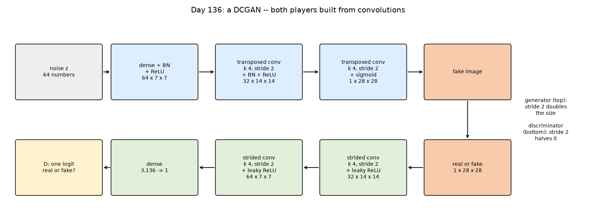
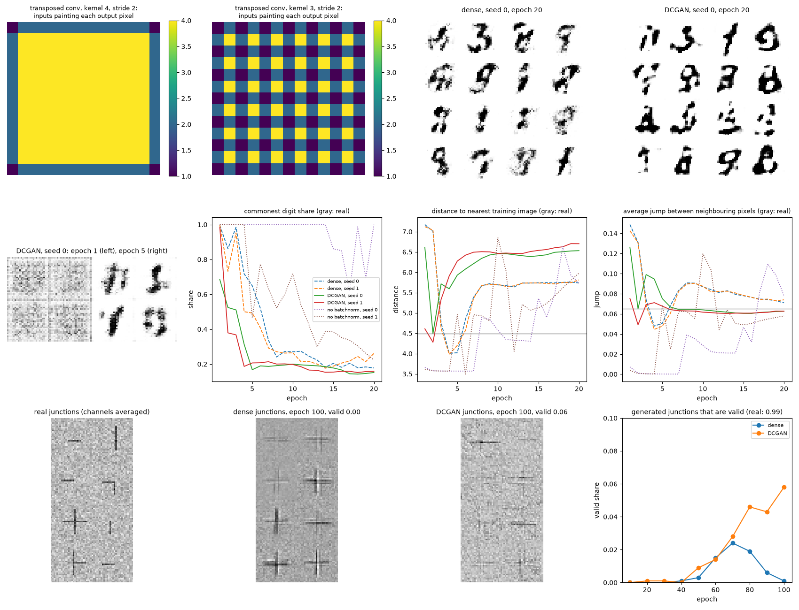

## Day 137 — Conditional GANs: real class-conditional generation
[`day137_conditional_gan.py`](day137_conditional_gan.py) — Day 136's DCGAN given the label as well as the noise: the generator reads 64 noise numbers and a one-hot label (74 inputs), and the discriminator reads the image with ten label planes (11 channels), so a good image with the wrong label counts as fake. The gradient through the joined input is checked by finite differences (worst relative error 3.9e-08).

- **Does it draw the digit it is asked for?** After 20 epochs a softmax-regression judge names the asked-for digit in 0.793 and 0.788 of the generated images (two seeds), against 0.864 for real test digits (the first 2,000 test images, which Day 138 later found are not a random sample). 9 is drawn as 7 or 4 most often.
- **The discriminator checks the label:** real test digits score 0.634 with their true label and 0.373 with a wrong one.
- **The label given to the generator only:** the share drawn as asked stays at chance (0.105 at epoch 20): nothing in the game rewards obeying the label.
- **The noise carries the style:** one noise vector drawn as all ten digits keeps its ink and slant (correlations 0.828 and 0.669 across digits, against -0.014 and 0.032 with the noise shuffled).

Study guide: [`day137_conditional_gan_complete_guide.pdf`](day137_conditional_gan_complete_guide.pdf) · Syntax walkthrough: [`day137_syntax_line_by_line.pdf`](day137_syntax_line_by_line.pdf) · [Run output](day137_run_output.txt)

Exercise: [`day137_exercise.py`](day137_exercise.py) holds the label's parts (the one-hot label, the two joined inputs, the players with room for the label, the conditional round and the variety measure), checked by hand — the fifth part of Day 139's build ([run output](day137_exercise_run_output.txt)).

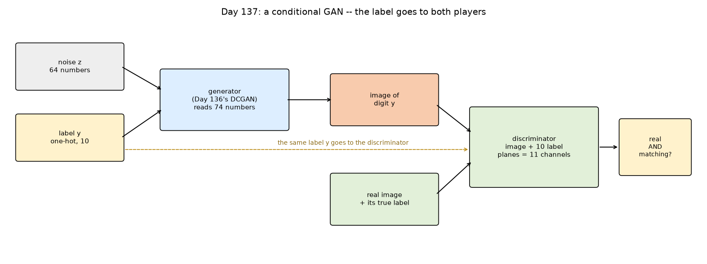
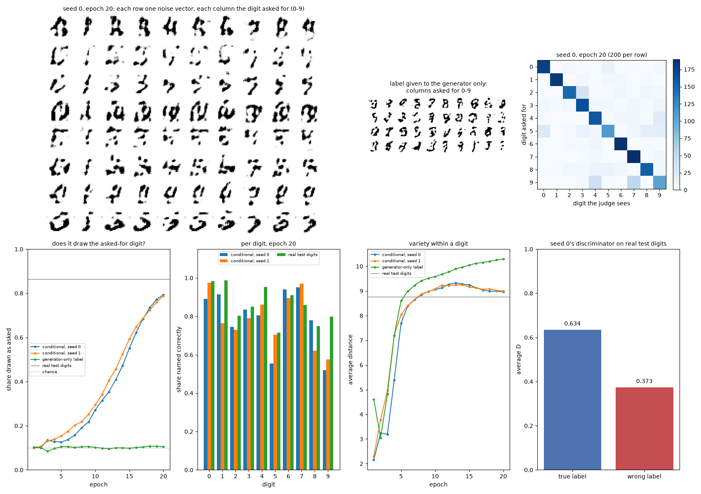

## Day 138 — Evaluating generative models: real FID/IS-style metric computation
[`day138_evaluating_generative_models.py`](day138_evaluating_generative_models.py) — the Inception Score, the Frechet distance (FID) and k-nearest-neighbour precision and recall, written from scratch on a small convolutional digit classifier (test accuracy 0.9829), checked on cases with known answers, then tested on damage done on purpose and on three of the week's GANs during training. The classifier is not Inception, so these are FID/IS-style numbers, not comparable with published ones.

- **Sample size:** real test digits in random order score FID 6.478 at 500 images and 2.060 at 10,000, so FIDs are compared at a fixed 2,000.
- **Sample order:** a first draft scored the first n test images; MNIST's test set is not stored in random order (its halves alone score FID 12.006 and 6.146; a random 5,000 scores 2.250), so the draft's explanation was wrong and was replaced.
- **Blind spots:** ten images repeated 200 times scored a higher Inception Score than real digits (9.598 against 9.407); FID (205.857) and recall (0.000) caught it. Precision rose with noise (0.903) and blur (0.933). Exact copies of training images scored like real digits (FID 3.161 against 2.996); only the pixel distance to the nearest training image caught them (0.00).
- **The GANs:** at epoch 20 the dense GAN and the DCGAN have similar FIDs (53.291 and 51.747) but the DCGAN has higher recall (0.518 against 0.355) and lower precision (0.383 against 0.582); with Adam's b1 at 0.9 the dense GAN never left collapse.

Study guide: [`day138_evaluating_generative_models_complete_guide.pdf`](day138_evaluating_generative_models_complete_guide.pdf) · Syntax walkthrough: [`day138_syntax_line_by_line.pdf`](day138_syntax_line_by_line.pdf) · [Run output](day138_run_output.txt)

Exercise: [`day138_exercise.py`](day138_exercise.py) is the scoring kit (matrix square root, FID, Inception Score, precision and recall, the feature network and the Scorer), checked by hand — the sixth part of Day 139's build ([run output](day138_exercise_run_output.txt)).

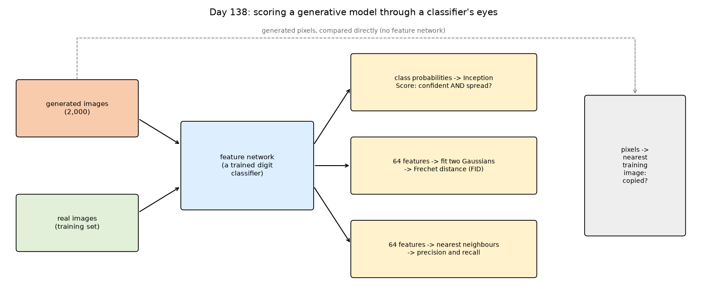
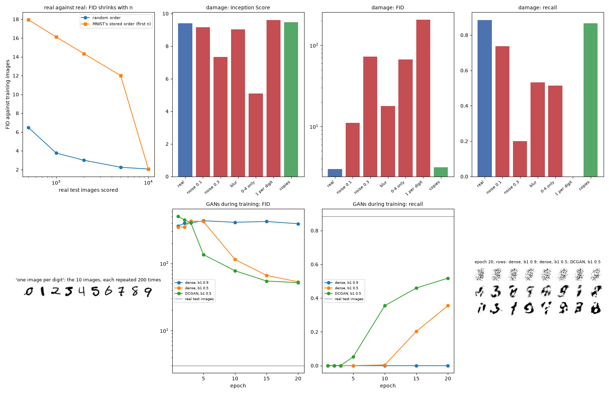

## Day 139 — Week 20 build: a conditional DCGAN, scored, and the forward diffusion process
[`day139_gan_build_and_forward_diffusion.py`](day139_gan_build_and_forward_diffusion.py) — the 43 functions and classes of Days 133–138's exercise files, pasted in verbatim (checked character by character: 43 of 43) and assembled into one model: Day 137's conditional DCGAN trained on all 60,000 MNIST training images and scored with Day 138's metrics against Day 133's Gaussian class models. The day then starts Week 21's subject, the forward diffusion process, with its one-jump shortcut checked against 1,000 small steps.

- **The week's model:** after 10 epochs the conditional DCGAN reaches FID 20.200 and recall 0.573, and draws the asked-for digit 0.834 of the time (real test digits: FID 2.996, recall 0.884). After epoch 1 it was collapsed (IS 1.442, recall 0.000), as every GAN in Day 138 was at first.
- **Against Gaussian class models:** the best Gaussian (full covariance) scores FID 41.405 and recall 0.342, worse than the GAN, but higher precision (0.844 against 0.442) and draws the asked-for digit more often (0.966), after 2 s of fitting instead of 6387 s of training.
- **The forward process on the ring:** points leave their modes early (good share 0.298 at t = 50), and by t = 700 the data is as close to N(0, I) as exact samples are (distance 0.0002).
- **On MNIST:** a softmax regression trained on noised digits falls below 0.5 accuracy at t = 500 with the linear schedule and at t = 800 with the cosine one; the linear schedule spends its last steps on near-noise. Day 116's learning rate 0.5 was unstable on noised digits; the run reports the tuning to 0.05.

Study guide: [`day139_gan_build_and_forward_diffusion_complete_guide.pdf`](day139_gan_build_and_forward_diffusion_complete_guide.pdf) · Syntax walkthrough: [`day139_syntax_line_by_line.pdf`](day139_syntax_line_by_line.pdf) · [Run output](day139_run_output.txt)

Day 139 is the week's build, so it has no exercise script of its own.

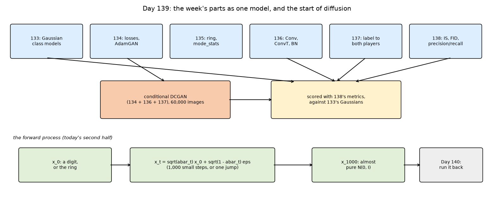
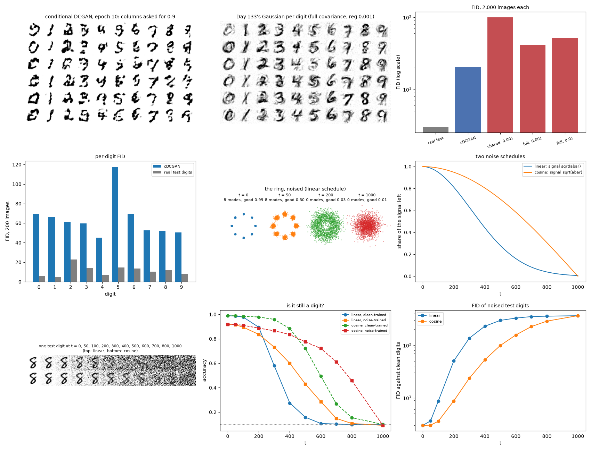

---
[← Back to main README](../README.md)
