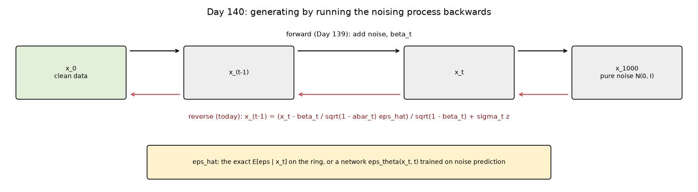
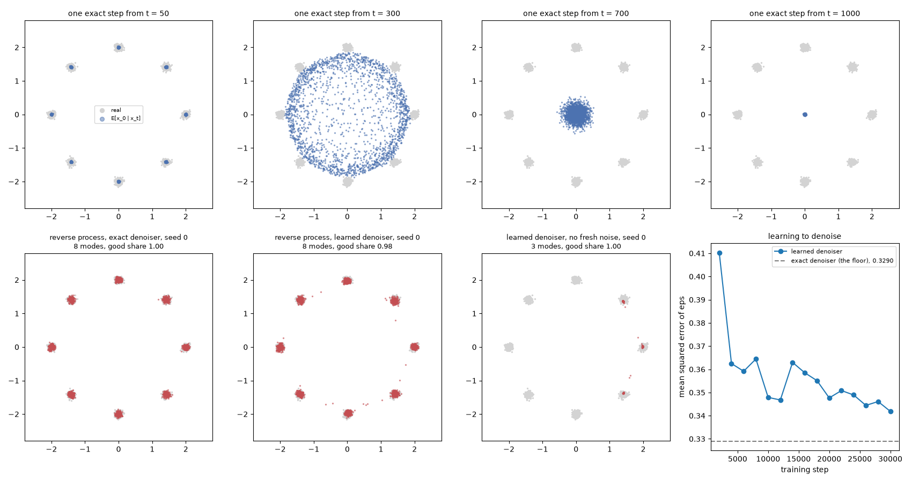
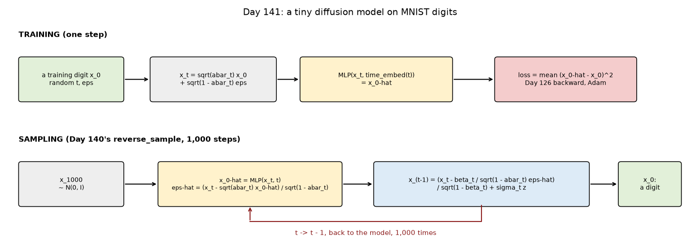
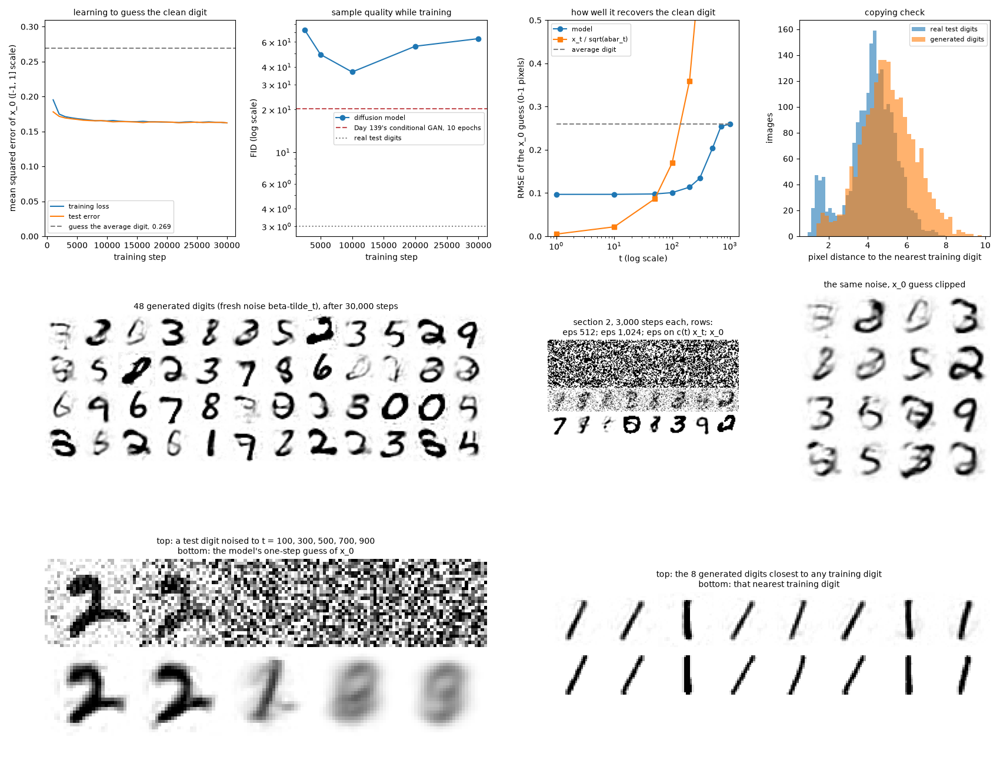
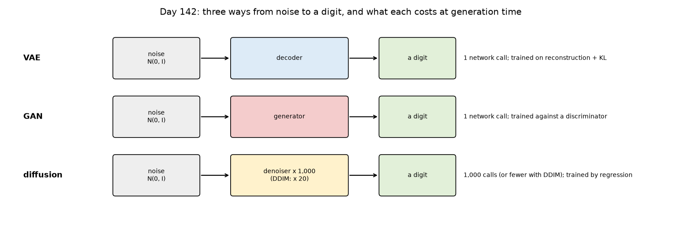
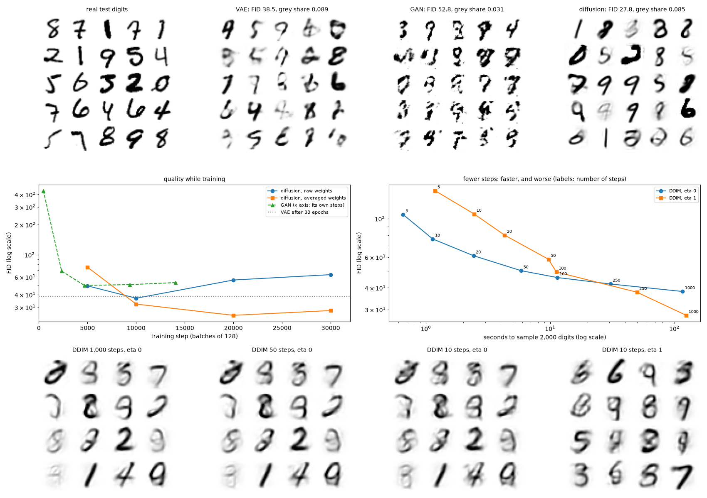

# Week 21: Diffusion Models & Modern Generative AI (Days 140–146)

Week 20 trained GANs, scored them, and ended by destroying data on purpose: Day 139's forward diffusion process adds a little Gaussian noise at each of 1,000 steps until nothing of the data is left. Week 21 runs that process backwards to generate, then compares the three families of generative models built so far and looks at modern text-to-image systems and their risks. Everything is written from scratch in NumPy. Days 140–145 each get the full-depth lesson plus a short `dayNN_exercise.py` isolating one part, and Day 146 is the capstone. See [`full_syllabus_days_1_365.md`](../full_syllabus_days_1_365.md) for the week's plan.

## Day 140 — Reverse diffusion from scratch: a real denoising step
[`day140_reverse_diffusion.py`](day140_reverse_diffusion.py) — Day 139's noising process run backwards: start from pure noise and take 1,000 small denoising steps (Ho et al., 2020). On Day 135's ring of eight Gaussians the best possible denoiser, E[x_0 | x_t], can be written down exactly, so the reverse process and a learned denoiser are tested separately.

- **The step's formula:** the posterior q(x_(t-1) | x_t, x_0) matches a million simulated runs (t = 50: 0.03660 against 0.03634).
- **One step cannot generate:** from t = 1,000 the exact guess of x_0 is the ring's centre for every point (radius 0.0160); many small steps are needed.
- **The process works:** 1,000 steps with the exact denoiser recovered all 8 modes in every seed (good share 0.998, 0.995, 0.997), slightly too tight with the posterior's own variance (spread 0.0455 against the real 0.0509) and right with beta_t (0.0496 to 0.0501).
- **A learned denoiser:** a network with two hidden layers of 256, trained on the noise-prediction loss came within 0.0129 of the lowest possible error (0.3290) after 30,000 steps; its samples cover all 8 modes but are a little too wide (spread 0.0607). With no fresh noise at each step it fell into three modes (seed 0's counts 1059 366 0 0 0 0 0 571), where the exact denoiser kept all eight.

Study guide: [`day140_reverse_diffusion_complete_guide.pdf`](day140_reverse_diffusion_complete_guide.pdf) · Syntax walkthrough: [`day140_syntax_line_by_line.pdf`](day140_syntax_line_by_line.pdf) · [Run output](day140_run_output.txt)

Exercise: [`day140_exercise.py`](day140_exercise.py) is the posterior, the exact denoiser, the sampling loop and the noise-predicting network, checked by hand — the first part of Day 146's capstone ([run output](day140_exercise_run_output.txt)).

## Day 141 — Training a tiny diffusion model: real toy image generation
[`day141_tiny_diffusion.py`](day141_tiny_diffusion.py) — a diffusion model trained on the 60,000 MNIST training digits and sampled with Day 140's 1,000-step reverse process, scored by Day 138's metrics. The network is Day 126's dense network (two hidden layers of 512) with Day 140's time embedding.

- **Two first drafts failed, and are kept:** with He initialisation the second hidden layer switched off (0.00 of its ReLUs on) and the loss sat at 1.000, the error of guessing zero; starting the output layer at zero fixed it. A network asked for the noise drew speckled noise, not digits (FID 325.88; 341.59 at twice the width); the same network asked for the clean digit gave FID 49.45 after 3,000 steps.
- **The loss hid a decline:** over 30,000 steps the test error fell from 0.1781 to 0.1623, but FID was best at 10,000 steps (36.856) and rose to 63.350 by the end.
- **Sampling choices:** with no fresh noise per step, 1782 of 2,000 samples came out as the digit 3; clipping the clean-digit guess to [-1, 1] made FID worse (95.212).
- **No copying:** the closest sample is 1.37 from a training digit, while a real test digit came as close as 0.95; the samples have 1399 different nearest training digits.

Study guide: [`day141_tiny_diffusion_complete_guide.pdf`](day141_tiny_diffusion_complete_guide.pdf) · Syntax walkthrough: [`day141_syntax_line_by_line.pdf`](day141_syntax_line_by_line.pdf) · [Run output](day141_run_output.txt)

Exercise: [`day141_exercise.py`](day141_exercise.py) is the straight-line guess, the network's output read as the clean digit or the noise, the training loop, the evaluation, the nearest-image check and the sample scorer, checked by hand — the second part of Day 146's capstone ([run output](day141_exercise_run_output.txt)).

## Day 142 — GANs vs VAEs vs diffusion: real, honest quality/speed tradeoffs
[`day142_generative_tradeoffs.py`](day142_generative_tradeoffs.py) — Week 19's VAE, Week 20's GAN and Day 141's diffusion model, each trained on the same 60,000 MNIST digits, scored by Day 138's scorer and timed on the same machine. New parts: an averaged copy of the weights (EMA), DDIM sampling, and a direct measure of blur.

- **Quality:** FID 27.778 for diffusion (sampled from the averaged weights), 38.520 for the VAE, 52.781 for the GAN.
- **Cost:** training took 100s, 125s and 1244s; sampling 2,000 digits took 0.02s (VAE), 0.01s (GAN) and 97.06s (diffusion, 1,000 network calls each). DDIM in 20 steps took 2.42s, at FID 61.201.
- **The averaged copy fixed Day 141's decline:** FID 27.778 at 30,000 steps against 63.350 for the raw weights, though it was worse early (75.153 against 48.992 at 5,000).
- **FID missed blur:** the share of grey pixels was 0.0500 for real digits, 0.0890 for the VAE and 0.0313 for the GAN, yet the VAE beat the GAN on FID.
- **Fewer steps, worse samples:** with no fresh noise, FID went 38.086 (1,000 steps), 50.174 (50), 105.503 (5); fresh noise helped at 1,000 steps and hurt at 100 and below.
- The first run was slowed by the laptop going into standby (diffusion training timed at 8,174 s); it was rerun kept awake, and every score came out identical.

Study guide: [`day142_generative_tradeoffs_complete_guide.pdf`](day142_generative_tradeoffs_complete_guide.pdf) · Syntax walkthrough: [`day142_syntax_line_by_line.pdf`](day142_syntax_line_by_line.pdf) · [Run output](day142_run_output.txt)

Exercise: [`day142_exercise.py`](day142_exercise.py) is the averaged copy, DDIM, the guesser wrapper, the grey share and the weight count, checked by hand — the third part of Day 146's capstone ([run output](day142_exercise_run_output.txt)).

---
[← Back to main README](../README.md)
