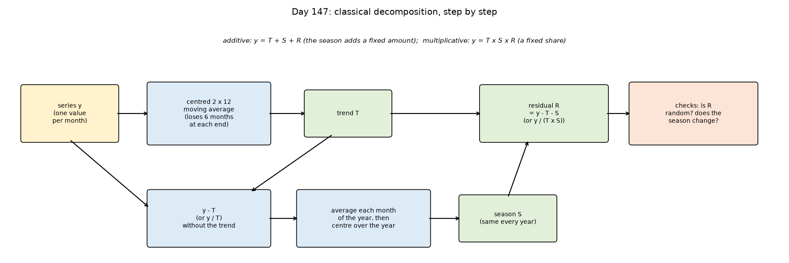
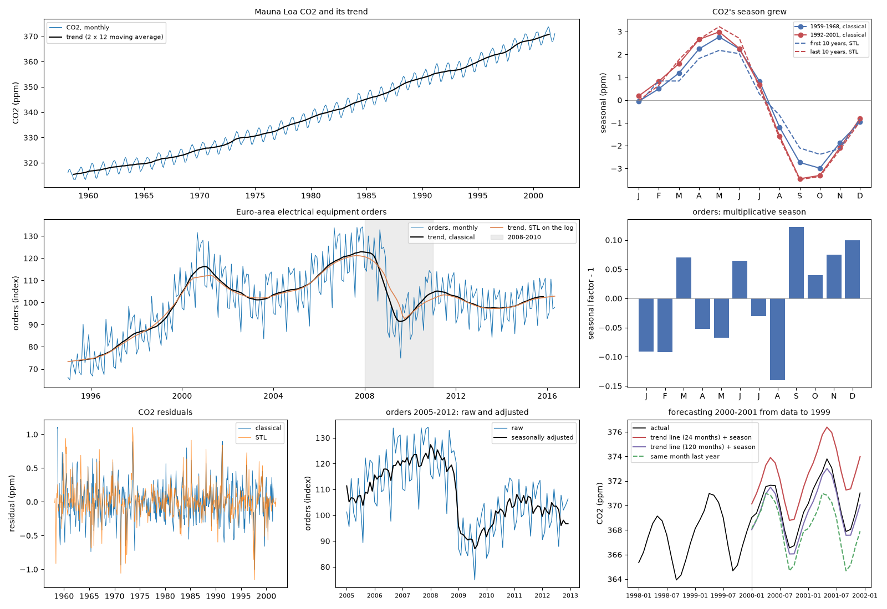
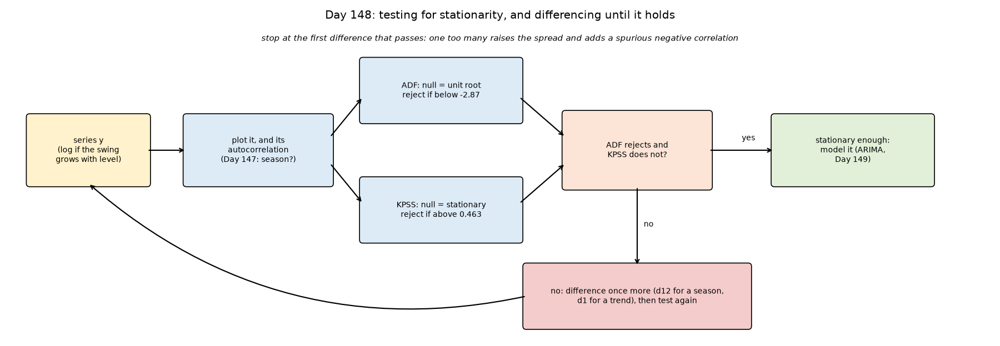
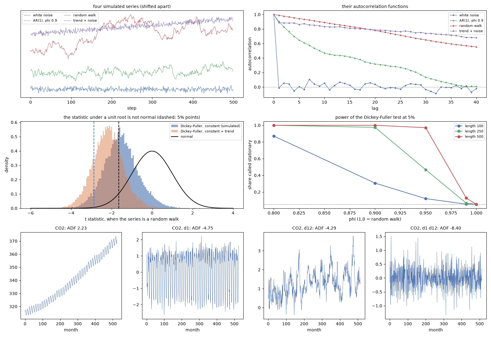
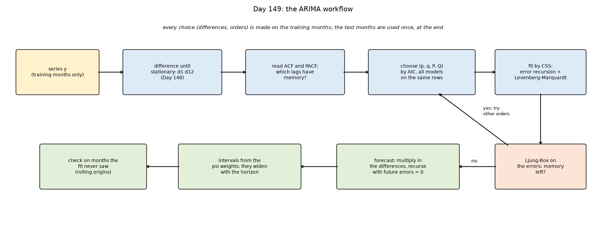
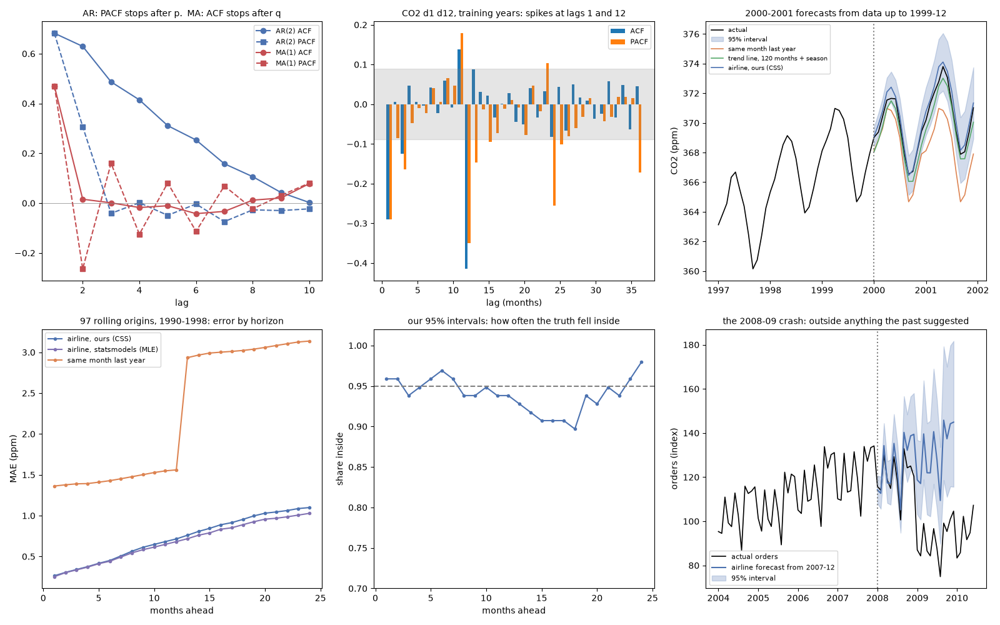
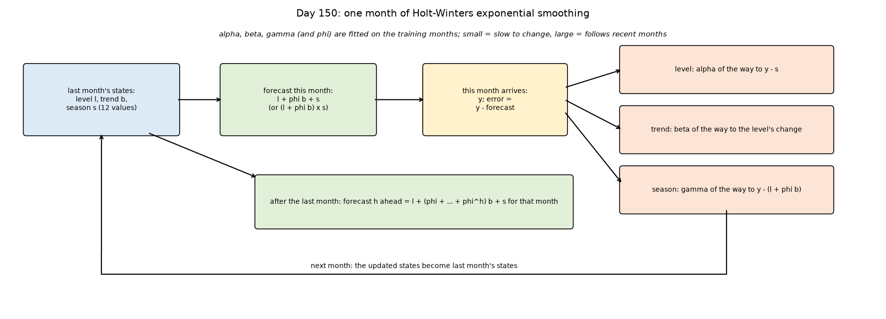
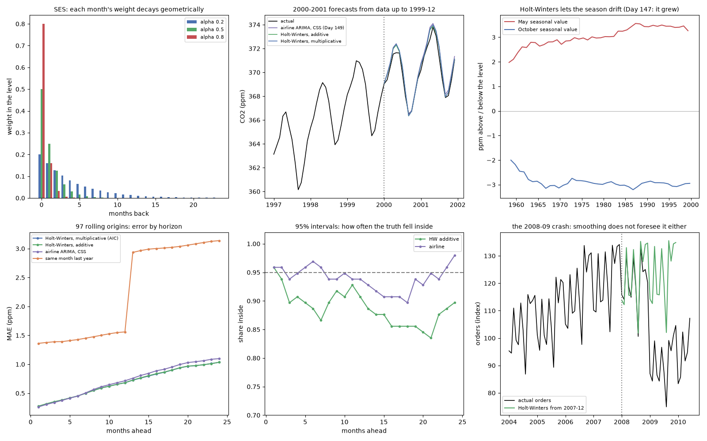

# Week 22: Time Series Analysis (Days 147–153)

Weeks 18–21 learned from images and text. Week 22 turns to time series: measurements in time order, where the order matters and the future has to be forecast from the past. It uses two real monthly series that ship with statsmodels: carbon dioxide at Mauna Loa (1958–2001) and euro-area orders for electrical equipment (1995–2016, including the 2008–09 crash). Every method is written from scratch in NumPy, with statsmodels used for the data and as a reference to check against. Days 147–152 each get the full-depth lesson plus a short `dayNN_exercise.py` isolating one part, and Day 153 builds a Prophet-style forecaster from those parts. See [`full_syllabus_days_1_365.md`](../full_syllabus_days_1_365.md) for the week's plan.

## Day 147 — Time-series decomposition: trend, seasonality and residual on real data
[`day147_time_series_decomposition.py`](day147_time_series_decomposition.py) — a monthly series split into a slow trend (a centred 2 × 12 moving average), a yearly season (the average of each month of the year) and what is left, written from scratch in NumPy on two real series: carbon dioxide at Mauna Loa (526 months, 1958–2001) and euro-area orders for electrical equipment (257 months, 1995–2016).

- **Checked:** the moving average returns a repeating 12-month pattern as its mean (1.1e-16) and a straight line unchanged (7.1e-15); the decomposition matches statsmodels' `seasonal_decompose` exactly (0.0e+00).
- **What it shows:** CO2's trend rose 0.86 ppm a year in the 1960s and 1.58 in the 1980s, and its season peaks in May and is lowest in October (swing 6.07 ppm). The orders drop in August and peak in September.
- **Additive or multiplicative:** in both series the seasonal swing grows with the level (correlation 0.616 and 0.703), and the multiplicative fit is closer (orders 2.4701 against 2.6607).
- **What it gets wrong:** the trend stops 6 months before the data; one fixed season cannot follow CO2's, which grew from 5.75 to 6.44 ppm between the 1960s and 1990s; and the residual is not noise (correlation one month apart 0.403, and 0.393 for statsmodels' STL). The orders' season survived the 2008–09 crash: leaving 2008–2010 out changes no monthly factor by more than 0.007.
- **Using it:** raw and seasonally adjusted month-to-month changes point opposite ways in 0.414 of months. A first forecast (a straight trend line through the last 24 trend values, plus the season) overshot by 2.425 ppm, worse than repeating last year (1.882), because those two years included a trend jump of +2.88; a 120-month line gave 0.591, a window that must not be chosen on the test months.

Study guide: [`day147_time_series_decomposition_complete_guide.pdf`](day147_time_series_decomposition_complete_guide.pdf) · Syntax walkthrough: [`day147_syntax_line_by_line.pdf`](day147_syntax_line_by_line.pdf) · [Run output](day147_run_output.txt)

Exercise: [`day147_exercise.py`](day147_exercise.py) is the two data loaders, the centred moving average, the classical decomposition, the strength measures and a January-to-December reordering, checked by hand — the first part of Day 153's forecaster ([run output](day147_exercise_run_output.txt)).

## Day 148 — Stationarity and differencing: the ADF and KPSS tests from scratch
[`day148_stationarity_differencing.py`](day148_stationarity_differencing.py) — what it means for a series to be stationary, the autocorrelation function, differencing at lag 1 and lag 12, and two tests that ask about stationarity from opposite sides (augmented Dickey-Fuller and KPSS), all written from scratch in NumPy and run on Day 147's two real series.

- **Checked:** the autocorrelation function, the ADF statistic (with the same AIC-chosen lags in every row) and the KPSS statistic match statsmodels (6.7e-16, 1.0e-11, 1.1e-16).
- **Why ADF needs its own table:** 20,000 simulated random walks give a 5% point of -2.874 (MacKinnon's published -2.867). Using the normal table would wrongly reject a unit root in 0.452 of random walks.
- **On CO2:** the raw series is far from stationary (ADF 2.233). Differencing once and then once at lag 12 passes clearly (-8.398, spread 0.4141). One surprise: the first difference alone passes ADF (-4.752) and KPSS, although its yearly season is intact (lag-12 autocorrelation 0.922), because neither test looks for seasonality.
- **When the tests disagree:** KPSS beside ADF gave a conflict on three of seven series, e.g. log orders (ADF rejects with p 0.0228, KPSS 0.558 also rejects).
- **Over-differencing:** one difference too many raised CO2's spread to 0.6676 and pushed the lag-1 autocorrelation to -0.613, and the ADF test still passed (-9.25), so it cannot warn about it.
- **Power:** with 100 steps the test detected a stationary series with phi 0.95 only 0.120 of the time; with 500 steps, 0.972. On random walks it was wrong 0.052 of the time, close to the 5% it should be.

Study guide: [`day148_stationarity_differencing_complete_guide.pdf`](day148_stationarity_differencing_complete_guide.pdf) · Syntax walkthrough: [`day148_syntax_line_by_line.pdf`](day148_syntax_line_by_line.pdf) · [Run output](day148_run_output.txt)

Exercise: [`day148_exercise.py`](day148_exercise.py) is the autocorrelation function, differencing, the Dickey-Fuller statistic and its simulated table, the ADF test and the KPSS test, checked by hand — the second part of Day 153's forecaster ([run output](day148_exercise_run_output.txt)).

## Day 149 — ARIMA from scratch: fitting, choosing and forecasting on real data
[`day149_arima_from_scratch.py`](day149_arima_from_scratch.py) — seasonal ARIMA written from scratch in NumPy: the partial autocorrelation, the model's error recursion, a Levenberg-Marquardt fit by conditional least squares (CSS), forecasts built back up through the differences, intervals from the psi weights, and the Ljung-Box check. statsmodels' exact-likelihood fit (MLE) and Kalman-filter forecasts are the reference.

- **Checked:** the partial autocorrelation matches statsmodels (4.0e-16), our solver matches scipy's least_squares (3.8e-09), and for the same coefficients our forecasts and interval widths match statsmodels' Kalman filter (2.2e-07, 4.2e-09).
- **Choosing the model:** on CO2's training years (up to 1999-12) the differenced series has ACF spikes at lag 1 and lag 12 only, and AIC over 36 models picks one MA term at each, the 'airline' model. Ljung-Box finds no clear memory left in its errors (p 0.159).
- **Forecasting 2000–2001:** mean error 0.412 ppm, against Day 147's 1.882 (same month last year) and 0.591 (trend line plus season). Every test month fell inside the 95% interval, although the forecast was too high in 23 of 24 months.
- **CSS against MLE:** the two fits differ in the seasonal coefficient (-0.6902 against -0.8480). A simulation with a known answer shows CSS biased towards 0 (in 40 of 40 runs), but by 0.051 on average, less than CO2's gap of 0.158; the rest is not explained here.
- **Rolling origins:** over 97 forecasts from 1990–1998, the error grows from 0.264 ppm one month ahead to 1.099 at 24 months, and the 95% intervals covered between 0.897 and 0.979 at every horizon.
- **Electrical-equipment orders:** the model wins one month ahead (1.92% against 5.31%) but loses a year ahead (6.26% against 4.83%). Through the 2008–09 crash, 13 of 24 months fell outside its 95% interval.

Study guide: [`day149_arima_from_scratch_complete_guide.pdf`](day149_arima_from_scratch_complete_guide.pdf) · Syntax walkthrough: [`day149_syntax_line_by_line.pdf`](day149_syntax_line_by_line.pdf) · [Run output](day149_run_output.txt)

Exercise: [`day149_exercise.py`](day149_exercise.py) is the partial autocorrelation, the seasonal ARMA polynomials, the error recursion, the Levenberg-Marquardt solver, the CSS fit, the differencing polynomial, forecasts, psi weights and Ljung-Box, checked by hand — the third part of Day 153's forecaster ([run output](day149_exercise_run_output.txt)).

## Day 150 — Exponential smoothing from scratch: Holt-Winters against ARIMA on real data
[`day150_exponential_smoothing.py`](day150_exponential_smoothing.py) — simple, Holt and Holt-Winters exponential smoothing written from scratch in NumPy: the smoothing equations (additive or multiplicative season, optional damped trend), starting values from the first two years, a least-squares fit of the weights from four starting points (Day 149's Levenberg-Marquardt solver), forecasts and intervals. statsmodels' ExponentialSmoothing is the reference.

- **Checked:** with fixed weights our one-step forecasts match statsmodels' (1.1e-13 additive, 0.0e+00 multiplicative), and the fitted sums of squares are the same (60.7544 and 60.5428). Simple smoothing equals Day 149's ARIMA(0,1,1) with theta = alpha - 1 (4.4e-15).
- **A difference in statsmodels:** the forecasts agree at 22 of 24 steps; at steps 12 and 24 statsmodels 0.15.0 uses the seasonal value from before the last update. Feeding the forecasts back in as data, ours reproduce themselves (1.1e-13) and statsmodels' do not (4.7e-02).
- **A first-draft failure:** with three starting points, Holt stopped at a sum of squares of 704.7799; a fourth start found 415.0547. Every fit now uses four starts, which is still no guarantee.
- **Forecasting CO2 in 2000–2001:** AIC on the training years chose multiplicative Holt-Winters (mean error 0.329 ppm), against the airline ARIMA's 0.412 and the additive version's 0.290 (not chosen: that would be choosing on the test). Without a season, SES (2.420) and Holt (13.418) fail.
- **Rolling origins:** over 97 forecasts, Holt-Winters is more accurate than the airline model at 18 of 24 horizons (1.035 against 1.099 at 24 months), but its 95% intervals are too narrow (coverage as low as 0.835), where the airline model's are not.
- **Electrical-equipment orders:** the airline model beats Holt-Winters in the ordinary years (6.26% against 7.33% a year ahead). Through the 2008–09 crash damped Holt-Winters was closer (18.81% against 23.86%), but neither beat the same month last year (18.04%).

Study guide: [`day150_exponential_smoothing_complete_guide.pdf`](day150_exponential_smoothing_complete_guide.pdf) · Syntax walkthrough: [`day150_syntax_line_by_line.pdf`](day150_syntax_line_by_line.pdf) · [Run output](day150_run_output.txt)

Exercise: [`day150_exercise.py`](day150_exercise.py) is the smoothing equations, the starting values, the fit, forecasts and the interval formula, checked by hand — the fourth part of Day 153's forecaster ([run output](day150_exercise_run_output.txt)).

---
[← Back to main README](../README.md)
