# Week 23: Recommender Systems (Days 154–160)

Week 22 forecast a series from its own past. Week 23 predicts something different: which films a person will like, from the ratings that they and everyone else have already given. It uses one real dataset throughout, MovieLens 100K (100,000 ratings of 1,682 films by 943 users, collected by GroupLens at the University of Minnesota in 1997–98; F. M. Harper and J. A. Konstan, *The MovieLens Datasets: History and Context*, ACM TiiS 5(4), 2015). The data is not stored in this repository: the scripts download it on first run to `~/movielens_data`. Every method is written from scratch in NumPy. Days 154–159 each get the full-depth lesson plus a short `dayNN_exercise.py` isolating one part, and Day 160 builds a neural recommender from those parts. See [`full_syllabus_days_1_365.md`](../full_syllabus_days_1_365.md) for the week's plan.

## Day 154 — Collaborative filtering: user-based and item-based on a real ratings matrix
[`day154_collaborative_filtering.py`](day154_collaborative_filtering.py) — predicting how a user will rate a film from ratings alone: a bias model (mean + user bias + film bias), user-based neighbours (people who agreed before) and item-based neighbours (films rated alike), with centred, shrunk similarities, all written from scratch in NumPy on MovieLens 100K (100,000 ratings by 943 users of 1,682 films; 6.3% of the table filled).

- **Checked:** the vectorised similarity matches a cosine worked by hand (0.4186) and numpy's Pearson correlation (1.1e-16). The exercise works a user-based and an item-based prediction on paper.
- **Small overlaps:** pairs of films sharing 1–2 raters have |similarity| above 0.9 in 0.786 of cases, so without shrinkage Star Wars's "nearest" films were obscure films sharing one rater. With shrinkage, Return of the Jedi (1983) and The Empire Strikes Back came first.
- **Test RMSE** (settings chosen on a validation split): bias model 0.9401, user-based 0.9353, item-based 0.9153. A control that shuffled the similarities among film pairs scored 0.9748, worse than no neighbours, so the gain comes from choosing the right neighbours.
- **Where neighbours help:** heavy users (item-based 0.8990 against 0.9275). For films with fewer than 20 ratings item-based lost to the bias model (1.0557 against 1.0416).
- **Top-10 lists:** the best rating predictor ranked badly. Its lists hit liked held-out films in 0.0417 of slots, below the bias model (0.0439) and far below recommending the most-rated films (0.1381). The weighted average gives a film with one rating (total similarity 0.001) a full correction; damping it, chosen on validation, raised precision to 0.0562.

Study guide: [`day154_collaborative_filtering_complete_guide.pdf`](day154_collaborative_filtering_complete_guide.pdf) · Syntax walkthrough: [`day154_syntax_line_by_line.pdf`](day154_syntax_line_by_line.pdf) · [Run output](day154_run_output.txt)

Exercise: [`day154_exercise.py`](day154_exercise.py) is the data loaders, the split, the ratings table, the bias model, the similarity with shrinkage and the two neighbour predictors, checked by hand — the first part of Day 160's recommender ([run output](day154_exercise_run_output.txt)).

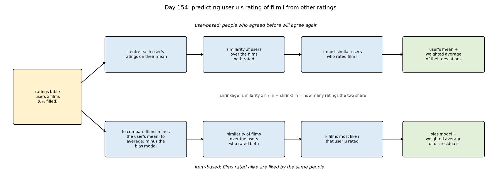
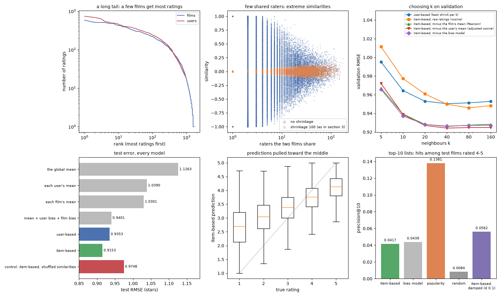

## Day 155 — Matrix factorization from scratch: SVD and learned factors
[`day155_matrix_factorization.py`](day155_matrix_factorization.py) — describing every user and film by a short list of hidden numbers (factors) whose products rebuild the known ratings. Two routes on Day 154's MovieLens split, written from scratch in NumPy: the SVD of a filled-in table, and factors fitted to the known ratings only, by alternating least squares (ALS) and by Funk-style SGD.

- **Checked:** the SVD by subspace iteration matches numpy's to 2.3e-07 and reaches the best possible rank-20 error (219.9119). The objective's gradient matches finite differences (7.0e-09), and the ALS objective fell after every sweep.
- **Low-rank, modestly:** the top 20 directions hold 0.189 of the residual table, against 0.154 when the same values are shuffled among the known cells.
- **What goes in the empty cells:** zeros scored 2.4282 on validation. With the bias model there, rank 20 scored 0.9255 on test. Filling and refitting with no penalty overfitted: at rank 50, training 0.2279 against validation 1.0896.
- **Learned factors** (100 factors, penalty chosen on validation): ALS 0.9115 and early-stopped SGD 0.9105 on test, just ahead of Day 154's item-based 0.9153. SGD's objective was higher (63418.4 against 62689.1), so early stopping acted as extra regularisation. Giving each user another user's factors scored 0.9711.
- **Top-10 lists did not improve:** precision@10 was 0.0405, against 0.1381 for recommending the most-rated films.

Study guide: [`day155_matrix_factorization_complete_guide.pdf`](day155_matrix_factorization_complete_guide.pdf) · Syntax walkthrough: [`day155_syntax_line_by_line.pdf`](day155_syntax_line_by_line.pdf) · [Run output](day155_run_output.txt)

Exercise: [`day155_exercise.py`](day155_exercise.py) is the SVD, the rank-k approximation, fill-factorize-repeat, the prediction, the objective and its gradient, ALS and SGD, checked by hand — the second part of Day 160's recommender ([run output](day155_exercise_run_output.txt)).

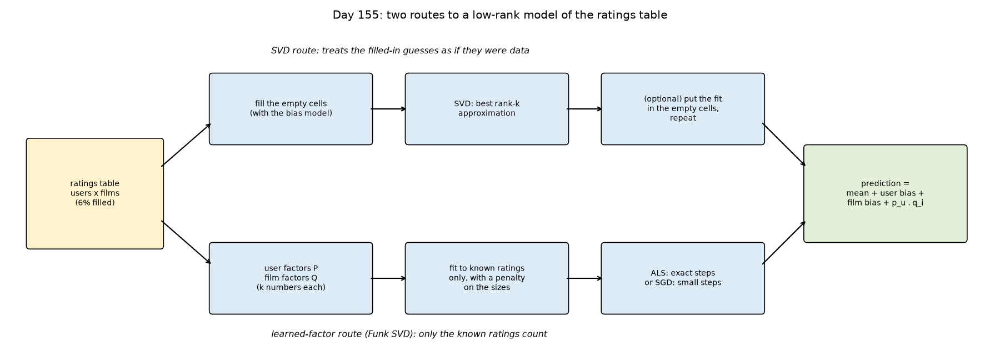
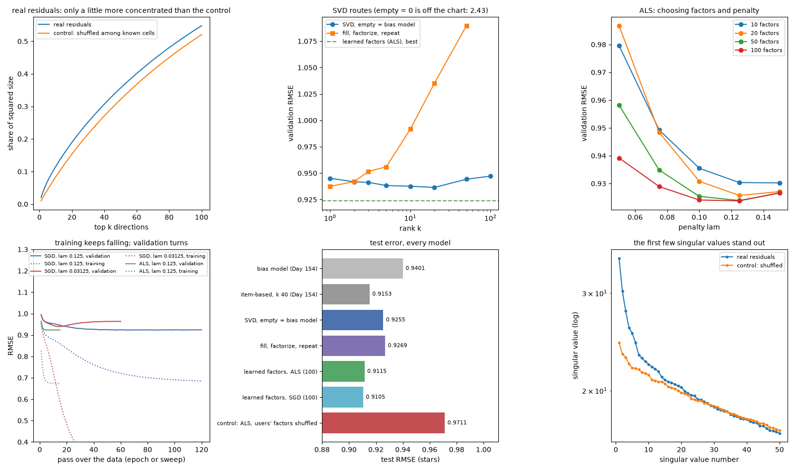

## Day 156 — Content-based filtering: user profiles over genre and decade, and the cold start
[`day156_content_based_filtering.py`](day156_content_based_filtering.py) — recommending from what the films are rather than who rated them. Each film becomes 27 flags (19 genres from MovieLens and its decade of release). Each user gets a profile: a ridge regression of their ratings on those flags, shrunk toward a profile fitted on everyone. Written from scratch in NumPy on Day 154's split.

- **Content and ratings agree partly:** films' 10 nearest rating neighbours have a mean content cosine of 0.443, against 0.322 for random films.
- **Profiles carry taste:** content alone scored 0.9901 test RMSE against 1.0384 for the user's average. With the content shuffled among films it scored 1.0418. On top of the bias model profiles gave 0.9222 (from 0.9401), still behind Day 154's item-based neighbours (0.9153).
- **Cold start:** with whole films held out, every ratings-only method falls back to 1.0567. Per-user profiles scored 1.0222, content kNN 1.0310, and the shuffled-content control 1.0729.
- **Top-10 lists:** bias model plus profiles reached precision@10 0.0627 (bias model 0.0439, popularity 0.1381). Content-only lists were not narrower on a genre count: 9.2 genres per list against 8.2.
- **Explainable:** each score is an exact sum of feature weights. User 1's profile likes Documentary +0.52 and dislikes Children's -0.60.

Study guide: [`day156_content_based_filtering_complete_guide.pdf`](day156_content_based_filtering_complete_guide.pdf) · Syntax walkthrough: [`day156_syntax_line_by_line.pdf`](day156_syntax_line_by_line.pdf) · [Run output](day156_run_output.txt)

Exercise: [`day156_exercise.py`](day156_exercise.py) is the release years, the feature builder, content similarity, the shared and per-user profiles, the prediction and the cold split, checked by hand — the third part of Day 160's recommender ([run output](day156_exercise_run_output.txt)).

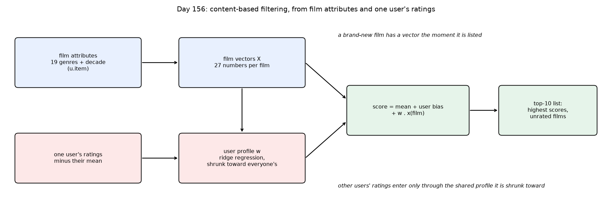
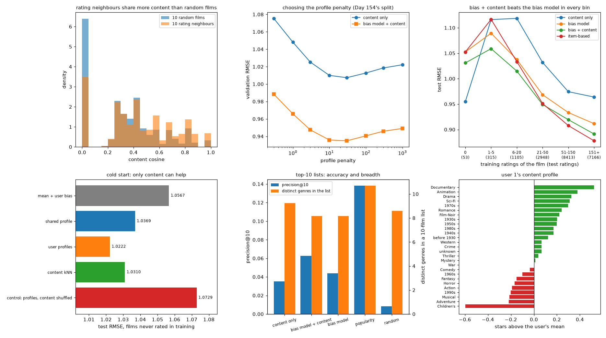

## Day 157 — Hybrid recommenders: blending, switching, and content inside the factor model
[`day157_hybrid_recommenders.py`](day157_hybrid_recommenders.py) — combining the week's models, each with its own blind spot. Item-based neighbours (Day 154), ALS factors (Day 155) and content profiles (Day 156) are combined three ways: a weighted blend fitted on validation; switching and feature-weighted blends that depend on how many ratings a film has; and one factor model with the content inside. Written from scratch in NumPy on Day 154's MovieLens split, importing the earlier days' parts.

- **Different mistakes:** item-based and ALS errors correlate 0.973. Content profiles are the weakest model but the least alike (0.878 with item-based).
- **Weighted blends:** test RMSE fell from 0.9115 (ALS alone) to 0.9061 with item-based + ALS, 0.9039 adding content, and 0.8973 with all five models. Three checks held: a noise column got weight -0.0124; weights fitted on test would have reported 0.8963; on two halves of validation the five-model blend still won (0.9012 against 0.9108).
- **Weights that depend on the film's rating count:** films with 0–5 ratings improved from 1.0487 to 0.9930. At 1 rating content got weight +0.64 and ALS -0.03; at 400 ratings, ALS +0.89.
- **Content inside the factors:** matched ALS on familiar films (test 0.9104) and scored new films at 1.0314 against the 1.0567 fallback, behind Day 156's profiles (1.0222). It made the week's best personalised top-10 lists (precision@10 0.0684).

Study guide: [`day157_hybrid_recommenders_complete_guide.pdf`](day157_hybrid_recommenders_complete_guide.pdf) · Syntax walkthrough: [`day157_syntax_line_by_line.pdf`](day157_syntax_line_by_line.pdf) · [Run output](day157_run_output.txt)

Exercise: [`day157_exercise.py`](day157_exercise.py) is the blend, the feature-weighted design, the switch and the factor model with content inside, checked by hand. Without a penalty on the films' own factors, a toy model left unseen films 0.474 off; with one, 0.019. It is the fourth part of Day 160's recommender ([run output](day157_exercise_run_output.txt)).

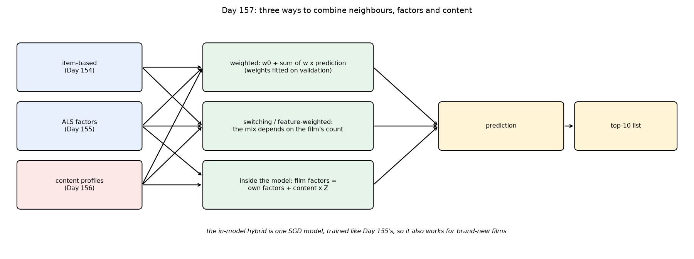
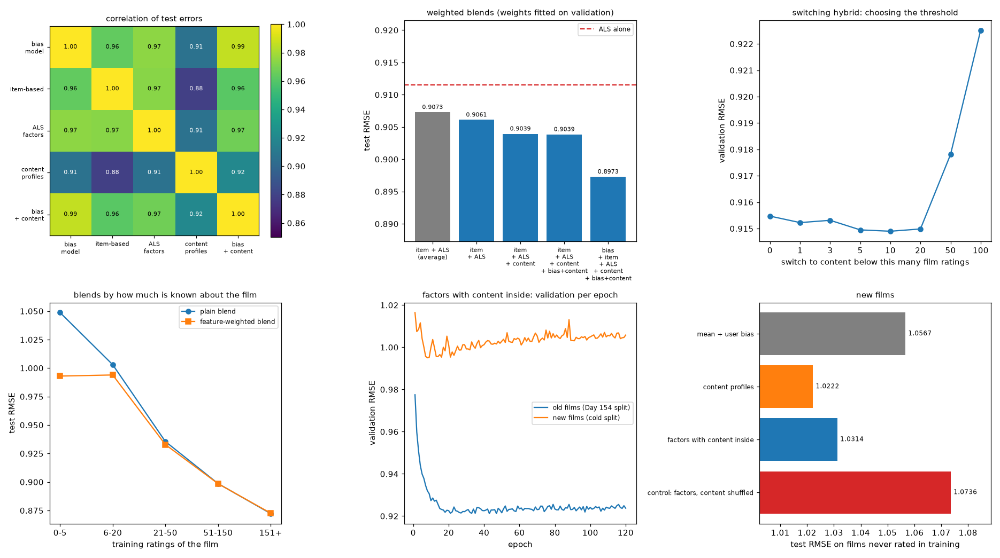

## Day 158 — Implicit feedback and cold start: learning from what people watch
[`day158_implicit_feedback.py`](day158_implicit_feedback.py) — most real systems see clicks and views, not stars. MovieLens's ratings become watched / not watched, and the question becomes "what will this user watch next?". Implicit ALS (Hu, Koren and Volinsky, 2008) fits every cell, with a confidence weight on what was watched. It is compared with popularity, item co-occurrence, PureSVD and Day 155's explicit ALS, and then serves brand-new users. Written from scratch in NumPy on Day 154's split.

- **Top-10 lists on test:** implicit ALS 0.3672 of recommended films watched, against popularity 0.1948, co-occurrence 0.2930 and PureSVD 0.3507. On liked films (4–5 stars) it scored 0.2653, against Day 157's best rating model at 0.0684. Shuffling users' factors dropped it to 0.1288, below popularity.
- **The week's puzzle answered:** Day 155's explicit ALS, trained only on rated cells, scored 0.0421, recommending films with a median of 7 watchers.
- **Grid:** 50 factors, penalty 30, alpha 3 on validation (0.1374). The first run chose 50 at the grid's edge; 100 factors scored 0.1337.
- **Stars as confidence:** a small gain, liked-film precision 0.2741 against 0.2653.
- **New users** (188 held out entirely): with 20 films known, fold-in reached recall@10 0.1584 against popularity's 0.0925 and co-occurrence's 0.1418. Age and gender alone barely beat popularity (0.0797 against 0.0791); a shuffled-group control scored 0.0719.

Study guide: [`day158_implicit_feedback_complete_guide.pdf`](day158_implicit_feedback_complete_guide.pdf) · Syntax walkthrough: [`day158_syntax_line_by_line.pdf`](day158_syntax_line_by_line.pdf) · [Run output](day158_run_output.txt)

Exercise: [`day158_exercise.py`](day158_exercise.py) is the users' table, implicit ALS, its objective, fold-in, co-occurrence and the top-k measures, checked by hand. The shortcut user step matches the full weighted ridge over every film, and the same check misses by 0.899 if the extra weight c − 1 is left out. It is the fifth part of Day 160's recommender ([run output](day158_exercise_run_output.txt)).

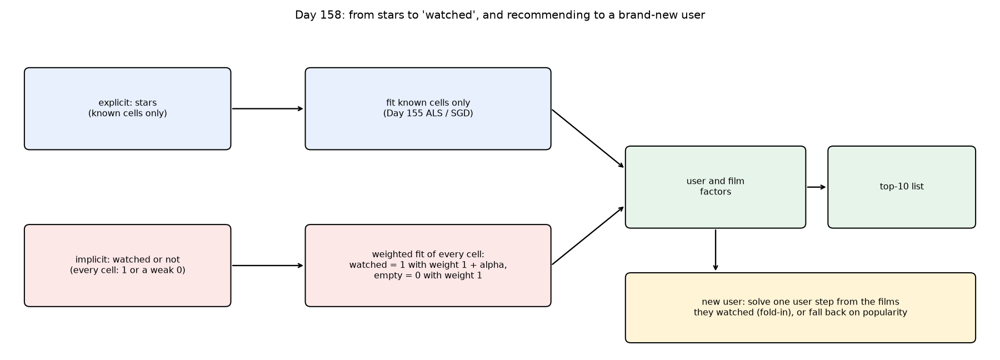
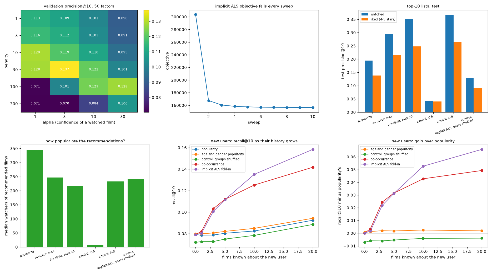

## Day 159 — Evaluating recommenders: precision, recall, MAP, NDCG, and how sure
[`day159_evaluating_recommenders.py`](day159_evaluating_recommenders.py) — the measures themselves are the subject today. Precision, recall, average precision, NDCG (also graded by stars), reciprocal rank and four beyond-accuracy measures are built from scratch, worked by hand, and applied to every model of the week. A paired bootstrap, a retrained seed and fresh splits test how sure each difference is. Written in NumPy on Day 154's MovieLens split, importing the earlier days' parts.

- **By hand:** two lists with the same two hits score the same precision, but NDCG 0.765 when the hits come first and 0.277 when they come last.
- **The measures agree:** every one ranks the two implicit ALS models first, then PureSVD, co-occurrence, popularity, explicit ALS and random. The one exception is recall, where the two implicit ALS models swap.
- **Beyond accuracy:** the 10% most-watched films hold 42.1% of the test watches. Popularity recommended a share of 0.030 of the catalogue and found none of the less popular films. Binary implicit ALS had the widest coverage of the accurate models (0.237).
- **How sure:** implicit ALS beat PureSVD by +0.0198 graded NDCG [+0.0136, +0.0259]. Retraining with another seed moved it by -0.0023. Day 158's stars-as-confidence gain won on all five fresh splits (mean +0.0142).
- **The sampled shortcut** (100 random negatives, as in the NCF paper) inflated implicit ALS's hit rate from 0.1474 to 0.6638 but kept the models' order here.

Study guide: [`day159_evaluating_recommenders_complete_guide.pdf`](day159_evaluating_recommenders_complete_guide.pdf) · Syntax walkthrough: [`day159_syntax_line_by_line.pdf`](day159_syntax_line_by_line.pdf) · [Run output](day159_run_output.txt)

Exercise: [`day159_exercise.py`](day159_exercise.py) holds the per-user measures, the beyond-accuracy measures, the paired bootstrap, the leave-last-out split and the sampled evaluation, each checked by hand (for example personalisation 0.667 on three tiny lists). It is the sixth part of Day 160's recommender ([run output](day159_exercise_run_output.txt)).

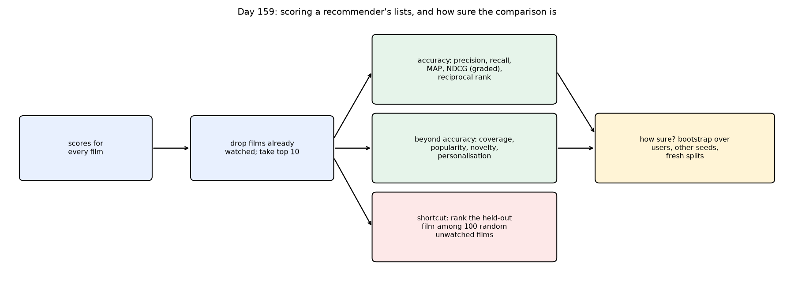
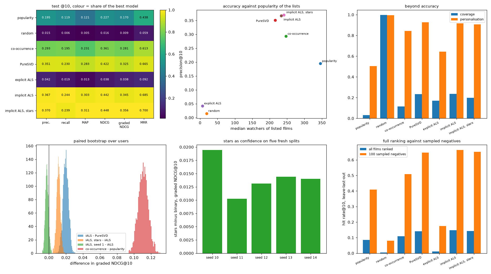

## Day 160 — Week 23 build: neural collaborative filtering from the week's parts
[`day160_neural_collaborative_filtering.py`](day160_neural_collaborative_filtering.py) — the week ends with a neural recommender. GMF, an MLP and NeuMF (He and others, 2017) are built from scratch in NumPy with hand-written backpropagation and Adam, trained on watched films plus 4 sampled unwatched films per epoch, and judged with every part of the week, imported from Days 154–159's exercise files: the split, PureSVD, genres, the blend, implicit ALS and the measures.

- **Gradient check** through the whole pipeline: backprop and finite differences agree to within 1.5e-10.
- **First-draft bug:** an L2 decay on every weight inside Adam collapsed GMF (validation 0.027 flat, every film embedding 0.0000). A penalty on the batch's rows only fixed it (0.088 by epoch 8).
- **Fine-tuning never helped:** pre-trained NeuMF (a trained GMF and MLP joined) scored 0.1319 on validation before any fine-tuning, and every fine-tuning rate lowered it.
- **The final test:** implicit ALS stays on top (precision@10 0.3672). NeuMF 0.3475, GMF 0.3311, MLP 0.3209. NeuMF minus implicit ALS on graded NDCG: -0.0275 [-0.0357, -0.0194]. The shuffled-user control fell to 0.1256. The networks covered more of the catalogue (0.303–0.353 against 0.237).
- **The paper's protocol:** with 100 sampled negatives NeuMF came first (0.6649); ranked against every film, MLP led (0.1485). Every gap among the top models was below one standard error (0.0116).

Study guide: [`day160_neural_collaborative_filtering_complete_guide.pdf`](day160_neural_collaborative_filtering_complete_guide.pdf) · Syntax walkthrough: [`day160_syntax_line_by_line.pdf`](day160_syntax_line_by_line.pdf) · [Run output](day160_run_output.txt)

Build day: no exercise file. The script imports Days 154–159's exercise files unchanged.

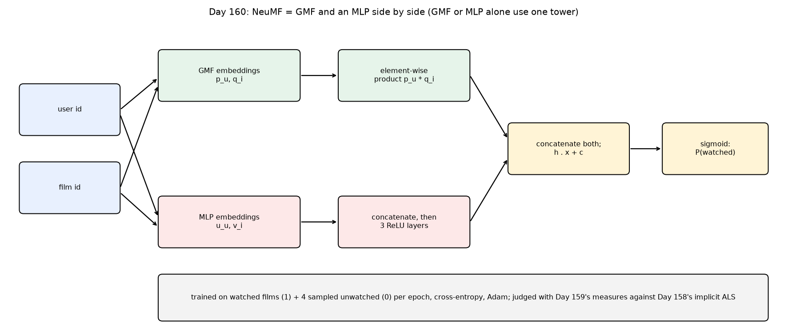
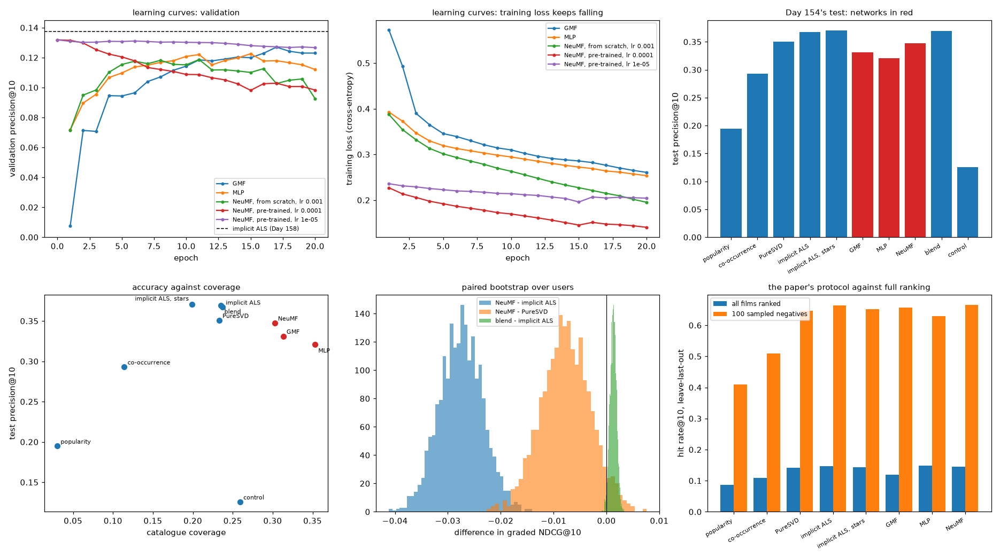

---
[← Back to main README](../README.md)
