# Week 24: Model Evaluation & Statistics (Days 161–167)

Week 23 built recommenders and judged them. Week 24 turns judging into a toolkit: how error splits into bias and variance, how to test whether a difference is real, how sure a score is, what happens when many things are tested at once, whether a model's probabilities can be trusted, and whether it treats groups of people alike. It uses two real public datasets: UCI Adult (census incomes, 48,842 people; B. Becker and R. Kohavi, 1996) and Kevin Hillstrom's MineThatData email experiment (64,000 customers randomly assigned to an email or none, 2008). The data is not stored in this repository: the scripts download it on first run to `~/week24_data`. Every method is written from scratch in NumPy. Days 161–166 each get the full-depth lesson plus a short `dayNN_exercise.py` holding that day's tool, and Day 167 builds model explanations from scratch and uses all six tools for one model's report card. See [`full_syllabus_days_1_365.md`](../full_syllabus_days_1_365.md) for the week's plan.

## Day 161 — Bias, variance and learning curves on real census data
[`day161_bias_variance_learning_curves.py`](day161_bias_variance_learning_curves.py) — Week 24 starts on UCI Adult (30162 training-file rows without missing values; is income above $50K?). Three models are compared throughout: logistic regression fitted by Newton's method, gradient boosting (Day 109's, imported unchanged), and one deep tree. The training file is split 80/20 with seed 0 into 24130 fitting rows and 6032 validation rows, and the test file is kept back for Day 167.

- **The reference fit:** Newton converged in 8 steps (largest gradient left 5.2e-17), with validation log loss 0.3410. **First draft:** Day 116's Adam at rate 0.5 stopped at 0.4070. Always predicting the base rate scores Brier 0.1869.
- **Learning curves:** logistic regression levels off at 0.110 on validation, with training and validation close together. Boosting goes from 0.142 at 250 rows to 0.092. The deep tree fits its training rows almost perfectly (0.000 at 250 rows) and is still at 0.182 on validation at the full size.
- **Bias and variance measured directly**, from up to 20 disjoint training sets per size: logistic regression's bias² + noise barely moves (0.1104 to 0.1099) while its variance shrinks from 0.0186 to 0.0005. At 8000 rows the deep tree's variance is still 0.0655.
- **A depth sweep and a first-draft error:** the first draft's bias term rose after depth 8 (0.0994 to 0.1056 at depth 20). That came from estimating with a finite number of models; subtracting variance / B fixes it (falling to 0.0973). Depth 5 is best (0.1144).
- **Extrapolation:** a + b·n^(−c), fitted on sizes up to 4000, predicted the full-size score to within +0.0040 (the tree), -0.0001 (boosting) and +0.0003 (logistic regression).

Study guide: [`day161_bias_variance_learning_curves_complete_guide.pdf`](day161_bias_variance_learning_curves_complete_guide.pdf) · Syntax walkthrough: [`day161_syntax_line_by_line.pdf`](day161_syntax_line_by_line.pdf) · [Run output](day161_run_output.txt)

Exercise: [`day161_exercise.py`](day161_exercise.py) holds the week's data loader and split, both feature matrices, the Newton logistic regression, the Brier score and the decomposition. Its hand checks: a logistic regression on two groups recovers probabilities [0.2, 0.7], and a decomposition worked on paper gives Brier 0.165 = 0.085 + 0.040. [Exercise output](day161_exercise_run_output.txt)

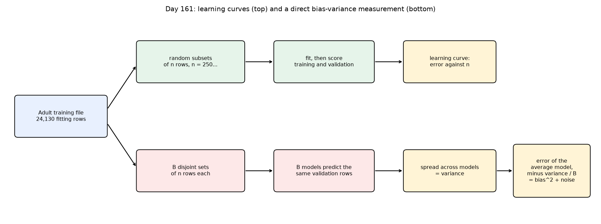
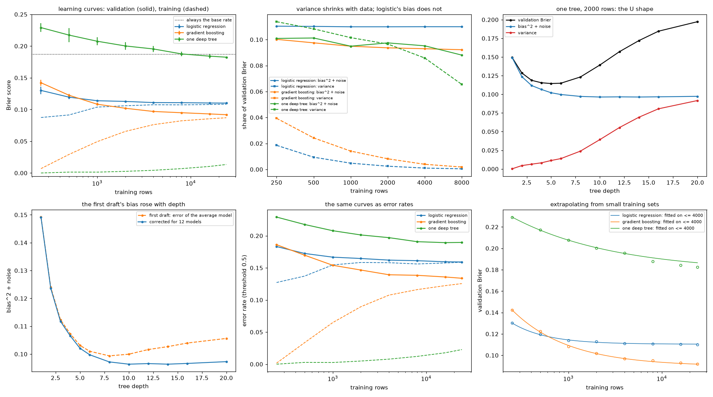

## Day 162 — Hypothesis testing for ML: a real A/B test, and comparing two models
[`day162_hypothesis_testing_ab.py`](day162_hypothesis_testing_ab.py) — Kevin Hillstrom's MineThatData email experiment (2008): 64000 customers assigned at random to a men's email, a women's email or no email, with visits, purchases and spend recorded for two weeks. Every test is written from scratch; section 6 returns to Day 161's UCI Adult models, imported from their exercise files.

- **Randomisation check:** none of 22 tests of before-email columns fell below 0.05; the largest standardised difference was 0.0137.
- **The effects:** the men's email raised visits by +0.0766 (+72%) with p 5.7e-112, and purchases by +119%. Men's against women's email on spend: p 0.030, with interval [+0.033, +0.658].
- **Permutation tests agree with the formulas:** Welch 0.0305 against 0.0288 from 10000 shuffles, within the shuffles' own spread of 0.0017.
- **A/A tests and peeking:** with no effect, p < 0.05 in 0.0475 (visits) to 0.0555 (purchases) of 2000 splits. Testing after every 500 customers (21 looks) and stopping at the first success raised false positives to 0.2430.
- **Power:** 330 per group to see the men's email's effect on visits, 11723 per group for the women's email's effect on purchases. A simulation on the real data matched the formula (0.789 against 0.792 at 3,000 per group).
- **McNemar's test:** 200 boosting rounds against 100 on the same 6032 rows gave p 1.11e-02, where an unpaired test gave 0.5409. **Control:** two models from the *same* procedure on different training halves were called different in 0.09 (logistic) and 0.14 (deep tree) of 100 repeats, not 0.05. McNemar compares fixed models and ignores the variation that comes from the training sample.

Study guide: [`day162_hypothesis_testing_ab_complete_guide.pdf`](day162_hypothesis_testing_ab_complete_guide.pdf) · Syntax walkthrough: [`day162_syntax_line_by_line.pdf`](day162_syntax_line_by_line.pdf) · [Run output](day162_run_output.txt)

Exercise: [`day162_exercise.py`](day162_exercise.py) holds the data loader, the two-proportion and Welch tests, the permutation test, sample size and power, and McNemar's test. Each is checked by hand: a z test gives z 1.633, p 0.1025; a sample size of 199.0; McNemar's exact p 0.0386. [Exercise output](day162_exercise_run_output.txt)

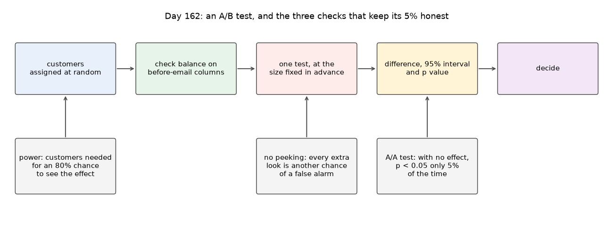
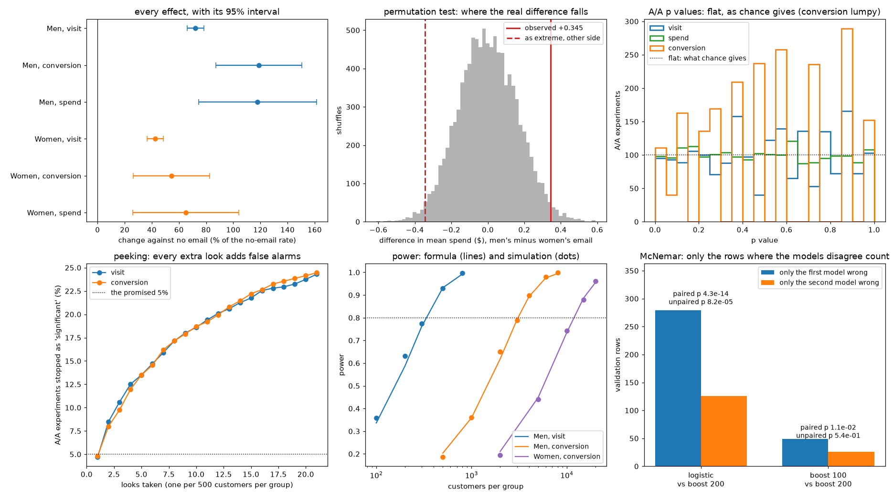

## Day 163 — Confidence intervals and the bootstrap: checking the 95% promise
[`day163_confidence_intervals_bootstrap.py`](day163_confidence_intervals_bootstrap.py) — a 95% interval promises to contain the truth 95% of the time; today measures how often it really does. A whole Hillstrom group plays the population, so the true values are known. Thousands of samples are drawn from it, and every interval is scored. Days 161 and 162's data and models, Day 109's boosting and Day 117's AUC are imported unchanged.

- **A rare rate (purchases, true rate 0.0057):** the textbook Wald interval covered the truth in 0.234 of samples at 50 customers and 0.429 at 100; 0.570 of samples of 100 had no buyer at all. The bootstrap failed the same way. Wilson's interval stayed between 0.936 and 0.982 at every size.
- **A mean of mostly zeros (spend; 0.9875 of customers spent nothing):** at 200 customers coverage was 0.730 (normal), 0.740 (percentile) and 0.740 (BCa). At 5,000, BCa reached 0.953.
- **No formula needed:** the median spend of men's-email buyers was $66.98 [58.13, 83.26]; the lift in spend was +1.179 [+0.629, +1.952]. With B = 200 the interval's lower end moved from 57.30 to 60.62 across seeds; with 5,000 from 57.90 to 58.13.
- **Model scores (UCI Adult):** the accuracy gap between boosting and logistic regression was +0.0254. Its paired interval had width 0.0126; unpaired, 0.0242. Retraining on resampled fitting rows moved validation accuracy by only 0.0010 (logistic) and 0.0017 (boosting), against 0.0045 from resampling the test rows.
- **Where it fails:** an interval for the largest value covered the truth in 0.030 of samples; one for the 95th percentile, in 0.940.

Study guide: [`day163_confidence_intervals_bootstrap_complete_guide.pdf`](day163_confidence_intervals_bootstrap_complete_guide.pdf) · Syntax walkthrough: [`day163_syntax_line_by_line.pdf`](day163_syntax_line_by_line.pdf) · [Run output](day163_run_output.txt)

Exercise: [`day163_exercise.py`](day163_exercise.py) holds Wald and Wilson intervals, the bootstrap, percentile and BCa intervals and the jackknife. Its hand checks include Wilson's interval for 0 successes in 50 ([0.0000, 0.0713]) and a bootstrap of (1, 2, 3), whose 27 possible resamples give the interval (1.0, 3.0). [Exercise output](day163_exercise_run_output.txt)

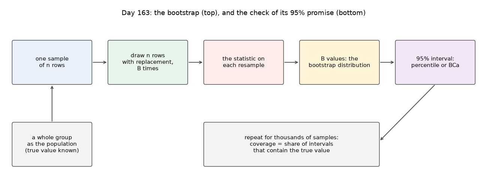
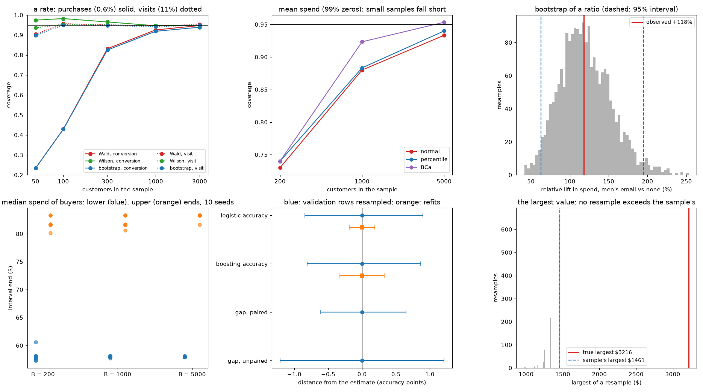

## Day 164 — Multiple comparisons: an honest p-hacking demonstration
[`day164_multiple_comparisons.py`](day164_multiple_comparisons.py) — one test at the 5% level raises a false alarm 5% of the time; 66 tests raise one most of the time. Hillstrom's customers are cut into 22 segments and 3 outcomes are tested in each. Bonferroni, Holm and Benjamini-Hochberg are built from scratch and scored on data where the truth is known. Day 162's tests and Day 161's Adult data and logistic regression are imported unchanged.

- **No effect at all (1,000 A/A splits of the no-email customers):** at least one 'significant' finding in 0.892 of experiments, 3.13 on average. Bonferroni and Holm brought that to 0.030; Benjamini-Hochberg to 0.032.
- **Known truth (32 certainly real effects mixed with 66 nulls, on 30% samples):** no correction found 29.35 real effects with 2.70 false ones. Holm found 21.44 with 0.01 false; Benjamini-Hochberg found 26.70 with 0.61 false, a false discovery rate of 0.0210, but at least one false discovery in 0.350 of repeats.
- **Replication on fresh customers:** with no effect, the best of 66 tests was significant again in 0.045 of repeats (0.052 of all discoveries); with the real email effect, 1.000 (0.776 of all discoveries).
- **The same trap in ML:** choosing the best of 100 logistic regressions on half the validation rows flattered its accuracy by +0.0034; a model fixed in advance changed by -0.0001.
- **First draft:** Welch's test divided 0 by 0 in small segments with no buyer on either side, and the replication step picked a NaN as its 'best' test. Such tests now get p = 1 and are counted in the output.

Study guide: [`day164_multiple_comparisons_complete_guide.pdf`](day164_multiple_comparisons_complete_guide.pdf) · Syntax walkthrough: [`day164_syntax_line_by_line.pdf`](day164_syntax_line_by_line.pdf) · [Run output](day164_run_output.txt)

Exercise: [`day164_exercise.py`](day164_exercise.py) holds the segments, the 66 tests and the three corrections. Its hand checks include five p values where Benjamini-Hochberg's step-up rejects one above its own line ([0, 1, 1, 1, 1]) and three where Holm finds more than Bonferroni ([1, 1, 0] against [1, 0, 0]). [Exercise output](day164_exercise_run_output.txt)

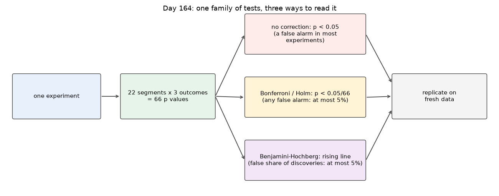
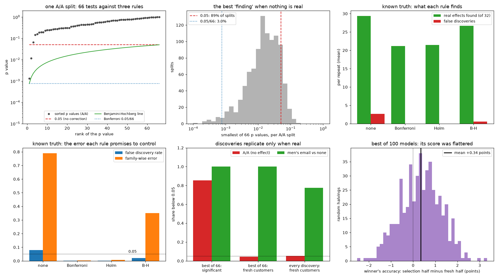

## Day 165 — Calibration: when a model says 70%, does it happen 70% of the time?
[`day165_calibration.py`](day165_calibration.py) — a model can rank people well and still give wrong probabilities. Four UCI Adult models are measured with reliability diagrams and the expected calibration error (ECE), next to the ECE a perfectly calibrated model would show by chance. Platt scaling and isotonic regression are built from scratch and fitted on held-out rows. Day 161's data and logistic regression, Day 109's trees and boosting, and Day 117's AUC are imported unchanged.

- **Measured:** logistic regression (ECE 0.0149, chance floor 0.0108) and boosting (0.0096, floor 0.0096) were close to calibrated. Logistic regression trained on a 50/50 sample ranked as well (AUC 0.8968) but had ECE 0.1327 and predicted 2301 high earners where there were 1501. The deep tree said 0% or 100% for almost everyone: log loss 2.3899.
- **Fixed on held-out rows (each half scored on its own):** Platt took the balanced model to 0.0230 and 0.0269; isotonic took the deep tree's log loss from 2.3899 to 0.4456. On the two models that were already calibrated, both fixes made ECE worse: each copies the base rate of the half it was fitted on (0.2410 against 0.2564).
- **Pooling flatters:** the deep tree after isotonic scored 0.0025 with both halves pooled, but 0.0164 and 0.0171 on each half alone.
- **The trap:** a fix fitted on the deep tree's memorised training rows left its ECE at 0.1757; on the balanced model, which had not memorised, training rows worked (0.0128).
- **First draft:** plain Newton for Platt ran away on the deep tree's 0/1 scores (slope 1.53e+13); step halving fixed it.

Study guide: [`day165_calibration_complete_guide.pdf`](day165_calibration_complete_guide.pdf) · Syntax walkthrough: [`day165_syntax_line_by_line.pdf`](day165_syntax_line_by_line.pdf) · [Run output](day165_run_output.txt)

Exercise: [`day165_exercise.py`](day165_exercise.py) holds the reliability table, ECE, log loss, Platt scaling, isotonic regression and cross-fitting. Its hand checks include Platt recovering the slope and intercept it was built from ([1.975, -0.983] for 2 and -1) and a six-row case where plain Newton runs away and step halving lands on the worked answer ([0.0502, 0.0]). [Exercise output](day165_exercise_run_output.txt)

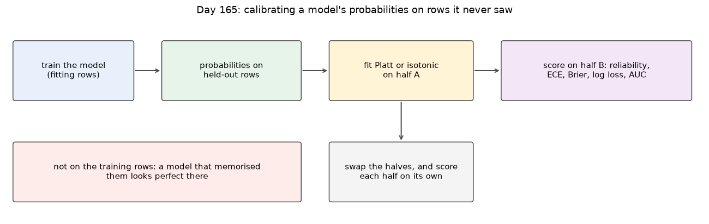
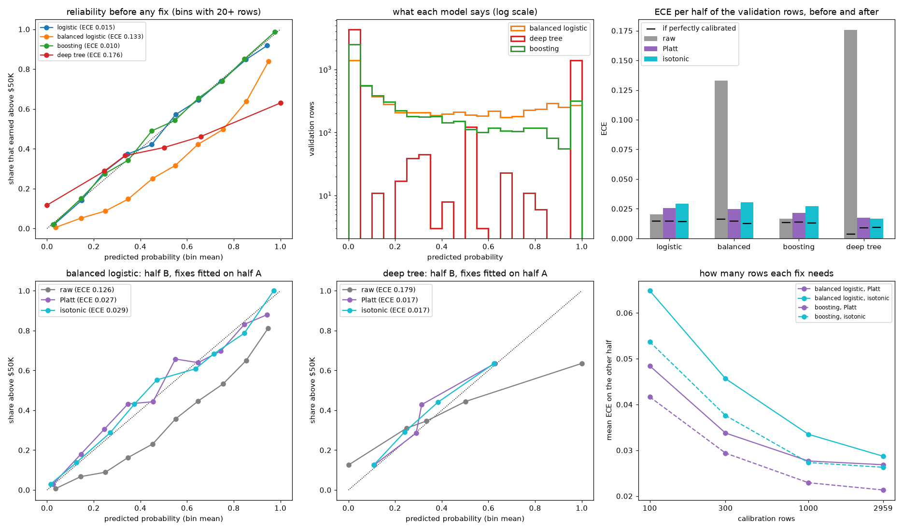

## Day 166 — Fairness: demographic parity, equalized odds, and why they conflict
[`day166_fairness.py`](day166_fairness.py) — a model can be accurate overall and still treat groups differently. Two UCI Adult models are compared across women and men on four rates (selection, true positive rate, false positive rate, precision), with bootstrap intervals and a shuffled-label control. Deleting the sex column, an identity that explains why the criteria conflict, one threshold per group chosen on half the rows, and small race × sex groups follow. Days 161, 109, 117, 163 and 165 are imported unchanged.

- **Measured:** logistic regression selected 0.0790 of women and 0.2652 of men (base rates 0.1174 and 0.3104), a ratio of 0.298 against the 80% rule's 0.8. Among the truly positive, women were found less often (TPR gap +0.1154 [+0.0455, +0.1833]); precision did not differ detectably (gap -0.0215 [-0.0931, +0.0527]).
- **Unawareness fails:** without the sex column, the other columns still predicted sex with AUC 0.9341 and the rates barely moved. Deleting relationship and marital-status too dropped accuracy to 0.8037 without making any rate equal.
- **Why they conflict:** FPR = odds(base) × (1 − precision)/precision × TPR held exactly (0.0235 and 0.1095). With odds 0.1330 and 0.4502 (ratio 3.38), a calibrated model cannot also equalise both error rates.
- **Per-group thresholds, checked on the other half (50 halvings):** parity changed accuracy by -0.0169 and lowered women's precision to 0.522; equal TPR changed it by +0.0004 (spread 0.0010) but men's FPR stayed above women's (0.079 against 0.023).
- **First draft:** the bootstrap gave [0.000, 0.000] for a group of 16 with nobody selected; Wilson gives [0.000, 0.194].

Study guide: [`day166_fairness_complete_guide.pdf`](day166_fairness_complete_guide.pdf) · Syntax walkthrough: [`day166_syntax_line_by_line.pdf`](day166_syntax_line_by_line.pdf) · [Run output](day166_run_output.txt)

Exercise: [`day166_exercise.py`](day166_exercise.py) holds rates per group, the gap, thresholds for a chosen selection rate or TPR, per-group decisions, the FPR identity and the feature behind each one-hot column. Its hand checks work through two groups of four people ([0.25, 0.5, 1.0, 0.3333, 0.5] for the men) and a TPR threshold between counted scores (0.4667). [Exercise output](day166_exercise_run_output.txt)

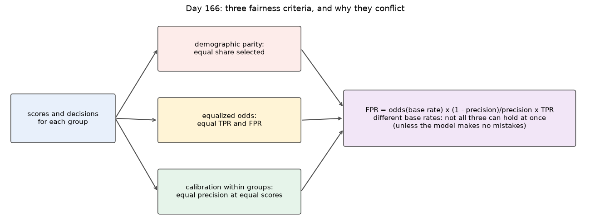
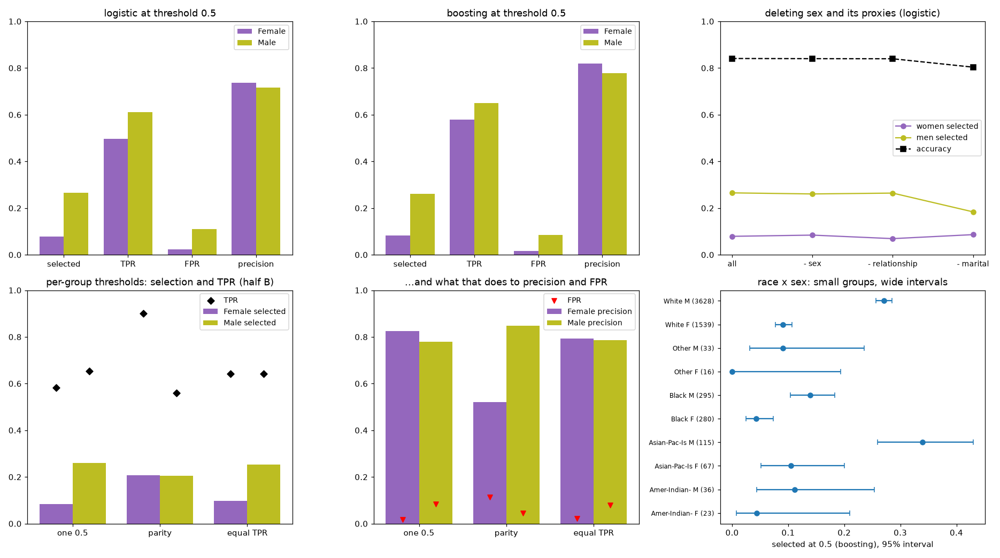

## Day 167 — Week 24 build: the report card, with SHAP and LIME from scratch
[`day167_report_card.py`](day167_report_card.py) — the week ends by using all six tools, imported unchanged from Days 161–166's exercise files, on one model. The plan was fixed on the validation rows before Adult's test file was opened: boosting is the model, logistic regression the baseline, the threshold is 0.5, and six named tests are corrected with Holm. The test file (15060 rows) is then scored once. SHAP (exact Shapley values and KernelSHAP) and LIME are built from scratch to explain it.

- **Performance and baseline:** accuracy 0.8691 [0.8636, 0.8744], AUC 0.9240 [0.9197, 0.9285]. McNemar against logistic regression: 291 rows only boosting got wrong, against 697 only logistic regression got wrong (exact p 4.52e-39).
- **Over-fitting, calibration, fairness:** Brier 0.0870 on its training rows against 0.0917 on test. ECE 0.0118, about twice its chance floor (0.0060). The sex gaps held on test: selection +0.1876, TPR +0.0961 [+0.0536, +0.1414]. 4 of 6 claims survived Holm; the drift check did not reject (p 5.81e-01).
- **SHAP checked:** on logistic regression, exact Shapley values matched the closed form to 2.2e-16. On boosting, KernelSHAP came within 0.0035 of the exact values with 1000 coalitions.
- **First draft:** a 50-row background was too small. Two such backgrounds moved values by up to 0.4536 and changed capital-gain's rank from 5 to 1. With 200 rows the change fell to 0.0468.
- **LIME:** with 1000 samples, one feature's value ran from -0.046 to +0.466 across five seeds. A narrow kernel width changed the explanation by 0.501.

Study guide: [`day167_report_card_complete_guide.pdf`](day167_report_card_complete_guide.pdf) · Syntax walkthrough: [`day167_syntax_line_by_line.pdf`](day167_syntax_line_by_line.pdf) · [Run output](day167_run_output.txt)

Build day: no exercise file. The script imports Days 161–166's exercise files unchanged.

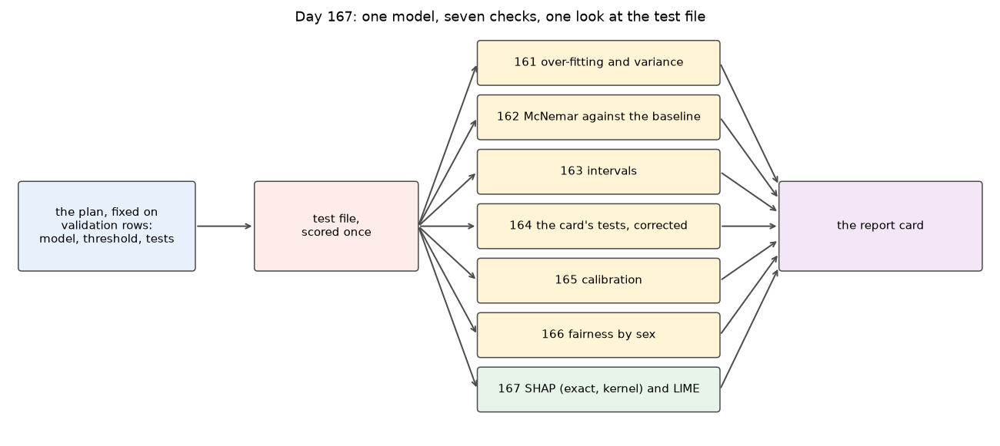
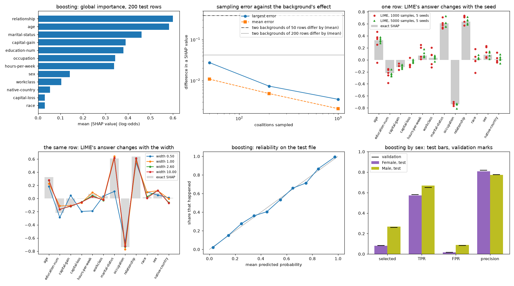

---
[← Back to main README](../README.md)
