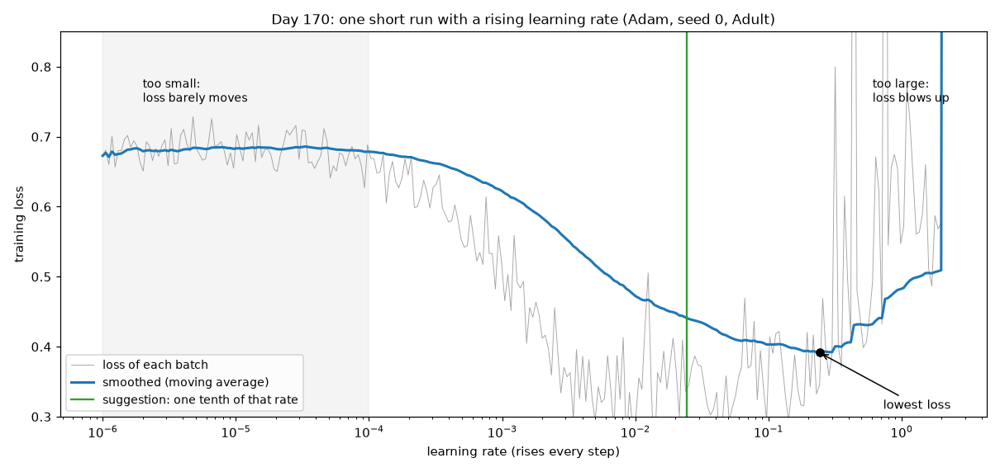
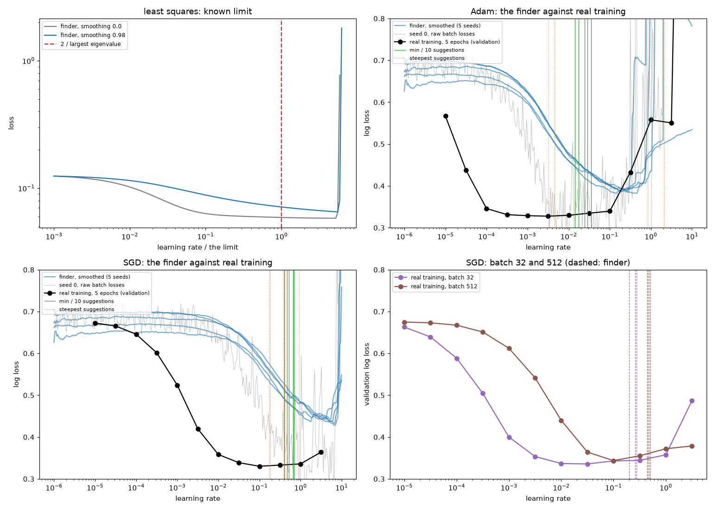
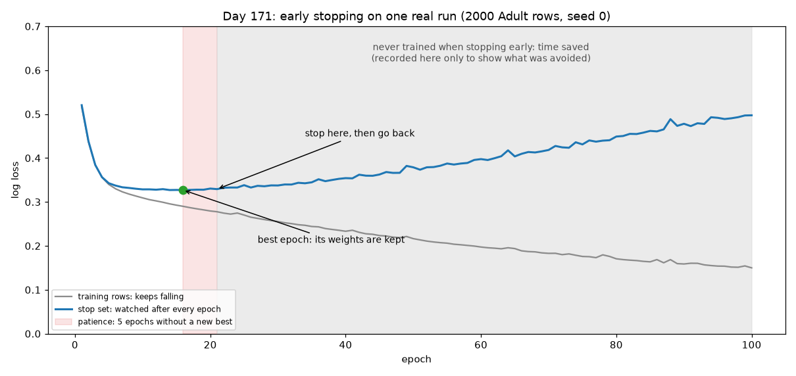
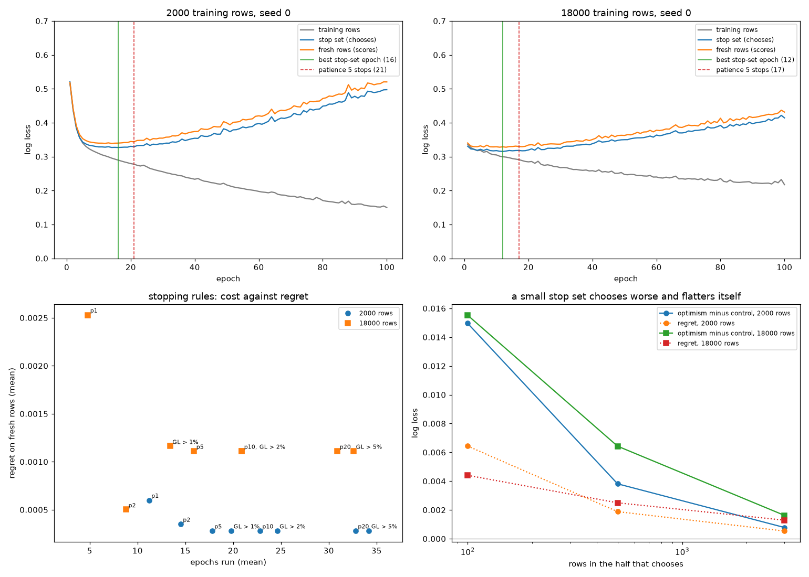
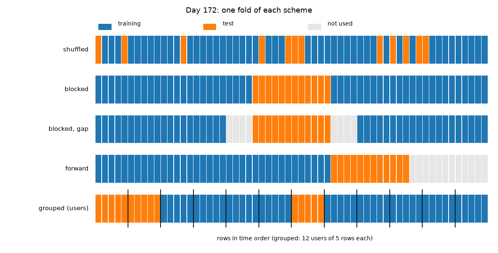
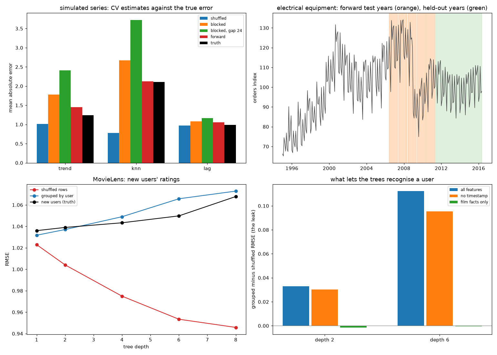
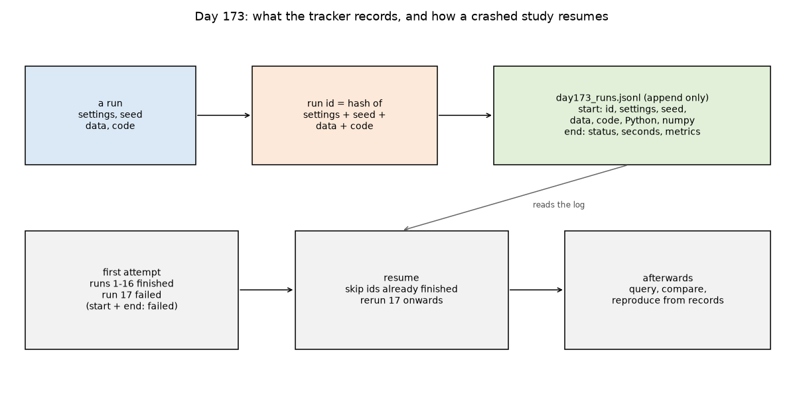
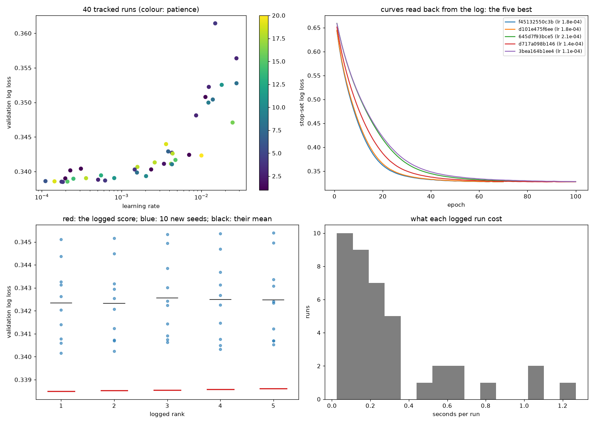
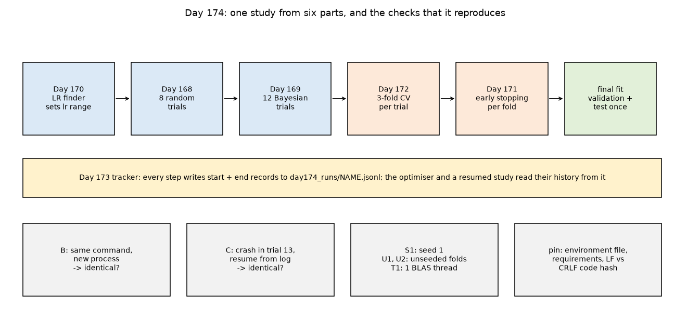
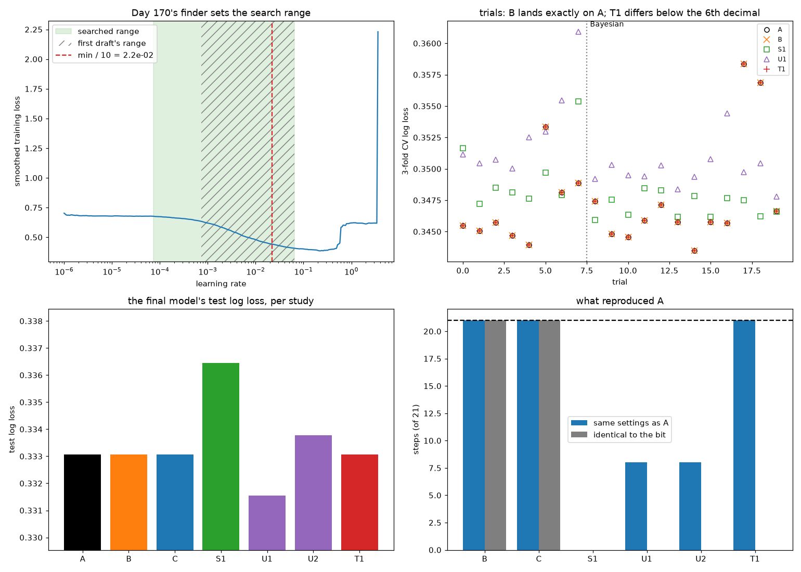

# Week 25: Hyperparameter Tuning & Experimentation (Days 168–174)

Week 24 built the tools for judging one model. Week 25 is about choosing its settings: grid against random search, Bayesian optimisation, learning-rate finders, early stopping, cross-validation for time series and grouped data, keeping a record of every experiment, and making a tuning study give identical results when it is run again. It reuses real public datasets from earlier weeks: UCI Adult (census incomes; B. Becker and R. Kohavi, 1996) from `~/week24_data`, statsmodels' CO2 and electrical-equipment series from Week 22, and MovieLens 100K from `~/movielens_data`. Every method is written from scratch in NumPy. Days 168–173 each get the full-depth lesson plus a short `dayNN_exercise.py` holding that day's tool, and Day 174 uses all six in one tracked, reproducible tuning study. See [`full_syllabus_days_1_365.md`](../full_syllabus_days_1_365.md) for the week's plan.

## Day 168 — Grid search against random search: a real efficiency comparison
[`day168_grid_vs_random_search.py`](day168_grid_vs_random_search.py) — Week 25 starts with the two simplest ways to tune: every point of a grid, or random points with the same budget. Day 109's gradient boosting (100 trees) is tuned on UCI Adult over learning rate (0.01–1, log scale), depth (1–8) and min leaf (1–300, log scale). Of Week 24's 24,130 fitting rows, 6000 train each configuration and 6000 others score it; 6032 validation rows are kept fresh.

- **Known-truth benchmark:** when one of three settings matters, random search finds the better point in 0.676 / 0.715 / 0.757 of 1000 problems at 8 / 27 / 64 trials. When all three matter equally, it is the other way round (0.285 / 0.335 / 0.361).
- **Real data, the textbook claim does not hold:** the grids found 0.2973 / 0.2934 / 0.2924, and random search matched or beat them in only 0.491 / 0.344 / 0.325 of 1000 searches. **Control:** five shifted grids of 27 averaged 0.2940 (the centred grid scored 0.2934), and random search matched or beat a shifted grid in 0.410 of comparisons.
- **Why:** learning rate explains 0.293 of the spread in log loss on its own and depth 0.046, but together they explain 0.535. The settings interact, so this is not the one-setting-matters case.
- **Cost:** a depth-8 fit took 6.76 s and a depth-1 fit 0.66 s. **Timing first draft:** a first run gave identical scores, but its times were about 2.4× smaller and it ranked grid and random in the opposite order by time, so only comparisons within one run are reported.
- **Winner's curse:** tuning and fresh scores correlate 0.996. The random winner's extra optimism grows from -0.0002 to +0.0018 as the budget rises, and the pool's winner ranks 9 of 200 on fresh rows.

Study guide: [`day168_grid_vs_random_search_complete_guide.pdf`](day168_grid_vs_random_search_complete_guide.pdf) · Syntax walkthrough: [`day168_syntax_line_by_line.pdf`](day168_syntax_line_by_line.pdf) · [Run output](day168_run_output.txt)

Exercise: [`day168_exercise.py`](day168_exercise.py) holds the search space, the three scales, grid and random points in the unit cube, decoding, the running best and eta-squared importance. Its hand checks include log scale u = 0.5 → 0.1, whole numbers on a log scale u = 0.5 → 17, and an importance of [1.0, 0.0] when one setting decides everything. [Exercise output](day168_exercise_run_output.txt)

## Day 169 — Bayesian optimisation from scratch
[`day169_bayesian_optimisation.py`](day169_bayesian_optimisation.py) — a Gaussian process (Matérn 5/2 kernel, length scale chosen by log marginal likelihood) learns the score from the trials so far, and expected improvement chooses the next trial. Everything is written in NumPy, including the normal CDF via `math.erf`. It reuses Day 168's rows, search space and parts.

- **Checked by hand and by simulation:** a GP on two trials gives sd 0.1573 halfway, matching the hand calculation. Expected improvement's formula gives 0.39894 against 0.39821 from a million simulated draws.
- **First draft: the GP can be confidently wrong.** On a 1-D test function, from 3 trials it spent trials 4–8 away from the dip, then walked into it and reached the true minimum (-6.021).
- **Hartmann-3 (known minimum -3.86278), 40 trials:** median gap EI 0.0111, greedy 0.0856, random 0.3968. 0.48 of greedy runs got stuck more than 0.1 away.
- **Day 168's 200 real configurations, recomputed exactly (0.2918, 0.7371):** EI got within 0.001 of the best in a median of 20 trials, random search in 44. **Control:** with the scores shuffled, Bayesian optimisation fell to random search's level (0.09 against 0.13 finding the best by 27 trials). A GP fitted on 30 configurations predicts the other 170 with rank correlation 0.84. **Complication:** a greedy rule did as well early on this smooth problem (0.61 by 27 trials).
- **Proposing anywhere, fitted for real (3 runs × 30 trials):** the runs ended at 0.2924, 0.2910 and 0.2915, against a random-search median of 0.2949. Run 2's random start had already reached 0.2916. The GP cost 0.1 s per run against about 50 s of fitting. **First run:** the computer slept during it and one timing read 29,907 s; it was rerun with identical scores.

Study guide: [`day169_bayesian_optimisation_complete_guide.pdf`](day169_bayesian_optimisation_complete_guide.pdf) · Syntax walkthrough: [`day169_syntax_line_by_line.pdf`](day169_syntax_line_by_line.pdf) · [Run output](day169_run_output.txt)

Exercise: [`day169_exercise.py`](day169_exercise.py) holds the normal distribution, the kernel, GP fitting and prediction, length-scale choice, expected improvement and `propose`. Its hand checks include the kernel at distance 0.5 (0.8286), a two-trial GP (sd 0.157) and EI = 0.39894 at mean 0, sd 1. [Exercise output](day169_exercise_run_output.txt)

## Day 170 — Learning-rate finders, checked against real training
[`day170_learning_rate_finder.py`](day170_learning_rate_finder.py) — a learning-rate finder from scratch: raise the rate by the same factor every step from 1e-6 to 10, smooth the loss, stop when it blows up, and read a rate off the curve. It is checked against real training of Day 126's network (87 → 64 → 32 → 1) on Week 24's UCI Adult split, scored on the validation rows.

- **Known truth:** on least squares, gradient descent diverges above 2 / (largest eigenvalue) = 0.5630. Constant rates confirm it: 0.99× the limit settles at 0.05795, while 1.01× reaches 9.08e+32. The finder's lowest smoothed loss came at 5.54× the limit, far above it. One tenth of that is 0.554× the limit: safe.
- **Two reading rules, five seeds:** with Adam, "one tenth of the minimum" moved by a factor of 2.5 between seeds, while "steepest slope" moved by a factor of 644.7.
- **The check (13 rates × 3 seeds of real training, and each suggestion with the same 3 seeds):** Adam's best rate was 3e-03 (0.3277). The min / 10 suggestions trained to within +0.0088 of it; the steepest-slope suggestions were up to +0.4491 worse. With SGD both rules worked (+0.0043 and +0.0055).
- **Complication, batch size:** at batch 512 the finder suggested about 4.70e-01, and real training there gave 0.3679, against the sweep's best of 0.3437 at 1e-01. The suggestion rose with batch size, but not reliably to a good rate.
- **Cost:** one finder run took 0.10 s (1.55 epochs); the real check took 38 s. **First draft:** it compared one seed at a suggestion with a sweep averaged over seeds, an unfair comparison; everything now uses the same 3 seeds.

Study guide: [`day170_learning_rate_finder_complete_guide.pdf`](day170_learning_rate_finder_complete_guide.pdf) · Syntax walkthrough: [`day170_syntax_line_by_line.pdf`](day170_syntax_line_by_line.pdf) · [Run output](day170_run_output.txt)

Exercise: [`day170_exercise.py`](day170_exercise.py) holds `lr_range`, `lr_find`, `suggest`, `SGD`, `bce_logits`, `train_mlp` and `mlp_stepper`. Its hand checks include a finder that must stop at a known step, both rules on a curve with a known minimum, one SGD step, the log loss at logit 0 (0.6931), and a toy problem where the finder's suggestion (0.227) trains to validation log loss 0.141. [Exercise output](day170_exercise_run_output.txt)

## Day 171 — Early stopping: patience, restoring the best weights, and the stop set's size
[`day171_early_stopping.py`](day171_early_stopping.py) — early stopping from scratch: score a held-out stop set after every epoch, stop after `patience` epochs without a new best, and restore the best epoch's weights. It uses Day 170's network on UCI Adult, with 2,000 or 18,000 training rows, a 6,000-row stop set and 6,032 fresh rows that only score. Every run is recorded for 100 epochs, so each rule can be replayed exactly.

- **Over-fitting:** with 2,000 rows the fresh loss went from 0.3418 at the stop set's best epoch to 0.5254 at epoch 100, while the training loss fell to 0.1517. **Control:** with shuffled labels, early stopping kept 0.5669, near the 0.5611 of predicting the base rate, while 100 epochs reached 0.8872.
- **Rules (10 seeds):** patience 5 ran 17.8 epochs (2,000 rows) and 15.9 (18,000 rows) and kept the stop set's best of all 100 epochs in every run. Patience 1 stopped too soon at 18,000 rows (worst +0.0085). Longer patience and Prechelt's GL rule gave the same weights at a higher cost.
- **Restore or keep the last weights:** with patience 20, restoring gave 0.3418 and keeping the last 0.3622.
- **Stop-set size (two halves, paired control):** choosing on 100 rows cost +0.0064 on fresh rows, and the chosen epoch's own score was +0.0150 too good (standard error 0.00063); with 3,000 rows, +0.0005 and +0.0008. **Complication:** at 18,000 rows patience 2 beat patience 5 (+0.0005 against +0.0011), because the stop set preferred later epochs than the fresh rows; it is not a recommendation.
- **Check:** running the stopper for real and replaying it on the recorded curve gave identical curves and the same stopping epoch (`curves identical: True`).

Study guide: [`day171_early_stopping_complete_guide.pdf`](day171_early_stopping_complete_guide.pdf) · Syntax walkthrough: [`day171_syntax_line_by_line.pdf`](day171_syntax_line_by_line.pdf) · [Run output](day171_run_output.txt)

Exercise: [`day171_exercise.py`](day171_exercise.py) holds `copy_net`, `EarlyStopper`, `stop_at`, `gl_stop_at`, `row_losses`, `train_epoch` and `train_es`. Its hand checks include stoppers that must stop at known epochs, `min_delta`, the GL rule, and a toy problem whose restored weights reproduce the curve's lowest loss exactly (0.581452; the noise floor is 0.5004). [Exercise output](day171_exercise_run_output.txt)

## Day 172 — Cross-validation for time series and grouped data, with real leaks
[`day172_cv_time_series_grouped.py`](day172_cv_time_series_grouped.py) — shuffled, blocked, blocked-with-a-gap, forward-chaining and grouped folds from scratch. Each is checked against a truth: simulated series whose real forecast error is known, five held-out years of two real series (statsmodels' CO2 and electrical-equipment orders), and 300 MovieLens users never used in any fold.

- **Known truth (50 simulated series, 12-month forecasts):** shuffled folds rated a "3 nearest months" forecaster at 0.780 when its real error was 2.104, and so would have chosen the worst of three forecasters. Forward folds estimated 2.125 and chose correctly. For a pure lag model, shuffled folds were nearly right (0.972 against 0.989), as Bergmeir, Hyndman and Koo (2018) predict.
- **Real series:** on electrical equipment, shuffled folds chose the trend model, while forward folds and the held-out years chose the lag model. **Complication:** the forward estimate (10.187) was far above the held-out error (2.907) because its folds include the 2008 crash (14.16 and 16.92 for those years).
- **Grouped data (MovieLens, boosted trees):** shuffled rows chose depth 8 (0.9458). Folds grouped by user and 300 new users both chose depth 1 (1.0318 and 1.0360).
- **What carried the leak:** dropping the timestamp barely helped (+0.0954 at depth 6). With film facts only the leak vanished (-0.0003), so the users' own age, sex and occupation let deep trees recognise them.

Study guide: [`day172_cv_time_series_grouped_complete_guide.pdf`](day172_cv_time_series_grouped_complete_guide.pdf) · Syntax walkthrough: [`day172_syntax_line_by_line.pdf`](day172_syntax_line_by_line.pdf) · [Run output](day172_run_output.txt)

Exercise: [`day172_exercise.py`](day172_exercise.py) holds `shuffled_folds`, `blocked_folds`, `forward_folds`, `group_folds` and `cross_val`. Its hand checks cover every row being tested once, a gap, a forward fold, no group split across sides, and a toy random walk where shuffled folds give 0.83 and forward folds 3.04. [Exercise output](day172_exercise_run_output.txt)

## Day 173 — Experiment tracking from scratch, on a real tuning study
[`day173_experiment_tracking.py`](day173_experiment_tracking.py) — a small tracker written from scratch, without MLflow. It keeps an append-only JSON Lines log ([`day173_runs.jsonl`](day173_runs.jsonl)) where every run writes a start record and an end record. Each run records its settings, seed, a hash of the data, a hash of the code, the Python and numpy versions, its status and time, and its per-epoch curve. It is used on a 40-configuration random search with Day 171's network and early stopping on UCI Adult.

- **Crash and resume:** the study crashed on purpose at run 17. The log kept 16 finished runs and 1 failed one with its error. On restart, 16 runs were skipped and 24 were run.
- **Reproduced from the record alone:** 5 of 5 logged runs were retrained from their settings and seed to the identical last bit (for example 0.33849483922349605). This was in the same process; Day 174 tests a fresh one.
- **The seed:** the top five configurations scored worse with ten new seeds, by +0.0039 for the winner. A control of five unchosen configurations lost +0.0022 too, so about half of that was seed 0 being a good seed. The top five lost +0.0017 more from being chosen, and their order became [2, 1, 5, 4, 3].
- **Fingerprints:** dropping 17 of 2000 training rows moved the score only from 0.3385 -> 0.3384, but it changed the data hash and the run id. Tracking cost 2.5 ms to read the whole log, against 0.31 s per run.

Study guide: [`day173_experiment_tracking_complete_guide.pdf`](day173_experiment_tracking_complete_guide.pdf) · Syntax walkthrough: [`day173_syntax_line_by_line.pdf`](day173_syntax_line_by_line.pdf) · [Run output](day173_run_output.txt)

Exercise: [`day173_exercise.py`](day173_exercise.py) holds `fingerprint`, `file_hash`, `run_id`, `Run`, `Tracker` and `query`. Its hand checks cover fingerprints that change with one value, a shape or a type, and ids that ignore dictionary order. They also run a toy study that crashes and resumes, checking for 4 and then 8 log lines. [Exercise output](day173_exercise_run_output.txt)

## Day 174 — Reproducibility: Week 25's build
[`day174_reproducible_study.py`](day174_reproducible_study.py) — one tuning study built from all six of this week's parts:
- Day 170's finder sets the learning-rate range.
- Day 168's 8 random trials and Day 169's 12 Bayesian trials choose configurations.
- Day 172's 3 folds and Day 171's early stopping score them.
- Day 173's tracker logs every step to [`day174_runs/`](day174_runs).

Each study runs in its own fresh Python process, with BLAS threads and the hash seed fixed. The chosen settings were scored once on the official test file, which Week 25 had not touched before. The environment is pinned in [`day174_environment.json`](day174_environment.json) and [`day174_requirements.txt`](day174_requirements.txt).

- **The study:** it chose a Bayesian trial (lr 2.97e-03). Test log loss 0.3331, test accuracy 0.8421.
- **First draft:** it searched a range only 30 times below the finder's suggestion and chose lr 4.02e-02, which peaked at epoch 1 (validation 0.3426). I widened the range after seeing that draft's validation and test numbers, and the guide says so. The draft is kept as study D30.
- **Same command, new process:** 21 of 21 steps identical to the bit, with final weights 770840edcfac in both.
- **Crash and resume:** a study that crashed in trial 13 and resumed from its log matched all 21 steps. A first draft of the resume passed silently but reproduced only 13 of 21: it proposed Bayesian trials from a history that included their own future.
- **What breaks it:**
  - Seed 1 chose other settings, with a test loss of 0.3364.
  - Unseeded folds made one command give two different studies (0 of 21 identical).
  - One BLAS thread instead of four kept every choice and the weights, but changed scores by up to 4.6e-07.
- **Line-ending trap:** the same script hashes differently with CRLF line endings, so the code hash should be computed on normalised text.

Study guide: [`day174_reproducible_study_complete_guide.pdf`](day174_reproducible_study_complete_guide.pdf) · Syntax walkthrough: [`day174_syntax_line_by_line.pdf`](day174_syntax_line_by_line.pdf) · [Run output](day174_run_output.txt)

---
[← Back to main README](../README.md)
