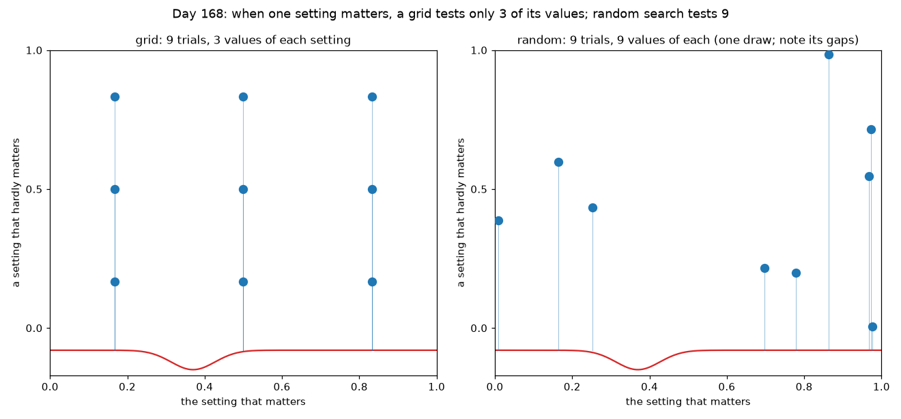
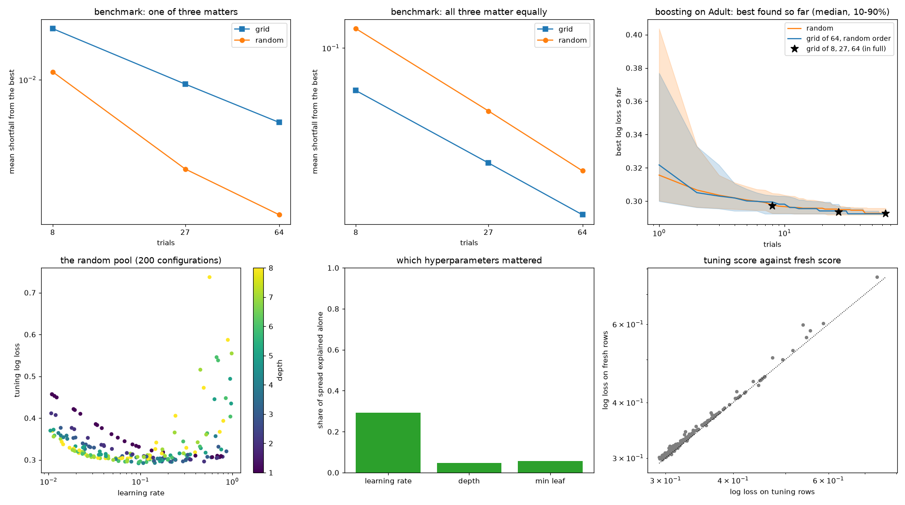
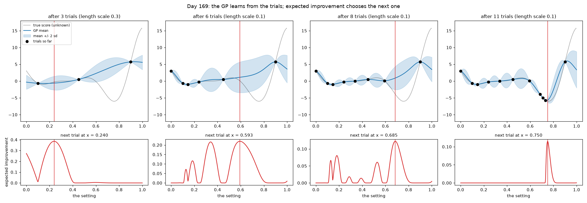
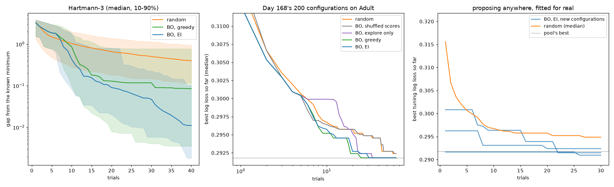

# Week 25: Hyperparameter Tuning & Experimentation (Days 168–174)

Week 24 built the tools for judging one model. Week 25 is about choosing its settings: grid against random search, Bayesian optimisation, learning-rate finders, early stopping, cross-validation for time series and grouped data, keeping a record of every experiment, and making a tuning study give identical results when it is run again. It reuses real public datasets from earlier weeks: UCI Adult (census incomes; B. Becker and R. Kohavi, 1996) from `~/week24_data`, statsmodels' CO2 and electrical-equipment series from Week 22, and MovieLens 100K from `~/movielens_data`. Every method is written from scratch in NumPy. Days 168–173 each get the full-depth lesson plus a short `dayNN_exercise.py` holding that day's tool, and Day 174 uses all six in one tracked, reproducible tuning study. See [`full_syllabus_days_1_365.md`](../full_syllabus_days_1_365.md) for the week's plan.

## Day 168 — Grid search against random search: a real efficiency comparison
[`day168_grid_vs_random_search.py`](day168_grid_vs_random_search.py) — Week 25 starts with the two simplest ways to tune: every point of a grid, or random points with the same budget. Day 109's gradient boosting (100 trees) is tuned on UCI Adult over learning rate (0.01–1, log scale), depth (1–8) and min leaf (1–300, log scale). Of Week 24's 24,130 fitting rows, 6000 train each configuration and 6000 others score it; 6032 validation rows are kept fresh.

- **Known-truth benchmark:** when one of three settings matters, random search finds the better point in 0.676 / 0.715 / 0.757 of 1000 problems at 8 / 27 / 64 trials. When all three matter equally, it is the other way round (0.285 / 0.335 / 0.361).
- **Real data, the textbook claim does not hold:** the grids found 0.2973 / 0.2934 / 0.2924, and random search matched or beat them in only 0.491 / 0.344 / 0.325 of 1000 searches. **Control:** five shifted grids of 27 averaged 0.2940 (the centred grid scored 0.2934), and random search matched or beat a shifted grid in 0.410 of comparisons.
- **Why:** learning rate explains 0.293 of the spread in log loss on its own and depth 0.046, but together they explain 0.535. The settings interact, so this is not the one-setting-matters case.
- **Cost:** a depth-8 fit took 6.76 s and a depth-1 fit 0.66 s. **Timing first draft:** a first run gave identical scores, but its times were about 2.4× smaller and it ranked grid and random in the opposite order by time, so only comparisons within one run are reported.
- **Winner's curse:** tuning and fresh scores correlate 0.996. The random winner's extra optimism grows from -0.0002 to +0.0018 as the budget rises, and the pool's winner ranks 9 of 200 on fresh rows.

Study guide: [`day168_grid_vs_random_search_complete_guide.pdf`](day168_grid_vs_random_search_complete_guide.pdf) · Syntax walkthrough: [`day168_syntax_line_by_line.pdf`](day168_syntax_line_by_line.pdf) · [Run output](day168_run_output.txt)

Exercise: [`day168_exercise.py`](day168_exercise.py) holds the search space, the three scales, grid and random points in the unit cube, decoding, the running best and eta-squared importance. Its hand checks include log scale u = 0.5 → 0.1, whole numbers on a log scale u = 0.5 → 17, and an importance of [1.0, 0.0] when one setting decides everything. [Exercise output](day168_exercise_run_output.txt)

## Day 169 — Bayesian optimisation from scratch
[`day169_bayesian_optimisation.py`](day169_bayesian_optimisation.py) — a Gaussian process (Matérn 5/2 kernel, length scale chosen by log marginal likelihood) learns the score from the trials so far, and expected improvement chooses the next trial. Everything is written in NumPy, including the normal CDF via `math.erf`. It reuses Day 168's rows, search space and parts.

- **Checked by hand and by simulation:** a GP on two trials gives sd 0.1573 halfway, matching the hand calculation. Expected improvement's formula gives 0.39894 against 0.39821 from a million simulated draws.
- **First draft: the GP can be confidently wrong.** On a 1-D test function, from 3 trials it spent trials 4–8 away from the dip, then walked into it and reached the true minimum (-6.021).
- **Hartmann-3 (known minimum -3.86278), 40 trials:** median gap EI 0.0111, greedy 0.0856, random 0.3968. 0.48 of greedy runs got stuck more than 0.1 away.
- **Day 168's 200 real configurations, recomputed exactly (0.2918, 0.7371):** EI got within 0.001 of the best in a median of 20 trials, random search in 44. **Control:** with the scores shuffled, Bayesian optimisation fell to random search's level (0.09 against 0.13 finding the best by 27 trials). A GP fitted on 30 configurations predicts the other 170 with rank correlation 0.84. **Complication:** a greedy rule did as well early on this smooth problem (0.61 by 27 trials).
- **Proposing anywhere, fitted for real (3 runs × 30 trials):** the runs ended at 0.2924, 0.2910 and 0.2915, against a random-search median of 0.2949. Run 2's random start had already reached 0.2916. The GP cost 0.1 s per run against about 50 s of fitting. **First run:** the computer slept during it and one timing read 29,907 s; it was rerun with identical scores.

Study guide: [`day169_bayesian_optimisation_complete_guide.pdf`](day169_bayesian_optimisation_complete_guide.pdf) · Syntax walkthrough: [`day169_syntax_line_by_line.pdf`](day169_syntax_line_by_line.pdf) · [Run output](day169_run_output.txt)

Exercise: [`day169_exercise.py`](day169_exercise.py) holds the normal distribution, the kernel, GP fitting and prediction, length-scale choice, expected improvement and `propose`. Its hand checks include the kernel at distance 0.5 (0.8286), a two-trial GP (sd 0.157) and EI = 0.39894 at mean 0, sd 1. [Exercise output](day169_exercise_run_output.txt)

---
[← Back to main README](../README.md)
